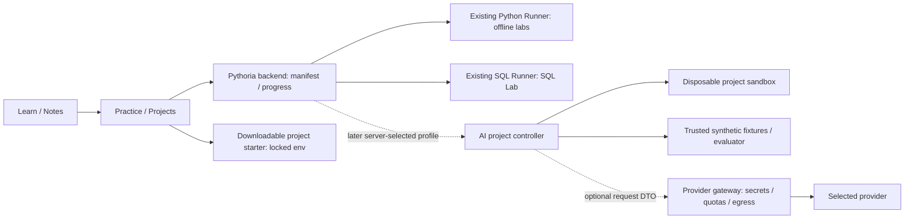

# Pythoria: персональный путь от Python Backend к AI Engineering

**Статус: research / design; все новые этапы, уроки, задания и функции — planned.**
Проверка репозитория и первичных источников: **2026-11-14, Asia/Almaty**;
контрольные чтения отдельных разделов — **2026-11-15**. Основа Pythoria:
`bdaniyar/interview-trainer`, `main`, commit `b39d1f0ccd4aad2e50913b9f0bb2d7f0185d2356`.
Документ не публикует учебный контент и не меняет приложение, curriculum, XP, сохранённый код или БД.

## 1. Резюме и образовательная цель

Цель — подготовить Данияра, студента университета с практикой Python Backend, к задачам
**AI Application Engineering / LLM Engineering**. Это разработка приложений вокруг моделей:
получать данные, обращаться к модели, проверять результат, безопасно выполнять инструменты,
находить документы и измерять качество всей системы. Обучение модели с нуля — отдельная специализация.

Маршрут: **существующий backend → основы AI → прямой LLM API → структурированные результаты
и инструменты → RAG → LangChain → агентные workflows и MCP → LangGraph → production AI**.
В основе — 10 этапов, **72 содержательных урока** и 9 проектов. Два проекта приходятся на RAG:
сначала поиск, затем ответы по найденным материалам. Уроки не являются опубликованными страницами.

Почему этот маршрут персональный:

- FastAPI, async HTTP, Pydantic и pytest уже встречаются в реальном коде проектов. Поэтому
  первый сервис появляется рано, без повторного курса Python и роутинга.
- PostgreSQL и очередь задач дают основу для индексации документов, повторной обработки,
  версий индексов и восстановления после ошибок. Но численные представления текстов,
  качество retrieval и вероятностные ответы модели требуют нового обучения.
- StudyHub даёт знакомую предметную область: учебные материалы, права доступа и вопросы
  студента. Учебные проекты используют **синтетические** документы этой области; приватные
  данные и код StudyHub не становятся учебными fixtures.
- Наличие AI-assisted кода не равно самостоятельному владению. До сокращения повторения
  проводятся короткие диагностики и самостоятельные изменения с тестами.

Первый полезный релиз — **15 выбранных уроков, 8 офлайн coding labs и проект Chat API**,
с полными русскими объяснениями и Markdown-конспектами. Он не ждёт RAG, GPU, брокера
провайдеров, агента или новой IDE. Остальные основы и проекты добавляются небольшими релизами.

Оценка нагрузки — проектная, а не обещание скорости: **189 часов** по карточкам уроков с
упражнениями и **110–158 часов** на самостоятельную сборку проектов, включая capstone.
Консервативный суммарный бюджет — около 300–350 часов; при 6–8 часах в неделю примерно
9–14 месяцев с запасом на семестр.
Время проектов не нужно повторно прибавлять, если урок уже выполняется как их milestone.

## 2. Ученик, подтверждённый опыт и prerequisites

### 2.1. Как проверялся background

Прочитаны README, зависимости, дерево файлов и выбранные реализации с тестами. Проверка
статическая: проекты не разворачивались, их тесты здесь не запускались, production-нагрузка
не измерялась. Вывод «в коде есть» не превращается в вывод «автор умеет объяснить и написать
это самостоятельно». Перечисленные пользователем навыки — отдельный источник самооценки.

| Проект и зафиксированный снимок | Что действительно прочитано | Что подтверждается артефактами | Ограничение вывода |
| --- | --- | --- | --- |
| [Hotel Booking API](https://github.com/bdaniyar/hotel-booking-api/tree/47f1feb83d0c0d183c24c3fb9d1939c8188daf27), public | README, requirements, pyproject, Compose; `bookings/dao.py`, `bookings/router.py`, `tasks/tasks.py`, booking API tests | Async SQLAlchemy-запросы, CTE и joins, Pydantic serialization, зависимости авторизации, Celery для изображений, HTTP integration tests | В просмотренном `add_booking` проверка остатков и INSERT раздельны, явной блокировки/constraint от overselling не видно. Последовательная параметризация теста не доказывает защиту от гонки. В router вызов удаления передаёт два аргумента, тогда как просмотренный DAO принимает один: runtime-корректность не подтверждена. Обработка исключений слишком широкая. Нельзя объявить транзакции и авторизацию полностью освоенными |
| [Training Job Queue](https://github.com/bdaniyar/training-job-queue/tree/63cac556f10bd1f405ea2a4f1a5b86d026c2fa90), public | README, pyproject, `transitions.py`, `worker.py`, queue/failure tests, `AI_USE.md` | Короткие транзакции, `SKIP LOCKED`, owner/generation fencing, heartbeat, idempotency key, cancellation, проверки конкуренции и неопределённого результата COMMIT | Это очередь **имитационных** задач, не обучение ML. [AI_USE.md](https://github.com/bdaniyar/training-job-queue/blob/63cac556f10bd1f405ea2a4f1a5b86d026c2fa90/AI_USE.md) прямо описывает значимую помощь Codex. Нужна самостоятельная защита решения; локальный атомарный эффект в БД не доказывает exactly-once внешний платный API |
| StudyHub, private; commit `b812cdb4b1acbc48fe265312388c3d6ed2fbcdb0` | Доступен через подключённый GitHub. README, backend pyproject, Gemini adapter, retrieval, client/transaction tests | Async `httpx`, provider boundary, ограничения ответа и timeout, mocks, тест отсутствия открытой auth-транзакции во время provider call; chunking и лексический ranking разрешённых текстов | README называет `/ai` неактивной оболочкой, хотя backend AI-код присутствует. Его фактическая активация и live provider работа не проверялись. Retrieval лексический: embeddings, pgvector и semantic retrieval этим не подтверждаются. Приватные детали и учебные данные не копируются в публичный курс |

Опорные публичные файлы: [Hotel DAO](https://github.com/bdaniyar/hotel-booking-api/blob/47f1feb83d0c0d183c24c3fb9d1939c8188daf27/fastapi_tasks_db/databasework/bookings/dao.py),
[Hotel tests](https://github.com/bdaniyar/hotel-booking-api/blob/47f1feb83d0c0d183c24c3fb9d1939c8188daf27/fastapi_tasks_db/databasework/tests/integration_tests/test_bookings/test_api.py),
[queue transitions](https://github.com/bdaniyar/training-job-queue/blob/63cac556f10bd1f405ea2a4f1a5b86d026c2fa90/src/training_queue/transitions.py),
[queue worker](https://github.com/bdaniyar/training-job-queue/blob/63cac556f10bd1f405ea2a4f1a5b86d026c2fa90/src/training_queue/worker.py).
Доступность всех трёх проверена 2026-11-14. Ссылки StudyHub доступны только уполномоченным
читателям; публичный reviewer не сможет независимо прочитать private-исходники.

### 2.2. Existing Backend Skills → AI Engineering Skill Gap

«С нуля» ниже означает полноценно объяснить механизм, пример, ограничения и упражнение.
«Освежить» — 20–45 минут с проверкой; провал диагностики направляет к конкретному backend-уроку,
а не заставляет заново проходить весь backend-трек.

| AI-тема | Что переиспользуем | Что изучаем с нуля | Короткое повторение / что ещё проверить | Новые инструменты | Переходное задание |
| --- | --- | --- | --- | --- | --- |
| ML и данные | Валидация входа, SQL-выборки, fixtures | Признак, target, train/validation/test, leakage, overfitting, loss | Чистые функции и воспроизводимые fixtures | Сначала stdlib; NumPy позднее по необходимости | Разделить синтетические бронирования по времени без утечки пользователя/будущего |
| Математика и нейросеть | Python-циклы, числовые проверки | Вектор, матрица, dot product, производная, градиент, слой, activation, backpropagation | Float tolerance, shape validation | Ничего для tiny exercises; PyTorch — только optional branch | Написать linear predictor, один шаг gradient descent и forward двух слоёв |
| LLM/Transformer | HTTP request/response как граница сервиса | Tokenization, next-token distribution, attention, causal mask, training vs inference, alignment | Размеры payload и кодировки; токен не равен символу | Закреплённый tokenizer fixture; optional `transformers` локально | Посчитать budget и tiny attention без обучения большой модели |
| Прямой LLM API | Async HTTP, FastAPI dependencies, Pydantic, timeout, mocks; StudyHub adapter | Provider-specific message/event protocols, usage, finish/refusal/incomplete | Lifecycle клиента, cancellation, retry budget. Сверить собственное объяснение кода StudyHub | `openai` как основной учебный SDK; обзор `google-genai`, `anthropic` | Chat API с injected fake, ошибками 429/503 и отменой |
| Structured output | Pydantic и domain validation | Constrained output vs JSON mode, schema subset, refusal, неполный ответ, фактическая ошибка при валидной JSON | Strict coercion, extra fields, nullable | JSON Schema + SDK parser | Извлечение параметров поездки; дата выезда после въезда, отсутствие данных явно |
| Tool calling | Service layer, DTO, auth dependencies | Model proposes/application executes, call IDs, loop, недоверенные arguments | JWT не заменяет object-level authorization; в Hotel есть основания повторить | SDK tool schema, собственный registry | Read-only tool бронирований: валидация, scope, отказ, исполнение и тесты |
| Context/state | PostgreSQL, stateless API, сохранение истории StudyHub | Window budget, truncation, summary drift, provider state vs application state | Ownership, redaction, транзакция не охватывает сетевое ожидание | Token estimator и history adapter | Изолировать две беседы; не разрывать пару tool-call/result |
| Embeddings | Хранение и версии данных, async batch jobs | Learned space, cosine, normalization, dimension/model mismatch | Индексы и численная погрешность | Embedding API optional; офлайн числовые fixtures | Поиск перефразированных вопросов и обработка zero vector |
| Vector search | PostgreSQL, SQLAlchemy, Alembic | `vector`, exact/ANN, HNSW trade-off, recall с фильтрами | EXPLAIN и параметры запроса, не полный SQL-курс | pgvector 0.8.7 как исследованная версия; отдельный PG17 lab | Сравнить ANN с exact baseline на размеченном корпусе |
| RAG | StudyHub chunking/lexical retrieval, API orchestration, права материалов | Retrieval → context → generation, provenance, reranking, groundedness, citation correctness | Hash/idempotency и удаление устаревших данных | Plain Python + SDK + pgvector; optional sentence-transformers | Заменить лексический baseline на semantic/hybrid, измерить улучшение, проверить ACL |
| LangChain | Уже написанные provider/tools/retriever interfaces | Абстракции сообщений, models, middleware, текущий agent API | Lockfiles, adapters, tracing | `langchain` v1 API и один provider integration package | Переписать готовый проект и сравнить один и тот же набор контрактов |
| Agents и MCP | Очереди, state transitions, backend tools | Выбор действий моделью, bounded loop, protocol roles/capabilities/transports | Trust boundaries, approval, ownership | Собственный loop; затем MCP Python SDK v2 API, протокол 2026-07-28 | Агент с read-only tools и отдельным approval для синтетической записи |
| LangGraph | Queue leases, state machine, PostgreSQL | StateGraph, reducers, checkpoint, interrupt, replay semantics | Стабильный idempotency key и uncertain external outcome | `langgraph`, checkpoint adapter | Убить процесс до/после side effect и доказать отсутствие повторного эффекта |
| Evals/security | pytest, failure injection, интеграционные тесты | Dataset eval, retrieval metrics, judge bias, indirect injection, data exfiltration | Приватность логов и fixtures | Собственный JSONL eval harness; optional OTel | Показать, как корректный HTTP 200 скрывает неправильный ответ или небезопасный tool |
| Production AI | Docker Compose, Redis, Celery, PostgreSQL, retries | Model migration, cost/latency/quality trade-off, prompt/index versions, AI-specific cache keys | Связка очереди с внешним платным вызовом; не переносить exactly-once обещание из локальной БД | SDK + pgvector + task queue + metrics; без обязательного SaaS | Индексация после crash, лимит расходов, rollback модели и регрессионный отчёт |

OAuth входит в самооценку пользователя, но полноценный OAuth flow в выбранной выборке не
подтверждён. Его нельзя отмечать как mastered. В AI8 нужен отдельный разбор delegated access;
для первого локального Chat API OAuth не является prerequisite.

### 2.3. Диагностика и дозированное повторение

В AI1.1 студент за 60–90 минут, без готового решения, добавляет endpoint с async fake client,
объясняет timeout/cancellation, валидирует DTO и пишет тест отказа по owner. Перед AI6 —
20-минутная SQL-диагностика parameterization/transaction/index. Перед AI9 — объясняет race
двух workers и исправляет failing idempotency test. Код, тест и устное объяснение нужны вместе.

При затруднении открыть точечные backend prerequisites: 8.7 timeout, 8.8 cancellation,
13.1 auth vs authorization, 13.7 RBAC, 15.1 BaseModel, 15.3 constraints, 16.17 AsyncSession,
18.7 mocks, 20.4 retry/backoff, 20.5 idempotency. Их точные стабильные IDs берутся из
`content/curriculum.json`; legacy-путь не вычисляется из номера. Существование урока со
статусом complete ещё не гарантирует содержательного review: проверять `content_source`.

## 3. Что Pythoria уже умеет

Источником факта считается код на указанном commit, затем тесты и только затем README/планы.
`docs/CONTENT_INVENTORY.md` описывает состояние августа; `docs/SQL_LAB_PLAN.md` — историю
проектирования. Их заявления «SQL execution не реализован» уже устарели. Проверены также
актуальный `docs/SQL_GRADING.md`, curated bundles 8.1, 8.7, legacy-размещённый 8.6,
SQL 10.7/10.8, metadata/interview, starter/solution/hidden tests и инструменты качества.

### 3.1. Проверенный inventory

- Taxonomy находится в **`content/curriculum.json`**, а не в корне: 406 lesson IDs, 33 этапа
  с номерами 0–32; 359 complete и 47 planned. На диске 417 metadata: дополнительно 11 archived.
- 63 bundles имеют Python coding tasks. Stage 8: 12 curated уроков; некоторые физически
  лежат в `content/concurrency/`. Нельзя строить связи только по имени директории.
- В SQL registry **8** уроков 10.2–10.9 с Check: projection, WHERE, NULL, ORDER/LIMIT,
  DISTINCT, aggregates, GROUP BY, HAVING. В банке 49 SQL records; это не 49 подключённых labs.
  README ещё говорит о пяти подключённых задачах — код и SQL_GRADING точнее.

| Компонент / код | Реальное поведение | Повторное использование | Необходимое расширение / ограничение |
| --- | --- | --- | --- |
| `backend/app/content.py` | Discovery `*/*/metadata.json`, global order, complete-only navigation; читает Markdown, interview, starter и server-selected tests | Не создавать второй lesson loader | Loader не исполняет prerequisites и не выделяет AI path; отдельное добавление track manifest/filter |
| `MarkdownLesson.tsx`, `lessonMarkdown.ts` | Learn/Review, GFM, code highlighting, закрытые `<details>`, сброс раскрытий при смене режима | Полная теория, self-check, источники, «Шпаргалка» | Quick Review/search/export как отдельные небольшие функции. Заголовок JUNIOR BACKEND сейчас жёсткий |
| `CourseApp.tsx` | Sidebar, темы, resize, загрузка файлов и progress; dispatch Python/SQL workspace | Сохранить UX и routing | Path selector/отдельная статистика; sidebar пока не фильтрует `tracks` |
| `CodeWorkspace.tsx` | Monaco, **несколько** файлов, создание/rename/delete `.py`, autosave, Run/Check, терминал, solution reveal | Первые offline AI labs и FastAPI TestClient | Не предлагать multi-file с нуля. UI не создаёт `.json/.md`, хотя backend принимает их. Live web preview/SSE viewer нет |
| `backend/app/schemas.py` | До 24 файлов; разрешены `.py/.txt/.json/.md/.toml/.yaml/.yml`, path/size validation | JSON fixtures возможны в starter payload | Серверный immutable fixture registry позже; не смешивать editable данные и эталон grading |
| `backend/app/main.py` | `/run`, `/check`, ограниченный terminal; tests выбираются по lesson, Check даёт +20 XP один раз; theory +5 | Python labs без новой API поверхности | `persist_files` удаляет отсутствующие файлы: всегда сохранять полный workspace. Не передавать SQL drafts через `/files` |
| `runner/app/main.py`, sandbox Dockerfile | Python 3.12, pytest/FastAPI/Pydantic/httpx/SQLAlchemy/Alembic; контейнер на запуск; no network, 128 MiB, 0.5 CPU, 64 PID, timeout 4s, output 32 KiB; plugin autoload off | stdlib math, fakes, validation, ASGI tests через TestClient; async tests через `asyncio.run` | Нет provider SDK, NumPy/torch/transformers. Нет постоянно работающего FastAPI-сервера. 4s не подходят реальному inference/model loading |
| SQL stack: `sql_routes`, `sql_content`, `sql_check`, `sql_runner/` | PG17 sandboxes, Explorer/Run/reset, server registries, fresh hidden datasets, comparator, отдельный task progress | UX таблицы, fixtures/version/checksum подход и архитектурный опыт | Это read-only SQL, не произвольный Python→PG канал. pgvector/DDL/внешний AI здесь не разрешены |
| SQLite models/database | `UserState(id=1)`, lesson progress/code keyed by slug; SQL attempt/task progress отдельно; startup `create_all` | Новые уникальные AI slugs без изменения старых ключей | Нет общей multi-user auth и versioned DB migration системы. Отдельный AI процент можно сначала вычислять по manifest |
| `content_quality.py`, `validate_content.py`, `curated_content.py` | Структура, boilerplate/leaks, curated bundle gate, защита генератора от overwrite; frontend имеет Vitest | Расширять существующие валидаторы и тесты | Проверки API freshness, source versions, eval fixtures и нового namespace ещё отсутствуют |

Важная граница: hidden pytest передаются в тот же sandbox, где выполняется код студента.
Они не отдаются обычным lesson endpoint, но это **не защита от злонамеренного чтения файлов
внутри исполнения**. Учебные hidden cases не должны содержать ключей или приватных данных.
`/solution` доступен по явному запросу без обязательной зафиксированной попытки; UI reveal —
педагогическое скрытие, не контроль доступа. Новый план не обещает иной текущей гарантии.

### 3.2. Идентификаторы и совместимость будущего трека

Зарезервировать отдельный namespace **`ai-engineering`**, modules **`ai-stage-01` … `ai-stage-10`**,
lesson ID **`ai-engineering.01.01.backend-diagnostic`**, slug **`ai01-backend-diagnostic`**.
Это предложение для будущей additive интеграции; ни одного такого ID сейчас в taxonomy нет.
Номер для отображения — `AI1.1`, не `1.1`. Не присваивать существующим этапам 0–32 новые смыслы.

Будущий manifest: `content/ai_curriculum.json`; bundles остаются на двух уровнях
`content/ai-stage-01/ai01-backend-diagnostic/`. Это совместимо с discovery loader, но
**ещё не совместимо со всеми validators**: текущие проверки знают backend taxonomy,
numeric stage, P0/P1=complete и фиксированные headings. В отдельном PR сделать track-aware
validation, namespace/slug/order collision checks, отображение planned и фильтр навигации.
До него manifest и bundles не добавлять. Порядок хранить отдельно внутри path; глобальный
`order/module_order` выделить новым диапазоном после проверки max, без renumber backend.

Первые progress records остаются keyed by новые slugs. AI percent вычисляется по опубликованным
AI урокам, backend percent — по backend manifest. Общий существующий XP не обнулять и не
обещать отдельный AI XP без спецификации. Project milestones, версии eval runs и multi-user
ownership позднее потребуют отдельных additive таблиц и явной миграции, а не побочного `create_all`.

## 4. Метод исследования и политика источников

В §19 приведены **проверенные URL, конкретные разделы, дата и применимость версии**.
Ссылки `[F1]`, `[A1]` и т. п. в карточках обозначают строки этой матрицы и являются ссылками.
Даты проверки страниц — 2026-11-14 и отмеченные в §19 контрольные чтения 2026-11-15;
это не даты выполнения будущих примеров.

Порядок: official docs/reference → official SDK docs → первичная статья → собственный
учебный вывод. «Документированный факт», «учебное упрощение» и «наш проектный выбор»
различать явно. Автор урока не подменяет первичный источник чужим tutorial.

Результаты исследования, влияющие на дизайн:

1. OpenAI text guide использует Responses API; structured output требует отдельно
   учитывать refusals, incomplete и бизнес-валидацию [A1], [A2]. Поэтому «валидный JSON =
   правильный ответ» не является допустимой учебной моделью.
2. LangChain v1 guide переносит старые chains в `langchain-classic` и рекомендует
   `langchain.agents.create_agent` [C1]. Основой курса не становятся `LLMChain`,
   `ConversationBufferMemory` или старые tutorials с `create_react_agent`.
3. MCP versioning сейчас указывает **2026-07-28**; старый handshake нельзя смешивать
   с request metadata текущего протокола [M1]. Python SDK документация описывает v2 [M4].
4. Документация LangGraph подчёркивает повторное исполнение узлов и отдельную ответственность
   за внешние эффекты [L3]. Checkpoint не заменяет idempotency.
5. pgvector даёт exact search по умолчанию; ANN меняет recall [R1]. Сначала измеряется exact
   baseline. Лучший chunk size, embedding model и ANN parameters источники за нас не выбирают.
6. OpenAI eval guide содержит уведомление о deprecation Evals platform [A5]. План использует
   переносимый JSONL + pytest/eval harness, а не зависимость от размещённого Evals API.

Честные пределы: исследованы docs и код, **не установлены и не протестированы новые SDK**,
нет платных запросов и benchmark. Точная patch-совместимость набора SDK/framework/adapter
остаётся задачей code-verification PR. Major/API/protocol version из источника записывается
сейчас; exact package versions и lockfile фиксируются после воспроизводимого прогона.
Не записывать выдуманный `tested_version` ради заполнения поля.

## 5. Как писать и преподавать

Каждый урок — оригинальный русский текст, B1–B2 по ясности объяснения, с точными терминами.
На первом употреблении: inference — применение обученной модели; context window — доступный
модели объём контекста в токенах, с отдельной проверкой правил input/output budget; retrieval — поиск подходящих материалов;
evaluation/eval — измерение качества на наборе случаев; observability — возможность понять
работу системы по событиям, метрикам и traces. Английское слово затем можно использовать.

Обязательная последовательность:

1. **Простое объяснение и знакомый backend-сценарий.** Например: «Embedding — набор чисел,
   с которым можно сравнивать тексты. “Как отменить бронь?” и “Можно удалить бронирование?”
   могут оказаться рядом, хотя слова различаются».
2. **Механизм.** Обученная функция переводит текст в вектор фиксированной размерности;
   близость зависит от модели и задачи. Вектор не хранит доказанную истинность и не даёт
   универсального смысла каждой координате. Query/document должны быть совместимы.
3. **Код с разбором.** Маленький расчет cosine, затем поиск; shape/zero-vector/error cases.
   Учебные вручную заданные числа не называются настоящими embeddings.
4. **Самостоятельная практика.** Иной вход и кейс отказа; решение раскрывается отдельно.
5. **Возвратные заметки.** Определение, механизм, один кодовый пример, ограничения, ошибки,
   3–5 self-check вопросов, ссылки и версия. Краткая заметка не заменяет полную теорию.

Для математики вводить по одному действию: список чисел → dot product → матрица как
несколько строк → loss → производная как чувствительность → gradient step → neural layer
→ attention. Объяснять каждый символ, размерность и связь с исполняемым кодом. Нейросеть
не называется набором if-правил; attention не называется человеческим пониманием.

Теория обязана различать: похожесть и релевантность; schema validity и truth; context и
training; deterministic fake и stochastic model; retrieval error и generation error;
timeout и доказанное отсутствие внешнего эффекта. `temperature=0` не обещает абсолютную
воспроизводимость. System prompt не заменяет авторизацию и не является полной защитой от injection.

Сохранять текущие lesson headings для совместимости reader/Review; добавить «Краткий конспект»
внутри «Шпаргалка». Условие coding task, сигнатура, input/output и ограничения открыты;
полное решение и prediction answer — закрытые `<details>`. Примеры в теории допустимы,
но не должны заранее решать тот же самостоятельный вопрос. Interview — после практики,
2–4 вопроса на механизм и trade-offs, а не замена учебному объяснению.

## 6. Полный roadmap: 10 этапов

| Этап | Уроков | Новый результат, опирающийся на backend | Проект и переход дальше |
| --- | ---: | --- | --- |
| AI1. Профессия, границы AI и диагностика | 4 | Выбрать AI/обычный алгоритм, назвать риски, проверить собственные prerequisites | Brief и acceptance scenarios P1; дальше — понятная карта понятий |
| AI2. ML, нейросети и LLM с нуля | 10 | Понять данные, loss, forward/training, tokens, attention, context, embedding и sampling | Tiny численные реализации и notes; не полный PyTorch course |
| AI3. Прямой LLM API | 8 | SDK adapter в знакомом async FastAPI, timeout/streaming/usage и mocks | P1 Chat API; готовность объяснить весь путь запроса |
| AI4. Prompts и structured output | 7 | Извлекать доменные данные, валидировать и измерять ошибки | P2 Structured Extraction; начало dataset eval |
| AI5. Tools и состояние диалога | 7 | Выполнять только разрешённые backend-функции с проверкой прав и budgets | P3 read-only Booking Assistant |
| AI6. Embeddings, поиск и RAG | 10 | От вектора и plain Python к PG vector search и ответам с источниками | P4 Vector Search → P5 Document RAG; без LangChain |
| AI7. LangChain после собственной реализации | 6 | Сопоставить framework abstraction со знакомыми компонентами и debugging | P6 повторяет P3/P5 под теми же контрактами |
| AI8. Bounded agents и MCP | 6 | Отличать workflow от агента, ограничить действия, собрать client/server | P7 multi-tool assistant с approval; один агент, не multi-agent system |
| AI9. LangGraph, evaluation и безопасность | 7 | Сохранить и возобновить state, проверить replay, regressions и trust boundaries | P8 checkpoint workflow; долговечность проверяется crash-тестом |
| AI10. Production AI backend | 7 | Очереди/кэш/БД применены к cost, model drift, ACL, recovery и deploy | P9 production-oriented capstone с воспроизводимыми измерениями |
| **Основной путь** | **72** | **AI Application Engineering** | **9 проектов; оплаченный API не является условием завершения** |

Обычный порядок — по этапам. В первом релизе допускается **вводный проход**:
AI1.1–1.3 → AI2.1, 2.5, 2.8, 2.10 → AI3.1–3.8. Все его реальные dependencies доступны.
После P1 пройти оставшиеся AI1/AI2 уроки; AI2 целиком и AI4/AI5 обязательны до RAG.
Это ранняя практика с API, а не замена ML foundations набором терминов.

Optional model-oriented ветка после AI2, параллельно основному пути: 6 модулей, **в число
72 не входят**. (1) tensors/autograd/PyTorch CPU и training loop; (2) datasets, leakage,
checkpoint и validation; (3) supervised fine-tuning маленькой открытой модели; (4) LoRA/PEFT,
trainable parameters и сравнение с baseline; (5) local inference, quantization, GPU memory,
batching и serving; (6) versioned artifacts, monitoring/drift и MLOps. Источники [F8], [F9].
Каждый модуль заканчивается исполняемым экспериментом и отчётом, а не установкой библиотеки.
GPU/квоты/лицензии выбираются отдельно; обучение большой LLM не является capstone core.

## 7. Подробный inventory уроков и зависимостей

Все следующие **72 карточки — planned**. В заголовках используются короткие номера AIx.y.
Полный ID/slug указан явно; ссылки prerequisites на AIx.y однозначно разрешаются в карточку.
`D0` — диагностика basic async/DTO/tests из §2.3, `Dsql` — SQL refresh, `Djobs` — race/retry
refresh. Уроки внутри этапа идут по порядку, но обязательны только явно указанные dependencies.

В каждой карточке «Цель/понятия» задаёт измеримый результат; «Интуиция/глубина» — содержание
будущего объяснения; «Практика» — один основной контракт; «Проверка» — hidden properties и
ошибочные решения. Общие starter/Run/Check/ограничения задаёт **профиль из §8.1**, указанный
в карточке; специфичные входы и дополнительные условия указаны индивидуально. Так контракт
полон, но одни и те же команды не копируются 72 раза. Все core задания офлайн; live режим
всегда отдельный optional эксперимент. Время включает теорию и локальное упражнение.

### AI1 — Вход в AI Engineering · 4 урока

#### AI1.1 — Проверка backend-основ на AI-сценарии

`ai-engineering.01.01.backend-diagnostic` · `ai01-backend-diagnostic`

- **До / уровень / время:** заявленный backend-опыт; начальный AI; 90 мин. Профиль A; P1.
- **Цель/понятия:** самостоятельно соединить endpoint, DTO, async dependency и error contract; отделить auth от object authorization.
- **Интуиция/глубина:** LLM provider сначала рассматриваем как медленный внешний HTTP-сервис. Разобрать cancellation и границу транзакции, не повторять весь FastAPI.
- **Практика:** вход `{question, conversation_id}` и fake с owner/timeout; вернуть типизированный результат только владельцу, timeout → 504, чужая беседа → 404. Ни provider SDK, ни сеть не нужны.
- **Проверка:** TestClient + spy проверяют валидацию, запрет вызова до auth, lifecycle и cleanup. Ошибки: общий mutable history, `except Exception: return "ok"`, trust к owner из тела. Источники [B1], [A7]; результат — список индивидуальных refresher тем.

#### AI1.2 — AI, ML, Deep Learning и работа AI Engineer

`ai-engineering.01.02.ai-roles-and-boundaries` · `ai01-ai-roles-and-boundaries`

- **До / уровень / время:** нет AI prerequisites; начальный; 60 мин. Профиль K; P1 brief.
- **Цель/понятия:** различить AI/ML/deep learning/generative AI, training/inference; сравнить AI Application Engineer, ML Engineer, Data Scientist как роли с пересекающимися обязанностями.
- **Интуиция/глубина:** backend вызывает готовую модель, как сервис, но модель получена обучением. Объяснить отличие обучаемого predictor от обычной бизнес-функции; названия вакансий не являются строгим стандартом.
- **Практика:** вход — 6 кейсов: расчёт цены брони, классификация спама, поиск документа, chat, обучение модели, SQL-отчёт. Составить decision table и маленький router по явно заданным требованиям стоимости/объяснимости.
- **Проверка:** rubric требует механизм, альтернативу и ограничение; код проверяется на новых requirements, а не на ключевых словах. Ошибка: все задачи отправлять LLM. Источники [F0], [F6]; deliverable — границы P1.

#### AI1.3 — Архитектура AI-приложения на знакомом backend

`ai-engineering.01.03.ai-backend-architecture` · `ai01-ai-backend-architecture`

- **До / уровень / время:** AI1.2, D0; начальный; 90 мин. Профиль F; P1.
- **Цель/понятия:** разделить transport, application service, provider adapter, storage; различить latency, token usage и качество.
- **Интуиция/глубина:** маршрут пользователя похож на Hotel API, но вместо одной DB-операции появляется вероятностный внешний результат. Нарисовать sequence и договориться о типизированном результате/ошибках.
- **Практика:** вход — три scripted provider outcomes; написать dispatcher, возвращающий `text/status/usage`, без знания провайдера в domain-функции. Не строить универсальный framework.
- **Проверка:** подмена fake не меняет service; invalid/error outcome не превращается в успешный текст. Ошибки: SDK types во всех слоях, глобальный клиент без cleanup. Источники [A1], [A6]; контракт станет seam P1.

#### AI1.4 — Где LLM ошибается и как ставить измеримую задачу

`ai-engineering.01.04.ai-task-and-baseline` · `ai01-ai-task-and-baseline`

- **До / уровень / время:** AI1.2–1.3; начальный; 90 мин. Профиль K; P1/P2 acceptance.
- **Цель/понятия:** определить baseline, failure case, hallucination, scope и проверяемые критерии; не путать гладкий ответ с правильным.
- **Интуиция/глубина:** HTTP 200 означает доставку, не истинность ответа. Показать задачу с однозначной проверкой и открытую задачу с rubric.
- **Практика:** для 8 синтетических ответов booking assistant разметить верность/основание/право, написать scorer отдельных булевых признаков и README с областью применения.
- **Проверка:** scorer не даёт pass ответу с чужими данными; reviewer проверяет разметку спорных случаев. Ошибка: exact match единственного текста или одна средняя оценка. Источники [A5], [S1].

### AI2 — ML, нейросети и LLM с нуля · 10 уроков

#### AI2.1 — Данные, признаки и обучение против inference

`ai-engineering.02.01.data-and-model-lifecycle` · `ai02-data-and-model-lifecycle`

- **До / уровень / время:** AI1.2; начальный; 120 мин. Профиль F; P1 foundations.
- **Цель/понятия:** определить feature/label, training/validation/test, leakage и inference; объяснить, что API-запрос обычно не переобучает веса.
- **Интуиция/глубина:** по прошлым бронированиям предсказываем отмену; признак из будущего выдаёт ответ заранее. Разобрать случайное, временное и групповое разбиение.
- **Практика:** вход — строки с `user_id/time/features/label`; разбить по заданной временной границе и группе, исключить будущий признак. Сохранить принадлежность каждой строки без потерь.
- **Проверка:** нет пересечения групп, потерянных/дублированных IDs и будущих признаков; повторный вызов воспроизводим. Ошибка: shuffle при временном контракте, test для подбора параметров. Источник [F1].

#### AI2.2 — Векторы, матрицы и численные размеры

`ai-engineering.02.02.vectors-and-matrices` · `ai02-vectors-and-matrices`

- **До / уровень / время:** AI2.1; начальный; 150 мин. Профиль F; P4 foundation.
- **Цель/понятия:** вычислить dot product и matrix-vector multiplication; назвать shape, norm, scalar и float tolerance.
- **Интуиция/глубина:** вектор — несколько числовых свойств объекта, матрица — правило их смешивания. Объяснить индексы и сумму произведений, а не только синтаксис NumPy.
- **Практика:** вход — небольшие списки float; реализовать `dot`, `norm`, `matvec`, отклонять разные размеры и нечисловые/нефинитные значения. Без сторонних пакетов.
- **Проверка:** нули, отрицательные числа, прямоугольные матрицы, ragged rows, NaN, `pytest.approx`. Ошибка: `zip` молча обрезает вход, сравнение float через `==`. Источники [F3], [F7].

#### AI2.3 — Loss и один шаг gradient descent

`ai-engineering.02.03.loss-and-gradient-step` · `ai02-loss-and-gradient-step`

- **До / уровень / время:** AI2.1–2.2; начальный→средний; 180 мин. Профиль F; foundations.
- **Цель/понятия:** посчитать `prediction = w*x+b`, MSE, производные по w/b и update с learning rate; различить parameter/hyperparameter.
- **Интуиция/глубина:** loss показывает ошибку на данных, градиент — изменение ошибки при малом изменении веса. Вывести производную квадрата на одном примере и проверить конечной разностью.
- **Практика:** вход — 4 пары `(x,y)`, начальные w/b и шаг; вернуть predictions, loss и обновлённые веса. Повторить 20 шагов на tiny linear dataset.
- **Проверка:** finite-difference gradient, update использует старые w/b одновременно; при выбранном безопасном шаге loss падает. Ошибки: неверный знак, забыто среднее, обещание сходимости при любом шаге. Источник [F2].

#### AI2.4 — Нейронный слой, нелинейность и обучение сети

`ai-engineering.02.04.neural-network-forward` · `ai02-neural-network-forward`

- **До / уровень / время:** AI2.2–2.3; средний; 180 мин. Профиль F; optional ML branch.
- **Цель/понятия:** выполнить forward двух слоёв, объяснить weights/bias/activation и цепочку backpropagation; отличить inference от обновления весов.
- **Интуиция/глубина:** несколько линейных преобразований без нелинейности не дают требуемой нелинейной границы. Показать tiny сеть и движение производной по цепочке на одном пути.
- **Практика:** заданные matrices/bias, входы и ReLU; реализовать forward, проверить чувствительность одного веса finite differences. Полный autodiff engine не требуется.
- **Проверка:** shape, negative activation, неизменность весов при forward, градиент для заданного гладкого участка. Ошибка: threshold вместо ReLU или мутация весов при inference. Источники [F3], [F8].

#### AI2.5 — Tokens и tokenization: текст не равен словам

`ai-engineering.02.05.tokens-and-tokenization` · `ai02-tokens-and-tokenization`

- **До / уровень / время:** AI2.1; начальный; 120 мин. Профиль F; P1 input budget.
- **Цель/понятия:** различить token/string/ID/vocabulary, subword и special token; объяснить зависимость счётчика от tokenizer/model.
- **Интуиция/глубина:** русский текст и код режутся на части иначе, чем строки через split. Пройти encode→IDs→decode; нормализация может менять вид восстановленной строки.
- **Практика:** по фиксированным offline token-ID fixtures для RU/EN/кода написать accounting и проверку превышения лимита. Локально optional `AutoTokenizer` с заранее загруженными файлами; это не точный счётчик любого provider.
- **Проверка:** Unicode, пустой текст, special tokens, разные tokenizer IDs; неизвестная версия отклоняется. Ошибка: длина символов/4 как точный токенизатор. Источник [F4].

#### AI2.6 — Transformer и attention по шагам

`ai-engineering.02.06.transformer-attention` · `ai02-transformer-attention`

- **До / уровень / время:** AI2.2, 2.4–2.5; средний; 210 мин. Профиль F; LLM foundation.
- **Цель/понятия:** проследить embeddings→Q/K/V→scores→softmax→weighted values, causal mask, positional information, residual/MLP; различить original encoder-decoder и decoder-only LLM.
- **Интуиция/глубина:** при обработке слова разные предыдущие части контекста получают разные веса. Объяснить `QKᵀ/√d`, размерности и ограниченность аналогии «внимание».
- **Практика:** tiny matrices для трёх tokens; реализовать stable softmax, masked attention одной головы. Ни training Transformer, ни GPU не нужны.
- **Проверка:** сумма весов строки≈1, будущие позиции имеют нулевой вес, крупные logits не дают overflow. Ошибки: softmax по неверной оси, отсутствие mask, отождествление attention с доказательством объяснимости. Источники [F5], [F6].

#### AI2.7 — Как LLM обучают и что такое alignment

`ai-engineering.02.07.pretraining-and-alignment` · `ai02-pretraining-and-alignment`

- **До / уровень / время:** AI2.1, 2.3, 2.6; средний; 120 мин. Профиль K; foundations/ML branch.
- **Цель/понятия:** различить pretraining, supervised fine-tuning, preference-based post-training и prompting; связать next-token loss с ограничениями знания.
- **Интуиция/глубина:** сначала модель учится продолжать текст, затем её поведение адаптируют. Это вводная схема; реальные recipe и закрытые training datasets могут быть неизвестны.
- **Практика:** из заданных token probabilities вычислить средний negative log likelihood на tiny последовательности; сопоставить 4 изменения системы с изменением weights/context/index.
- **Проверка:** target shift и пропуск masked positions, `p=0` обрабатывается по публичному контракту; rubric различает RAG и training. Ошибка: любой feedback пользователя немедленно меняет веса. Источники [F6], [F5].

#### AI2.8 — Context window и бюджет запроса

`ai-engineering.02.08.context-window-budget` · `ai02-context-window-budget`

- **До / уровень / время:** AI2.5; начальный; 120 мин. Профиль F; P1/P3/P5.
- **Цель/понятия:** посчитать instruction/history/tools/context/output reserve и margin; отличить длину window от полезности всех её частей.
- **Интуиция/глубина:** как ограниченный payload, в который должны поместиться и важные данные, и допустимый ответ. Provider/model ограничения могут разделять input/output/reasoning, поэтому единый выдуманный лимит недопустим.
- **Практика:** вход — блоки с зафиксированным token count, обязательностью и priority; собрать бюджет без удаления system policy и целостных tool pairs.
- **Проверка:** точная граница, невозможный mandatory input, output reserve и стабильный выбор при ties. Ошибки: считать только user text, отрезать половину JSON/tool exchange. Источники [A1], [F6].

#### AI2.9 — Embedding и смысл числовой близости

`ai-engineering.02.09.embedding-intuition` · `ai02-embedding-intuition`

- **До / уровень / время:** AI2.2, 2.4–2.5; начальный→средний; 120 мин. Профиль F; P4.
- **Цель/понятия:** объяснить learned representation, dimension, normalization и domain dependence; отличить token embedding внутри Transformer от text embedding API.
- **Интуиция/глубина:** вопросы с разными словами могут быть рядом. Координаты и расстояние имеют смысл только внутри согласованного пространства; высокая близость не доказывает истинность.
- **Практика:** вход — вручную подготовленные 3D учебные vectors с model/dimension metadata; проверить совместимость и сравнить с лексическим overlap на парафразах.
- **Проверка:** incompatible models/dimensions запрещены, case с lexical match и неверным смыслом анализируется по rubric. Ошибка: назвать ручные векторы обученными или смешать модели. Источники [F7], [R4].

#### AI2.10 — Sampling, уверенность и ограничения LLM

`ai-engineering.02.10.sampling-and-limitations` · `ai02-sampling-and-limitations`

- **До / уровень / время:** AI2.5, 2.8; начальный; 120 мин. Профиль F; P1 error model.
- **Цель/понятия:** объяснить probability distribution, temperature, top-p, stop/budget и hallucination; различить refusal и transport failure.
- **Интуиция/глубина:** модель выбирает продолжение, а не извлекает гарантированную истину из БД. Уменьшение случайности не доказывает точность и не гарантирует идентичный ответ.
- **Практика:** по фиксированным logits и injected RNG реализовать temperature>0 и nucleus candidate selection; отдельно классифицировать 4 outcome. Нулевую температуру представить отдельным greedy mode.
- **Проверка:** normalization, boundary ties, invalid temperature/top-p, seeded reproducibility собственного sampler. Ошибки: seed fake объявлен seed provider или уверенный текст признан confidence score. Источники [F6], [A1], [A2].

### AI3 — Прямая интеграция LLM API · 8 уроков

#### AI3.1 — Provider SDK без framework

`ai-engineering.03.01.direct-provider-adapter` · `ai03-direct-provider-adapter`

- **До / уровень / время:** AI1.1–1.3, AI2.1, 2.5, 2.8, 2.10; начальный; 120 мин. Профиль A; P1.
- **Цель/понятия:** отделить provider SDK от приложения, сопоставить request/output/usage, выбрать synchronous или asynchronous интерфейс по месту вызова.
- **Интуиция/глубина:** StudyHub HTTP adapter — знакомая отправная точка; SDK добавляет типы и transport helpers, но не отменяет ошибок протокола. Основной разбор — OpenAI Responses; Gemini/Anthropic как сравнение формы, не три обязательных интеграции.
- **Практика:** scripted SDK-shaped object → собственный `GenerationResult`; обработать отсутствие текстового output и usage. SDK boundary имитируется локальным stub, реальный SDK — optional local example.
- **Проверка:** несколько output items, missing usage, explicit error; spy подтверждает одну отправку. Ошибка: брать первый произвольный элемент как текст. Источники [A1], [A6], [G1], [G2].

#### AI3.2 — Сообщения, инструкции и недоверенный контекст

`ai-engineering.03.02.messages-and-instructions` · `ai03-messages-and-instructions`

- **До / уровень / время:** AI3.1; начальный; 90 мин. Профиль F; P1.
- **Цель/понятия:** разнести постоянную policy, user input и внешние данные; различить instruction hierarchy конкретного API и универсальную безопасность приложения.
- **Интуиция/глубина:** входной текст пользователя не должен получать полномочия конфигурации сервера. Объяснить роли и content items на текущем API, не объявлять все provider message formats одинаковыми.
- **Практика:** вход — question + untrusted note; собрать request DTO с неизменной policy и ограниченным context; сохранить исходный вопрос без string injection в template metadata.
- **Проверка:** adversarial note не меняет policy/tool allowlist; пустой и большой input отклоняются. Ошибка: user-controlled role или ожидание, что маркировка текста устраняет prompt injection. Источники [A1], [S1].

#### AI3.3 — Async lifecycle, timeout и отмена

`ai-engineering.03.03.async-provider-lifecycle` · `ai03-async-provider-lifecycle`

- **До / уровень / время:** AI3.1, D0; начальный→средний; 150 мин. Профиль A; P1.
- **Цель/понятия:** переиспользовать клиент в lifespan, разделить connect/read/overall deadlines и cancellation; не удерживать DB transaction во время inference.
- **Интуиция/глубина:** долгий AI call — то же внешнее ожидание, но дороже при ошибочном повторе. Кратко освежить asyncio, затем показать transaction boundary по примеру StudyHub tests.
- **Практика:** fake ждёт Event и отмечает cleanup; сервис поддерживает отмену, timeout и успех; клиент закрывается ровно при завершении lifecycle.
- **Проверка:** Event-based tests через `asyncio.run`, cancellation пробрасывается, cleanup выполнен, fake DB не в транзакции. Ошибка: blocking call в async route, `CancelledError` превращён в retry. Источники [B1], [A7].

#### AI3.4 — Retry budget и rate limits

`ai-engineering.03.04.retries-and-rate-limits` · `ai03-retries-and-rate-limits`

- **До / уровень / время:** AI3.3; средний; 150 мин. Профиль F; P1/P9.
- **Цель/понятия:** различить transient/permanent/uncertain error, bounded exponential backoff, jitter, Retry-After и общую deadline.
- **Интуиция/глубина:** очередь научила повторять работу, но повторный inference может повторно стоить денег. SDK, framework и Celery retries не должны перемножаться незаметно.
- **Практика:** последовательность `[429,503,success]`, injected clock/sleep/RNG; реализовать policy с max attempts/deadline, 401/validation не повторять. Не ждать реальные секунды.
- **Проверка:** Retry-After ограничен deadline, cancellation не retry, exhaustion сохраняет причину, количество transport calls известно. Ошибка: бесконечный цикл или «timeout значит запрос не оплачен». Источники [A7], [C2].

#### AI3.5 — Streaming и жизненный цикл потока

`ai-engineering.03.05.streaming-events` · `ai03-streaming-events`

- **До / уровень / время:** AI3.2–3.3; средний; 150 мин. Профиль A; P1.
- **Цель/понятия:** преобразовать typed provider events в application stream, различить delta/completed/error и partial response.
- **Интуиция/глубина:** HTTP-тело приходит частями; отдельная часть ещё не готовый JSON/ответ. Показать disconnect, backpressure и освобождение upstream.
- **Практика:** fake выдаёт start/deltas/final usage либо midstream error; adapter выдаёт публичные events и ровно один terminal status; при закрытии consumer вызывает cleanup.
- **Проверка:** пустые/нетекстовые events, ошибка после delta, Unicode, раннее закрытие; endpoint tests проверяют framing, generator tests — порядок. Ошибка: HTTP 200 считать completed или тестировать только склеенный happy path. Источник [A4].

#### AI3.6 — Usage, модель и цена запроса

`ai-engineering.03.06.usage-and-cost-budget` · `ai03-usage-and-cost-budget`

- **До / уровень / время:** AI3.1, AI2.8; начальный; 120 мин. Профиль F; P1/P9.
- **Цель/понятия:** разделить estimated/actual/unknown cost, input/output/cached usage; выбрать модель по task eval/latency/budget, а не названию.
- **Интуиция/глубина:** счёт за внешний сервис зависит от объёма и тарифа, который может меняться. Model snapshot, capabilities и дата тарифа — часть конфигурации.
- **Практика:** вход — synthetic price table и usage с optional полями; `Decimal` calculator возвращает оценку и provenance; неизвестные usage/price не заменяет нулём.
- **Проверка:** нулевой usage, missing data, разные единицы цены, partial billed attempt и переполнение budget. Ошибка: price hardcode внутри route или считать повтор бесплатным. Источники [A1], [A8].

#### AI3.7 — Chat API с dependency injection

`ai-engineering.03.07.fastapi-chat-service` · `ai03-fastapi-chat-service`

- **До / уровень / время:** AI3.2–3.6; средний; 180 мин. Профиль A; P1 integration.
- **Цель/понятия:** соединить DTO, provider adapter, error mapping, request ID и quota seam в работающий ASGI-сервис.
- **Интуиция/глубина:** route тонкий, policy и state принадлежат приложению, transport — adapter. FastAPI basics повторяются только при провале AI1.1.
- **Практика:** `POST /chat` с bounded question; fake/optional provider выбирается server config, возвращаются text/status/usage. Core Run — TestClient, порт не нужен.
- **Проверка:** 422 invalid input, timeout/unavailable, no key in response/log capture, параллельные запросы не смешивают state. Ошибка: ключ или provider URL приходит из student body. Источники [A1], [A7], [B1].

#### AI3.8 — Контрактные тесты и сдача Chat API

`ai-engineering.03.08.chat-contract-tests` · `ai03-chat-contract-tests`

- **До / уровень / время:** AI3.7; средний; 180 мин. Профиль A; P1 gate.
- **Цель/понятия:** отличить test double, transport contract и live eval; собрать независимые tests для success/refusal/incomplete/failure.
- **Интуиция/глубина:** fake проверяет корректность интеграции, но не качество реальной модели. Привести один deliberately broken adapter и показать, какой тест ловит ошибку.
- **Практика:** дописать parameterized scripted fake suite; public sample один, hidden scenarios другие. README описывает Run/Check, optional live и отсутствие подтверждённой live совместимости без реального прогона.
- **Проверка:** все заявленные переходы имеют asserts/spies; offline suite не открывает сокеты, неверный terminal outcome проваливает тест. Ошибка: всегда возвращать одну строку или mock обходить проверяемый service. Источники [A5], [A7].

### AI4 — Prompts и structured outputs · 7 уроков

#### AI4.1 — Prompt как версия входного контракта

`ai-engineering.04.01.prompt-contract` · `ai04-prompt-contract`

- **До / уровень / время:** AI1.4, AI3.8; начальный; 120 мин. Профиль F; P2.
- **Цель/понятия:** определить task/instructions/context/output constraints, template version и few-shot; связать изменение prompt с regression set.
- **Интуиция/глубина:** prompt похож на спецификацию внешнему исполнителю; примеры показывают формат, но могут смещать ответы. Ясность проверяется результатами, не длиной инструкции.
- **Практика:** booking-text input → prompt DTO с двумя допустимыми few-shot и обязательным указанием неизвестных полей; eval cases не входят в examples.
- **Проверка:** корректная подстановка Unicode/фигурных скобок, immutable examples, stable version; reviewer сравнивает две версии на frozen cases. Ошибки: leakage test answers в prompt, заявленный «идеальный prompt». Источники [A1], [A5].

#### AI4.2 — JSON Schema и Pydantic для AI-ответа

`ai-engineering.04.02.schema-and-domain-model` · `ai04-schema-and-domain-model`

- **До / уровень / время:** AI4.1, Pydantic refresh при необходимости; начальный→средний; 120 мин. Профиль F; P2.
- **Цель/понятия:** описать schema, required/nullable/extra и business constraints; различить schema провайдера и полную валидацию домена.
- **Интуиция/глубина:** валидатор FastAPI теперь стоит ещё и после внешнего исполнителя. Не все JSON Schema возможности поддерживает конкретный structured output API.
- **Практика:** `TripRequest(city,check_in,check_out,guests)`; неизвестная дата — null, checkout позже checkin, guests>0, extra запрещены. Генерацию schema сопоставить с поддерживаемым subset.
- **Проверка:** неверные даты, nullable/omitted, строка вместо strict integer, неизвестные поля. Ошибки: поле optional автоматически необязательное во всех API или смешение schema/domain rules. Источник [A2].

#### AI4.3 — Structured output и parser adapter

`ai-engineering.04.03.structured-output-parser` · `ai04-structured-output-parser`

- **До / уровень / время:** AI4.2, AI3.1; средний; 150 мин. Профиль A; P2.
- **Цель/понятия:** связать output schema и SDK parser, получить typed result, сохранить provenance модели/schema/prompt.
- **Интуиция/глубина:** constrained generation ограничивает форму успешного ответа, но не доказывает верность города или даты. Разобрать Responses `text_format` parser по текущей документации отдельно от wire format.
- **Практика:** SDK-shaped fake parsed/result items → `ExtractionResult`; поддержать success без повторного текстового regex parsing и provider malformed outcome.
- **Проверка:** nested/nullable поля, schema version, invalid payload, отсутствие parsed object. Ошибки: вырезать JSON между первыми скобками, считать Pydantic доказательством фактов. Источник [A2].

#### AI4.4 — Refusal, incomplete и ограниченное восстановление

`ai-engineering.04.04.structured-output-failures` · `ai04-structured-output-failures`

- **До / уровень / время:** AI4.3, AI3.4; средний; 150 мин. Профиль F; P2.
- **Цель/понятия:** выделить refusal/incomplete/invalid/domain-invalid; принимать решение retry/reject/ask clarification с budget.
- **Интуиция/глубина:** не всякий ответ можно «починить» ещё одним prompt. Отказ не превращать в fabricated extraction, недостаток данных — в выдуманные значения.
- **Практика:** таблица scripted outcomes и max repair=1; state handler возвращает typed status и причину, повторяет только явно разрешённый failure.
- **Проверка:** отказ не retry автоматически, повторный incomplete завершает процесс, исходный input сохраняется, budget не сбрасывается. Ошибки: бесконечный repair loop или silently default values. Источники [A2], [A7].

#### AI4.5 — Dataset eval и метрики extraction

`ai-engineering.04.05.extraction-evaluation` · `ai04-extraction-evaluation`

- **До / уровень / время:** AI4.2–4.4, AI2.1; средний; 180 мин. Профиль F; P2/P9.
- **Цель/понятия:** разделить schema validity, field accuracy, refusal handling и unknown correctness; назначить dev и held-out datasets.
- **Интуиция/глубина:** один хороший ответ не даёт оценки системы. Метрика показывает выбранное свойство; её знаменатель и отсутствующие значения нужно определить.
- **Практика:** 20 synthetic cases RU/EN с ground truth, ambiguity, missing fields; реализовать field scorer с counts и per-case report, не одну усреднённую строку.
- **Проверка:** ошибки в разных полях, null vs guessed value, пустой dataset даёт undefined/explicit status, не 100%. Ошибки: обучать prompt на holdout, игнорировать отказы в denominator. Источники [A5], [F1].

#### AI4.6 — API извлечения с источником каждого результата

`ai-engineering.04.06.extraction-api` · `ai04-extraction-api`

- **До / уровень / время:** AI4.4–4.5, AI3.7; средний; 180 мин. Профиль A; P2 integration.
- **Цель/понятия:** объединить extraction pipeline, domain validation и хранение версии результата без исходных private текстов в логах.
- **Интуиция/глубина:** backend отвечает за контракт даже при нестабильном поставщике. Разобрать privacy и срок жизни input/result.
- **Практика:** `POST /extract-trip`, scripted outcomes; вернуть status, validated data, model/prompt/schema versions и request ID; invalid business data не сохранять как accepted.
- **Проверка:** повторные и конкурентные запросы независимы, ошибки не leaking input/key, response contract стабилен. Ошибка: возвращать provider object целиком. Источники [A2], [S1].

#### AI4.7 — Защита проекта structured extraction

`ai-engineering.04.07.extraction-project-review` · `ai04-extraction-project-review`

- **До / уровень / время:** AI4.6; средний; 150 мин. Профиль K+A; P2 gate.
- **Цель/понятия:** объяснить schema vs factual quality, продемонстрировать failure taxonomy и воспроизводимый eval report.
- **Интуиция/глубина:** портфолио показывает решения и границы, а не скрин успешного prompt. Разобрать regression между двумя prompt versions.
- **Практика:** внести специально заданный prompt/schema change и приложить diff отчёта; восстановить passing offline contract и написать решение о rollout/отказе.
- **Проверка:** migration case не теряет null semantics, holdout не редактируется, reviewer может повторить команды. Ошибки: удалять неудачные cases или заявлять live quality по fake. Источники [A5], [A2].

### AI5 — Tools и состояние беседы · 7 уроков

#### AI5.1 — Tool calling: предложение модели и действие приложения

`ai-engineering.05.01.tool-call-protocol` · `ai05-tool-call-protocol`

- **До / уровень / время:** AI4.7; средний; 120 мин. Профиль F; P3.
- **Цель/понятия:** проследить tool schema → call → validation/execution → result → model continuation; отличить tool call от обычного текста.
- **Интуиция/глубина:** модель просит backend вызвать функцию, но сама не получает доступ к БД. Разобрать call IDs и сохранение требуемых provider output items.
- **Практика:** scripted response с `get_booking` и последующим текстом; построить typed call/result envelope и сопоставить каждый результат исходному call ID.
- **Проверка:** несколько calls, неизвестный name, отсутствующий/дублированный ID, невалидные arguments. Ошибка: исполнить Python из текста ответа или сопоставить по позиции. Источник [A3].

#### AI5.2 — Инструмент с Pydantic validation

`ai-engineering.05.02.validated-tool-registry` · `ai05-validated-tool-registry`

- **До / уровень / время:** AI5.1, AI4.2; средний; 150 мин. Профиль F; P3.
- **Цель/понятия:** описать allowlist registry, schema и DTO, отделить parse/type/domain errors от ошибки сервиса.
- **Интуиция/глубина:** tool arguments — ещё один недоверенный API input. Даже schema-constrained call проходит локальную проверку перед side effect.
- **Практика:** JSON arguments `{booking_id}` → validated DTO → injected read function; вернуть bounded typed error для unknown field, bad ID или not found. Registry не допускает динамический import/eval.
- **Проверка:** tool spy не вызван на invalid args, корректный call исполняется один раз, ошибки сериализуются без traceback/секретов. Ошибка: только объявить schema и не выполнить функцию. Источники [A3], [A2].

#### AI5.3 — Авторизация backend tools

`ai-engineering.05.03.tool-authorization` · `ai05-tool-authorization`

- **До / уровень / время:** AI5.2, D0; средний; 150 мин. Профиль A; P3.
- **Цель/понятия:** привязать caller identity/scopes к trusted execution context, проверить owner и минимизировать output.
- **Интуиция/глубина:** JWT подтверждает пользователя, но не право читать любую бронь. Модель не выбирает tenant/user ID, выданный backend.
- **Практика:** два пользователя и две брони; `get_my_booking` читает только разрешённые поля владельца. Подставленный `user_id` в arguments должен отклоняться, не менять caller.
- **Проверка:** cross-owner, missing auth, revoked permission, guessed IDs; spy доказывает отсутствие запрещённого DB/service вызова. Ошибка: проверка прав только в prompt или до исполнения, но без актуальной проверки ресурса. Источники [S1], [A3].

#### AI5.4 — Bounded tool execution loop

`ai-engineering.05.04.bounded-tool-loop` · `ai05-bounded-tool-loop`

- **До / уровень / время:** AI5.1–5.3, AI3.4; средний; 180 мин. Профиль F; P3.
- **Цель/понятия:** ограничить steps, calls, output bytes, elapsed budget; передать результат и дать модели продолжить.
- **Интуиция/глубина:** это управляемый протокол, а не `while True` до красивого текста. Показать no-tool final, ошибку инструмента и повторяющийся запрос.
- **Практика:** scripted model выполняет до 3 шагов; loop поддерживает 0/1/несколько read calls, регистрирует safe trace и завершает exhaustion явным статусом.
- **Проверка:** loop limit, invalid/repeated IDs, tool timeout, final без text, cancellation. Ошибка: не передать tool result модели, повторить side effect с новым ID или исчерпать budget без статуса. Источник [A3].

#### AI5.5 — История, stateless API и budget контекста

`ai-engineering.05.05.conversation-state` · `ai05-conversation-state`

- **До / уровень / время:** AI5.4, AI2.8; средний; 150 мин. Профиль A; P3/P8.
- **Цель/понятия:** разделить application history, provider-managed state, thread ownership, summary и immutable tool exchanges.
- **Интуиция/глубина:** таблица сообщений знакома по StudyHub, но окно модели ограничено. Summary — тоже ошибающийся результат, его происхождение нужно хранить.
- **Практика:** вход — история двух владельцев с tool pairs; вернуть доступный контекст под budget, сохраняя пары целиком и system policy. Provider state ID не считается правом доступа.
- **Проверка:** owner boundary, empty history, budget exhaustion, malformed pair, trim idempotence. Ошибки: глобальный список сообщений, разрезанная пара, вечное хранение без deletion policy. Источники [A1], [A3], [L2].

#### AI5.6 — Prompt injection и approval boundary

`ai-engineering.05.06.tool-trust-boundaries` · `ai05-tool-trust-boundaries`

- **До / уровень / время:** AI5.3–5.5; средний; 150 мин. Профиль F; P3/P7.
- **Цель/понятия:** различить direct/indirect injection, предложенное и разрешённое действие, approval и audit record.
- **Интуиция/глубина:** вредная инструкция может прийти из описания брони или документа. Code policy проверяет полномочия независимо от уверенности модели.
- **Практика:** read-only registry и synthetic `propose_cancel`; текст «одобрено пользователем» в tool data не создаёт approval. Вернуть pending proposal без изменения брони; показать точные resource/args для будущего approval.
- **Проверка:** injected delete/request URL, forged approval, changed arguments и unknown tool не вызывают write. Ошибки: regex запрет слова вместо policy или доверие self-reported model approval. Источники [S1], [M2].

#### AI5.7 — Read-only Booking Assistant

`ai-engineering.05.07.booking-assistant-project` · `ai05-booking-assistant-project`

- **До / уровень / время:** AI5.1–5.6; средний; 180 мин. Профиль A; P3 gate.
- **Цель/понятия:** собрать контролируемый assistant из собственного loop, validated tools, history и bounded trace.
- **Интуиция/глубина:** предметная область Hotel знакома, но упражнение использует отдельный корректный synthetic repository. Не подключать учебного агента к действующим бронированиям.
- **Практика:** вопрос → list/get tools → ответ с разрешёнными данными; минимум 3 сценария: успех, чужая бронь, tool failure. У результата есть terminal status и список использованных tool IDs.
- **Проверка:** новый hidden сценарий меняет ID/owner/порядок calls; suite проверяет фактическое исполнение и отсутствие writes. Ошибка: заранее заготовленный answer без calls. Источники [A3], [S1].

### AI6 — Embeddings, vector search и RAG · 10 уроков

#### AI6.1 — Cosine similarity руками

`ai-engineering.06.01.cosine-similarity` · `ai06-cosine-similarity`

- **До / уровень / время:** AI2 целиком, AI5.7; начальный→средний; 120 мин. Профиль F; P4.
- **Цель/понятия:** реализовать dot/(norms), similarity vs distance и устойчивую top-k сортировку.
- **Интуиция/глубина:** сравниваем направление числовых представлений. Объяснить знаменатель, диапазон [-1,1], zero-vector и почему одинаковая длина не доказывает совместимость модели.
- **Практика:** query и labelled vectors; `cosine` отклоняет zero/nonfinite/mismatched dimensions, `top_k` использует публичный tie-break ID.
- **Проверка:** одинаковые/противоположные/ортогональные векторы, масштабирование, k>n, k=0 по контракту. Ошибка: Euclidean distance назвать cosine или отсортировать distance по убыванию. Источники [F7], [R1].

#### AI6.2 — Embedding pipeline и версии пространства

`ai-engineering.06.02.embedding-pipeline` · `ai06-embedding-pipeline`

- **До / уровень / время:** AI6.1, AI3.4; средний; 150 мин. Профиль F; P4.
- **Цель/понятия:** batch input/output mapping, model/version/dimensions, normalization и failure handling.
- **Интуиция/глубина:** как batch внешнего API, где порядок и пространство результата — часть контракта. Миграция embedding model обычно требует нового индекса, а не смешения строк.
- **Практика:** fake batch embedder возвращает vectors и index metadata, иногда out of order/partial; собрать результат по IDs, missing пометить failed, сохранить content hash.
- **Проверка:** размеры, duplicates, reordered batch, partial failure, несовместимый cache entry. Ошибка: zip без проверки количества или повторный batch с потерей успешных IDs. Источники [F7], [R4].

#### AI6.3 — Chunking и происхождение фрагмента

`ai-engineering.06.03.chunking-and-provenance` · `ai06-chunking-and-provenance`

- **До / уровень / время:** AI6.2, AI2.8; средний; 150 мин. Профиль F; P4/P5.
- **Цель/понятия:** document/version/chunk identity, overlap, offsets/page, token vs character bounds и provenance.
- **Интуиция/глубина:** большой конспект режется на фрагменты; разрез может отделить определение от условия. Сравнить simple lexical chunking StudyHub с heading-aware вариантом, без обещания универсального размера.
- **Практика:** synthetic Markdown + page markers → детерминированные chunks с source ID/version/span/hash; не терять текст на границах и не создавать бесконечный overlap loop.
- **Проверка:** empty/long paragraph/Unicode, overlap bounds, stable IDs, deletion/version update. Ошибки: hash только текста без версии документа или citation на несуществующую страницу. Источники [R3], [R4].

#### AI6.4 — PostgreSQL + pgvector: exact baseline

`ai-engineering.06.04.pgvector-exact-search` · `ai06-pgvector-exact-search`

- **До / уровень / время:** AI6.1–6.3, Dsql; средний; 180 мин. Профиль V; P4.
- **Цель/понятия:** schema с vector/model/version/owner, parameterized insert/search, `<=>` и `1-distance`, exact top-k.
- **Интуиция/глубина:** знакомая таблица получает векторную колонку. Повторить только vector operators, размерность, composite constraints и фильтр владельца до выдачи.
- **Практика:** отдельная PG17+pgvector БД и fixed vectors; поиск разрешённых chunks возвращает IDs/distance/version с stable tie-break. Миграция не затрагивает SQLite Pythoria.
- **Проверка:** integration tests на новой БД, несовместимая размерность, SQL parameters, owner/deleted/version filters, ties. Ошибки: SQL interpolation, отсутствие ACL, путать cosine similarity/distance. Источник [R1].

#### AI6.5 — ANN, HNSW и измерение recall

`ai-engineering.06.05.ann-and-recall` · `ai06-ann-and-recall`

- **До / уровень / время:** AI6.4; средний; 180 мин. Профиль V; P4 gate.
- **Цель/понятия:** exact/approximate nearest neighbors, HNSW vs IVFFlat, memory/build/query trade-offs, recall@k и влияние фильтров.
- **Интуиция/глубина:** индекс ускоряет поиск ценой возможности пропустить соседа. «Быстрее» оценивается отдельно от качества и не обещается на tiny dataset.
- **Практика:** фиксированный seed benchmark corpus; получить exact reference IDs и ANN results для нескольких settings, записать recall и latency distribution без абсолютного performance порога.
- **Проверка:** формула recall на ручных случаях, сравнение одинаковых filters, EXPLAIN/план в отчёте; если planner не выбрал индекс — так и записать. Ошибка: назвать отсутствие отличий доказательством 100% recall всегда. Источник [R1].

#### AI6.6 — Лексический, hybrid поиск и reranking

`ai-engineering.06.06.hybrid-and-rerank` · `ai06-hybrid-and-rerank`

- **До / уровень / время:** AI6.4–6.5; средний; 180 мин. Профиль V+F; P5.
- **Цель/понятия:** FTS `tsvector/tsquery`, rank fusion, candidate retrieval vs rerank, bi-encoder vs cross-encoder.
- **Интуиция/глубина:** exact идентификатор полезнее искать словами, парафраз — смыслом. Scores разных методов не обязаны иметь общую шкалу; reciprocal rank fusion — наш прозрачный baseline.
- **Практика:** две ranking lists → RRF с dedup, затем fake reranker по candidate IDs; optional CPU reranker отдельно. Сравнить lexical/dense/hybrid на одних qrels.
- **Проверка:** разные шкалы score, duplicates, empty branch, missing reranker result, ACL сохраняется на всех стадиях. Ошибки: складывать raw scores без обоснования или rerank всей БД. Источники [R2], [R4].

#### AI6.7 — RAG: retrieval → context → generation

`ai-engineering.06.07.plain-python-rag` · `ai06-plain-python-rag`

- **До / уровень / время:** AI6.3–6.6, AI4.7, AI5.7; средний; 180 мин. Профиль A; P5.
- **Цель/понятия:** собрать pipeline plain Python + SDK interface, объяснить отдельные ошибки retrieval/context/generation и отличие RAG от fine-tuning.
- **Интуиция/глубина:** прежде чем отвечать, приложение ищет страницы и передаёт выдержки. Найденный текст остаётся недоверенными данными; наличие RAG не гарантирует верность.
- **Практика:** вопрос + retriever fake + document chunks → bounded context → fake generator; если нет доступного evidence, вернуть `insufficient_evidence`, без выдуманной ссылки.
- **Проверка:** spies проверяют порядок и реальное использование retrieval, budget, empty context, failed generation. Ошибка: передавать весь корпус или начинать LangChain до понимания pipeline. Источники [R3], [A1], [S1].

#### AI6.8 — Источники ответа и честное abstention

`ai-engineering.06.08.citations-and-abstention` · `ai06-citations-and-abstention`

- **До / уровень / время:** AI6.7, AI4.3; средний; 150 мин. Профиль F; P5.
- **Цель/понятия:** отделить допустимый source ID от доказательной поддержки claim, проверить citation provenance, конфликт и отсутствие источника.
- **Интуиция/глубина:** ссылка на документ может существовать, но не подтверждать конкретную фразу. Код проверяет membership/version, человек или калиброванный evaluator — содержательную поддержку.
- **Практика:** typed answer со списком claim/source IDs; отклонить unknown/inaccessible/version-stale IDs и явно unsupported claim. Gold fixture задаёт поддержку claims для офлайн проверки.
- **Проверка:** valid ID с неверной gold support не получает pass, empty citation и conflicting evidence имеют явный статус. Ошибки: substring URL check или fallback на придуманный ответ. Источники [R3], [A5].

#### AI6.9 — Retrieval eval отдельно от answer eval

`ai-engineering.06.09.rag-evaluation` · `ai06-rag-evaluation`

- **До / уровень / время:** AI6.5–6.8, AI4.5; средний; 180 мин. Профиль F; P5.
- **Цель/понятия:** считать recall@k/MRR по qrels, измерить groundedness/citation support отдельно от task correctness; назвать ограничения judge.
- **Интуиция/глубина:** если документ не найден, хороший prompt часто не поможет. Если документ найден, генератор всё равно может ошибиться.
- **Практика:** 30 RU/EN synthetic questions с qrels, unanswerable/conflicting/ACL cases; построить per-case report и error bucket, сравнить lexical baseline с hybrid.
- **Проверка:** ручные rank examples, duplicate IDs, no relevant docs имеют публичную политику denominator; нельзя менять qrels после получения score. Ошибка: единственный LLM judge score или точный match фразы. Источники [R4], [A5].

#### AI6.10 — Document RAG Service и обновление корпуса

`ai-engineering.06.10.document-rag-project` · `ai06-document-rag-project`

- **До / уровень / время:** AI6.1–6.9; средний; 210 мин. Профиль V+A; P5 gate.
- **Цель/понятия:** соединить ingest/search/answer с ACL, index version и invalidation; продемонстрировать полный проект без framework.
- **Интуиция/глубина:** знание приложения меняется при обновлении документа; старый embedding/citation нельзя считать актуальным. Очередь пока optional, синхронный маленький ingest достаточен.
- **Практика:** 20 документов; повторный ingest того же hash не дублирует chunks, новая версия переключает active index, delete делает документ недоступным во всех шагах.
- **Проверка:** update/delete/replay, cross-owner, held-out RAG suite и report; ошибки: mixed embedding spaces, partial reindex виден как complete, live quality заявлена по fixture. Источники [R1], [R3], [B1].

### AI7 — LangChain как осмысленная абстракция · 6 уроков

#### AI7.1 — Версии и карта абстракций LangChain

`ai-engineering.07.01.langchain-version-map` · `ai07-langchain-version-map`

- **До / уровень / время:** AI6.10; средний; 120 мин. Профиль G; P6.
- **Цель/понятия:** сопоставить свои model/messages/tools/retriever с текущими APIs и packages; прочитать migration guide и зафиксировать lock.
- **Интуиция/глубина:** framework заменяет часть glue-кода, но остаются provider contracts и ответственность приложения. Объяснить v1 namespace и отличие от `langchain-classic`.
- **Практика:** установить изолированный совместимый набор и создать manifest mapping «старый компонент → abstraction → что не покрыто»; mock model smoke без сети.
- **Проверка:** imports на закреплённых версиях, no implicit provider call, mapping содержит auth/cost/error seams. Ошибка: перенести старый tutorial без проверки или устанавливать latest при каждом Check. Источники [C1], [C5].

#### AI7.2 — Models, messages и asynchronous calls

`ai-engineering.07.02.langchain-models-messages` · `ai07-langchain-models-messages`

- **До / уровень / время:** AI7.1, AI3.5; средний; 150 мин. Профиль G; P6.
- **Цель/понятия:** разобрать model invocation, message/content blocks, async/stream и usage metadata без потери application types.
- **Интуиция/глубина:** знакомый adapter получает общий интерфейс; это не гарантия одинаковых возможностей всех providers. Native output items не всегда сводятся к строке.
- **Практика:** framework mock model → прежний `GenerationResult` и stream protocol; сохранить explicit unknown usage и refusal.
- **Проверка:** те же P1 contract tests, multimodal/non-text block не попадает в text, cleanup и cancellation. Ошибка: `str(message)` вместо правильного разбора content или двойной retry layer. Источник [C2].

#### AI7.3 — Tools и controlled context в LangChain

`ai-engineering.07.03.langchain-tools-context` · `ai07-langchain-tools-context`

- **До / уровень / время:** AI7.2, AI5.7; средний; 150 мин. Профиль G; P6.
- **Цель/понятия:** адаптировать validated backend tools, сохранить caller context и typed errors; отличить model-visible args от trusted runtime context.
- **Интуиция/глубина:** decorator создаёт удобный schema adapter, не новую систему прав. Переиспользовать service/owner checks, не переносить их в текст описания tool.
- **Практика:** два read-only tools P3 через current tool interface; scripted calls проходят тот же auth и validation service.
- **Проверка:** P3 negative tests неизменны, framework error сохраняет safe category, unknown fields не исполняются. Ошибка: framework tool напрямую читает всю БД. Источники [C3], [C5].

#### AI7.4 — Retrieval adapter и сравнение с plain Python

`ai-engineering.07.04.langchain-retrieval-adapter` · `ai07-langchain-retrieval-adapter`

- **До / уровень / время:** AI7.2–7.3; средний; 180 мин. Профиль G+V; P6.
- **Цель/понятия:** подключить свой retriever через композицию, сохранить metadata/ACL/budget; сравнить сложность и диагностируемость двух реализаций.
- **Интуиция/глубина:** прежний retrieval уже понятен; теперь виден конкретный объём abstraction. Не обязательно использовать отдельный legacy retriever base class ради framework.
- **Практика:** тот же P5 query handler с framework model interface и прежним retriever callable; общий dataset и публичный response contract.
- **Проверка:** result IDs/provenance/filter совпадают на deterministic fixtures, report объясняет расхождения model output. Ошибки: новый corpus вместо сравнения или потеря ACL metadata. Источники [C2], [C5], [R1].

#### AI7.5 — Middleware, budgets и отладка

`ai-engineering.07.05.langchain-middleware-debugging` · `ai07-langchain-middleware-debugging`

- **До / уровень / время:** AI7.3–7.4; средний; 180 мин. Профиль G; P6.
- **Цель/понятия:** использовать current `create_agent` и middleware для call limits/error mapping; читать trace на границе framework/provider/tool.
- **Интуиция/глубина:** middleware похоже на знакомую обвязку запроса, но запускается вокруг шагов agent/model/tool. Сначала использовать только уже изученные tools и bounded сценарий.
- **Практика:** один known tool loop с scripted model; middleware считает calls, обрезает запрещённый tool output и пишет redacted events.
- **Проверка:** ошибку tool видно как tool failure, limit работает при повторном шаге, fallback не скрывает auth failure. Ошибка: stacktrace читать только сверху или логировать секреты. Источники [C3], [C4].

#### AI7.6 — Решение: framework или direct SDK

`ai-engineering.07.06.framework-comparison-review` · `ai07-framework-comparison-review`

- **До / уровень / время:** AI7.1–7.5; средний; 150 мин. Профиль G+K; P6 gate.
- **Цель/понятия:** защитить trade-off dependencies, boilerplate, runtime visibility, capability differences и migration cost.
- **Интуиция/глубина:** меньше строк не обязательно означает более простой продукт. Выбор принимается для конкретного P3/P5, а не «все AI проекты на framework».
- **Практика:** запустить одинаковый contract/eval corpus в обеих реализациях, собрать dependency/latency/error report и короткий ADR с выбранным вариантом.
- **Проверка:** tests не ослаблены ради parity, versions и commands воспроизводимы, live/fake результаты различены. Ошибка: benchmark измеряет разные datasets или сравнивается только happy path. Источники [C1], [C2], [A5].

### AI8 — Agentic workflows и MCP · 6 уроков

#### AI8.1 — Детерминированный workflow или агент

`ai-engineering.08.01.workflow-versus-agent` · `ai08-workflow-versus-agent`

- **До / уровень / время:** AI7.6; средний; 120 мин. Профиль K+F; P7.
- **Цель/понятия:** различить заранее заданный control flow и выбор следующего действия моделью; назвать planner/action/observation/stop.
- **Интуиция/глубина:** обработка документа по фиксированным шагам — workflow; выбор нужного tool по вопросу — ограниченный агентный шаг. Не называть автономностью любую цепочку функций.
- **Практика:** один synthetic support case решить фиксированным router и scripted agent, сравнить trace, budget и failure surface. Сохранить одинаковый application contract.
- **Проверка:** branch decisions видны, unknown task останавливается, agent не получает более широкие права. Ошибка: агент для простого deterministic rule без объяснения пользы. Источники [C3], [L1].

#### AI8.2 — Multi-step loop, state и остановка

`ai-engineering.08.02.agent-state-and-stop` · `ai08-agent-state-and-stop`

- **До / уровень / время:** AI8.1, AI5.4–5.5; средний; 180 мин. Профиль F; P7.
- **Цель/понятия:** описать state/messages/observations, step budget, stop reason, short-term state vs long-term memory.
- **Интуиция/глубина:** предыдущий tool loop расширяется до нескольких зависимых действий. Краткая история не является доказанной «памятью» или обучением модели.
- **Практика:** вопрос → search document → get booking → propose action; scripted policy, max 4 steps и bounded tool results; terminal states completed/failed/pending_approval/exhausted.
- **Проверка:** repeated observation, invalid transition, exception/cancellation и отсутствие progress; trace replay на fixed events. Ошибка: unlimited self-correction или хранение секретов в state. Источники [C3], [L1].

#### AI8.3 — MCP: роли, protocol version и возможности

`ai-engineering.08.03.mcp-protocol-foundations` · `ai08-mcp-protocol-foundations`

- **До / уровень / время:** AI8.2; средний; 150 мин. Профиль F; P7.
- **Цель/понятия:** различить host/client/server, tools/resources/prompts, JSON-RPC, discovery, protocol metadata и capabilities.
- **Интуиция/глубина:** MCP стандартизирует общение с источниками и tools, но не является LLM, agent framework или системой авторизации сам по себе. Разобрать 2026-07-28 и несовместимость некоторых старых handshake примеров.
- **Практика:** protocol transcripts с version/capability/tool schemas; написать validator ожидаемых metadata и разрешённых методов, корректно классифицировать unsupported version.
- **Проверка:** malformed/unknown method/version, namespace collision, отсутствующая capability, invalid schema. Ошибка: считать любой JSON HTTP endpoint MCP или доверять server annotations как authority. Источники [M1], [M2].

#### AI8.4 — MCP server и client с тестами

`ai-engineering.08.04.mcp-server-client` · `ai08-mcp-server-client`

- **До / уровень / время:** AI8.3, AI5.3; средний; 180 мин. Профиль G; P7.
- **Цель/понятия:** создать read-only server, discovery/list/call, typed result и safe error; различить stdio и Streamable HTTP.
- **Интуиция/глубина:** backend service остаётся владельцем данных; MCP adapter лишь открывает узкие функции. Начать с in-memory client/server по текущему Python SDK, затем локальный stdio.
- **Практика:** expose `search_notes` и `get_booking_summary` на synthetic data; client перечисляет tools и выполняет их с trusted principal. SDK package/patch закрепить перед публикацией.
- **Проверка:** in-memory tests на реальных SDK schemas, invalid args и чужой resource, tool failure, cleanup; stdio smoke отдельно. Ошибка: произвольный SQL/shell tool или stdout logs портят protocol framing. Источники [M2], [M3], [M4].

#### AI8.5 — Approval, delegated access и восстановление ошибок

`ai-engineering.08.05.agent-approval-and-recovery` · `ai08-agent-approval-and-recovery`

- **До / уровень / время:** AI8.2, 8.4, OAuth refresher по диагностике; средний→сложный; 180 мин. Профиль G; P7.
- **Цель/понятия:** связать approval с caller/resource/action/args/version/expiry; отличить credentials host, пользователя и remote server; решить retry/reconcile/stop.
- **Интуиция/глубина:** согласие на отмену одной брони не разрешает другое действие. Если внешний write мог исполниться, повтор требует idempotency/reconciliation, а не нового текста согласия.
- **Практика:** синтетический `cancel_booking` только после durable approved proposal; expired/modified/cross-user approval отвергается; provider timeout после записи оставляет uncertain state.
- **Проверка:** repeated approval не дублирует effect, смена args требует нового approval, отсутствие scope не лечится prompt. Ошибка: OAuth token passthrough или model-generated consent. Источники [M2], [S1], [L3]; детали production OAuth — дополнительное чтение, не выдаются за освоенные.

#### AI8.6 — Multi-tool assistant: сдача и eval

`ai-engineering.08.06.multi-tool-agent-project` · `ai08-multi-tool-agent-project`

- **До / уровень / время:** AI8.1–8.5; средний→сложный; 180 мин. Профиль G; P7 gate.
- **Цель/понятия:** оценить достижение задачи, корректность последовательности, безопасность и стоимость шагов по отдельности.
- **Интуиция/глубина:** итоговый текст может выглядеть правильным при запрещённом промежуточном действии. Проверять нужно trace и effects.
- **Практика:** 12 scripted сценариев assistant, включая невозможный запрос, отказ tool, чужую бронь, повтор и pending approval; экспорт redacted trace + report.
- **Проверка:** policy invariants на каждом шаге, допустимы разные корректные последовательности, max budget строгий. Ошибка: exact trace sequence там, где задача допускает альтернативы, или score только по final phrase. Источники [A5], [M2], [S1].

### AI9 — LangGraph, evaluation и security · 7 уроков

#### AI9.1 — Граф: state, nodes, edges и reducers

`ai-engineering.09.01.langgraph-state-model` · `ai09-langgraph-state-model`

- **До / уровень / время:** AI8.6; средний; 180 мин. Профиль G; P8.
- **Цель/понятия:** собрать StateGraph с typed state, deterministic node и conditional edge; объяснить reducer и merge updates.
- **Интуиция/глубина:** знакомую state machine рисуем графом с явными переходами; state — данные исполнения, не глобальная переменная на всех пользователей.
- **Практика:** intake→retrieve→answer/abstain, scripted nodes; выбрать reducers для списка events и scalar result, показать START/END.
- **Проверка:** все branches, repeated invoke, invalid state и merge без потери/дублирования; graph не запускает provider. Ошибка: append в общий mutable list или return полного stale state при частичном update. Источник [L1].

#### AI9.2 — Checkpoints, thread и длительное состояние

`ai-engineering.09.02.checkpoint-persistence` · `ai09-checkpoint-persistence`

- **До / уровень / время:** AI9.1, Djobs; средний→сложный; 180 мин. Профиль G; P8.
- **Цель/понятия:** различить checkpoint и store, thread ownership, in-memory и durable saver; объяснить границу сохранённого шага.
- **Интуиция/глубина:** сохранение списка сообщений не равно восстановлению workflow. InMemorySaver теряется с процессом; production-oriented тест требует persistent backend.
- **Практика:** checkpoint после retrieval; остановить процесс и продолжить в новом с тем же разрешённым thread; разные users не могут читать чужой checkpoint.
- **Проверка:** restart test с persistent local saver, missing/corrupt state, cross-thread isolation; state version записана. Ошибка: тот же Python object выдать за crash recovery. Источники [L2], [B1].

#### AI9.3 — Interrupt и human-in-the-loop

`ai-engineering.09.03.interrupt-and-resume` · `ai09-interrupt-and-resume`

- **До / уровень / время:** AI9.2, AI8.5; сложный; 180 мин. Профиль G; P8.
- **Цель/понятия:** остановить граф на approval, проверить resume payload и полномочия, продолжить корректный thread.
- **Интуиция/глубина:** пауза возвращает управление человеку и сохраняет state. Resume может переисполнить node; код перед interrupt должен учитывать это.
- **Практика:** `interrupt` с точной proposal schema, затем `Command(resume=...)`; approve/reject/expired имеют разные terminal transitions, write до approval отсутствует.
- **Проверка:** повторный resume, wrong principal/thread/args, rejection, процесс перезапущен между interrupt/resume. Ошибка: side effect перед interrupt или client присылает произвольный checkpoint. Источники [L4], [L3].

#### AI9.4 — Повтор узла, внешние эффекты и crash windows

`ai-engineering.09.04.replay-idempotency` · `ai09-replay-idempotency`

- **До / уровень / время:** AI9.3, Djobs; сложный; 210 мин. Профиль G; P8/P9.
- **Цель/понятия:** разложить write/commit/checkpoint/ack, at-least-once node execution, stable key и uncertain outcome.
- **Интуиция/глубина:** опыт training queue полезен, но его атомарный DB effect не охватывает внешнего провайдера. Checkpoint не делает письмо/платёж/LLM call exactly once.
- **Практика:** synthetic external effect store поддерживает idempotency key; fault injection до эффекта, после эффекта до checkpoint и после checkpoint; key берётся из уже durable business identity.
- **Проверка:** после restart effect count≤1 при поддержке ключа, unknown outcome без dedup не повторяется слепо. Ошибки: новый UUID внутри retryable node или read-after-timeout без доказательства отсутствия эффекта. Источник [L3].

#### AI9.5 — Regression datasets и ограничения LLM-as-judge

`ai-engineering.09.05.agent-regression-evals` · `ai09-agent-regression-evals`

- **До / уровень / время:** AI9.4, AI6.9; сложный; 180 мин. Профиль G+F; P8.
- **Цель/понятия:** versioned cases, task success/tool validity/policy/cost metrics, calibration judge и human disagreement.
- **Интуиция/глубина:** судья-модель — ещё одна ошибающаяся модель, а не ground truth. Deterministic contract tests и semantic eval отвечают на разные вопросы.
- **Практика:** frozen trace fixtures + 10 human-labelled answer pairs; scorer строит per-case diff и agreement report; judge outputs сначала mock, live отдельно.
- **Проверка:** reversed answer order, judge invalid/refusal, incomplete cases, запрещённое действие всегда fail независимо от quality. Ошибки: общий score скрывает policy violation, judge оценивает собственный prompt как эталон. Источник [A5].

#### AI9.6 — Injection, утечки и границы доверия

`ai-engineering.09.06.ai-security-regressions` · `ai09-ai-security-regressions`

- **До / уровень / время:** AI9.5; сложный; 180 мин. Профиль G; P8/P9.
- **Цель/понятия:** threat model user/document/tool/provider/logs; data exfiltration, SSRF, over-permission и malicious tool result.
- **Интуиция/глубина:** разрешённый документ может содержать чужую инструкцию. Показать, какие code boundaries гарантируют запрет, а где остаётся вероятностный residual risk.
- **Практика:** 12 adversarial inputs на synthetic docs; allowlist tools/URL destinations, ACL, no secrets in context и bounded output; сохранить policy decisions без private payloads.
- **Проверка:** запрет write/чужого resource/private URL на boundary независимо от fake model compliance, redirect/DNS cases документированы для real gateway. Ошибки: «sanitize prompt решает всё» или секрет в system prompt. Источники [S1], [M2].

#### AI9.7 — Stateful workflow: trace, recovery и сдача

`ai-engineering.09.07.stateful-workflow-project` · `ai09-stateful-workflow-project`

- **До / уровень / время:** AI9.1–9.6; сложный; 210 мин. Профиль G; P8 gate.
- **Цель/понятия:** объединить graph/checkpoints/approval/recovery/evals; показать runtime trace и объяснить каждый переход.
- **Интуиция/глубина:** trace — наблюдаемые входы/действия/результаты и длительности, не скрытые рассуждения модели. Для обучения достаточно JSON-отчёта, дорогой dashboard не нужен.
- **Практика:** инцидент: tool committed, process died, пользователь повторил resume. Восстановить workflow, приложить redacted timeline и доказательства состояния effect/checkpoint.
- **Проверка:** fresh-process recovery, effects не дублируются, permissions актуальны, regression corpus проходит. Ошибка: успешный final response при потерянном checkpoint. Источники [L1], [L2], [L3], [L4], [B3].

### AI10 — Production AI Engineering · 7 уроков

#### AI10.1 — Production service: контракты, конфигурация и SLO

`ai-engineering.10.01.production-ai-contracts` · `ai10-production-ai-contracts`

- **До / уровень / время:** AI9.7; сложный; 180 мин. Профиль A+G; P9.
- **Цель/понятия:** разделить service SLO, semantic quality и security gates; определить config/model/prompt/index versions и graceful degradation.
- **Интуиция/глубина:** работающий backend нуждается в предсказуемом поведении при ошибке модели, БД или quota. HTTP availability не измеряет answer correctness.
- **Практика:** capstone config с offline/live modes и readiness dependencies; synthetic failure matrix → typed status; provider secrets отсутствуют в публичном config dump.
- **Проверка:** unavailable retriever/provider/quota, unsupported capability, invalid config fail fast; не объявлять проект production-ready по одному deploy. Ошибки: health всегда 200 или fallback без сообщения об ограничении. Источники [A5], [A7], [B3].

#### AI10.2 — Фоновая индексация, Celery и idempotency

`ai-engineering.10.02.ai-background-jobs` · `ai10-ai-background-jobs`

- **До / уровень / время:** AI10.1, Djobs; сложный; 210 мин. Профиль G+V; P9.
- **Цель/понятия:** versioned ingest jobs, canonical payload/hash, atomic active-index switch, retries/dead-letter/cancellation, outbox как trade-off.
- **Интуиция/глубина:** ingestion — знакомая очередь, но внешний embedding call может быть дорогим и частично успешным. Не переписывать Training Queue как новый продукт; использовать один task stack.
- **Практика:** Celery worker + synthetic embedder, повтор одного document/version/job key не дублирует chunks; crash между batch и activation не открывает неполный индекс.
- **Проверка:** redelivery, retry exhaustion, cancellation, stale worker, cost accounting неизвестного вызова. Ошибки: `acks_late` считают exactly-once или network call под длинной DB lock. Источники [B2], [B1], [L3].

#### AI10.3 — Cache, quota и стоимость под конкуренцией

`ai-engineering.10.03.ai-cache-and-quota` · `ai10-ai-cache-and-quota`

- **До / уровень / время:** AI10.2; сложный; 180 мин. Профиль G; P9.
- **Цель/понятия:** безопасный cache key, TTL/invalidation, reserve/settle quota, request dedup и stampede.
- **Интуиция/глубина:** Redis знаком, но одинаковый вопрос разных пользователей может иметь разные разрешённые документы. Ключ включает tenant/permission revision/model/prompt/index/params.
- **Практика:** fake atomic quota store, затем локальный Redis integration; два concurrent requests делят допустимый лимит, revoked ACL не получает старый cached answer.
- **Проверка:** race на последнем слоте, timeout после отправки не возвращает budget без reconciliation, missing usage остаётся unknown. Ошибки: cache только по тексту или overspend check после всех calls. Источники [A8], [S1].

#### AI10.4 — Latency, logs, traces и диагностика

`ai-engineering.10.04.ai-observability` · `ai10-ai-observability`

- **До / уровень / время:** AI10.3, AI3.5; сложный; 180 мин. Профиль G; P9.
- **Цель/понятия:** измерить retrieval/provider/tool/queue durations, time-to-first-token, p50/p95, usage/cost/error rate и redacted correlation.
- **Интуиция/глубина:** средняя задержка скрывает медленные хвосты; trace показывает конкретный bottleneck. Содержимое пользователя не должно стать metric label.
- **Практика:** injected clock и span sink, далее optional OTel exporter; построить latency report с sample size и warm/cold разделением.
- **Проверка:** spans закрываются при error/cancel, request ID связывает этапы, PII/key не попадает в attributes, finite cardinality. Ошибки: сравнить streaming total только с TTFT или заполнять пропуски нулями. Источник [B3].

#### AI10.5 — Model/provider migration и evals в CI

`ai-engineering.10.05.model-migration-ci` · `ai10-model-migration-ci`

- **До / уровень / время:** AI10.4, AI9.5; сложный; 180 мин. Профиль G; P9.
- **Цель/понятия:** capability matrix, pinned versions, contract regression, canary/shadow, rollout/rollback и embedding migration отдельно от generation model.
- **Интуиция/глубина:** обновление модели похоже на смену внешней зависимости с изменением поведения. Даже прежняя schema не гарантирует прежнее качество.
- **Практика:** два scripted provider adapters с различным refusal/tool behavior; CI report сравнивает frozen evals и blocks запретный diff, выбирает rollback config.
- **Проверка:** несовместимая schema/tool capability выявлена до traffic, budget regression не теряется, secrets отсутствуют в CI artifacts. Ошибки: automatic latest upgrade без eval или менять dataset вместе с моделью. Источники [A5], [A2], [C1].

#### AI10.6 — Deploy, приватность и disaster recovery

`ai-engineering.10.06.ai-deployment-recovery` · `ai10-ai-deployment-recovery`

- **До / уровень / время:** AI10.5; сложный; 210 мин. Профиль G+V; P9.
- **Цель/понятия:** Compose deployment приложения, secret injection, restricted egress, retention/delete, backup/restore index/checkpoints и compatibility migrations.
- **Интуиция/глубина:** Docker basics уже знакомы; новое — согласованность application data, retrieval index, checkpoint и model configuration после восстановления.
- **Практика:** отдельный capstone Compose, synthetic data; backup→fresh restore→resume job, delete document/user делает его недоступным в context/cache/traces согласно retention policy.
- **Проверка:** секреты не в image/client/logs, fresh restore воспроизводит разрешённые queries, недоступный provider даёт bounded failure. Ошибки: удалён только document row, старые chunks/cache продолжают отвечать. Источники [B1], [L2], [S1].

#### AI10.7 — Capstone: проверка и техническая защита

`ai-engineering.10.07.production-capstone-review` · `ai10-production-capstone-review`

- **До / уровень / время:** AI10.1–10.6; сложный; 240 мин на gate, разработка проекта отдельно; профиль G+V+K; P9.
- **Цель/понятия:** доказать весь путь request→retrieval→tools→approval→answer и job→index, объяснить границы гарантий и trade-offs.
- **Интуиция/глубина:** портфолио показывает проверяемую систему, а не набор библиотек. Student должен внести новый tool или regression fix без копирования эталона.
- **Практика:** fresh clone run, blind change одного условия и incident drill с process death/429/stale permission; приложить ADR, tests/eval report и source/version manifest.
- **Проверка:** все P9 acceptance gates из §9, самостоятельная защита, offline reproducibility, никакой скрытой покупки API. Ошибки: демо только happy path, выдуманные performance numbers, нет объяснения AI-assisted кода. Источники [A5], [L3], [S1].

### 7.1. Критические зависимости и checkpoints обучения

`AI1/D0 → AI3 → AI4 → AI5 → AI6 → AI7 → AI8 → AI9 → AI10`.
Полный AI2 обязателен перед AI6; для первого API-проекта разрешён явно перечисленный вводный
набор. Tiny attention требует векторов и neural forward; schema — до tool validation;
plain Python tools/RAG — до LangChain; собственный bounded agent — до сложного graph recovery.
Source verification и code practice присутствуют на каждом gate, безопасность начинается в AI1/AI3,
evals — в AI1/AI4, а не откладываются до AI9.

Ускорение допускается только по diagnostic artifact: выполнить упражнение и объяснить
ошибочный вариант. Backend опыт сокращает повторение, **не отменяет** AI2, retrieval eval,
injection и stochastic evaluation. Проекты P1–P8 можно развивать в одной учебной codebase с
milestone tags; P6 хранит две сопоставимые реализации. Это уменьшает overhead девяти новых репозиториев.

## 8. Архитектура практики и проверки

### 8.1. Общие исполняемые профили заданий

Профиль — проектная спецификация будущего bundle, не существующий endpoint. Все starter
файлы ниже принадлежат **конкретному lesson slug**. Public fixture может меняться студентом
для Run; Check берёт собственный case и ожидаемые свойства на сервере. Hidden inputs никогда
не содержат ключей, private documents или реальных пользовательских данных.

| Профиль | Starter и вход | Run | Check / hidden проверка | Ограничения и типичная ошибка | Live API |
| --- | --- | --- | --- | --- | --- |
| K — concept + исполняемая модель | `starter/main.py` с function stub/decision table, `starter/fixtures.py`, публичный rubric в lesson; ответ-объяснение в notes/Markdown | `python main.py` показывает результат на одном supplied case | pytest проверяет вычислимую часть; reasoning оценивается по 4 критериям 0–2: механизм, пример, ограничение, выбор. Self-review не выдаётся за automatic grading prose | Не проверять совпадение слов/формулировки. Карточка задаёт числа/сценарии. Механическая классификация без объяснения не закрывает reasoning gate | Нет |
| F — pure Python / scripted AI | `starter/main.py`, `starter/fixtures.py` с 2–3 public cases, при необходимости `starter/fakes.py`; `tests/test_main.py` и solution только в server bundle | `python main.py`; никаких sockets/model downloads; вывод trace/metrics компактный | pytest на новых values/outcomes; assertions по структуре/числам/invariants/spy calls. Async — `asyncio.run`, не недоступный pytest plugin | Имеющиеся лимиты runner: 4s/128 MiB/24 editable files; fake clock вместо долгих sleeps. Ошибка — hardcode public input или единственная ожидаемая фраза | Нет |
| A — backend integration in-process | `starter/main.py` (Run demo), `starter/service.py`, `starter/api.py`, `starter/fakes.py`, `starter/fixtures.py` | `python main.py` вызывает ASGI через TestClient либо показывает scripted flow; постоянно открытый порт не требуется | `tests/test_api.py`, `tests/test_service.py`: DTO/status, lifecycle, cancellation, owner, tool effect, usage, no egress. Secret sentinel только синтетический | FastAPI/httpx/Pydantic уже в sandbox. Ошибка — mock подменяет сам проверяемый service или открывает внешний URL | Нет; локальный optional SDK experiment отдельно |
| V — PostgreSQL/vector project | В отдельном starter repository: `app/search.py`, `app/ingest.py`, `fixtures/documents.jsonl`, `fixtures/vectors.json`, `tests/`, `compose.yaml`, migration, lockfile | Локальные `docker compose up -d db`, `python -m app.demo`; network только к собственному lab DB. Команды относятся к будущему проекту, не запускаются этим PR | `pytest -m integration` на disposable PG17+pgvector; fixed vectors/qrels, свежая schema, real SQL properties. Pure math scorer отдельно F | Не выполняется текущим read-only SQL Runner или default Python sandbox. Установка extension только доверенным init, runtime role без DDL. Ошибка — подключить основную БД | Нет; live embeddings optional |
| G — framework/agent/production project | Изолированный starter repository: `app/`, `tests/`, `fixtures/scenarios.jsonl`, `pyproject.toml` + lock, `README.md`; Compose только по проекту | `python -m app.demo --scenario public`; mock mode default, traces в bounded local artifacts | `pytest` + `python -m app.evals --dataset fixtures/...`; persistent recovery/Redis/DB tests отдельным integration marker | Current Python Runner не получает framework dependencies/сеть автоматически. Offline network guard, scenario version и fixed clock. Ошибка — тестировать fake вместо настоящего graph/adapter | Нет; explicit live flag с budget отдельно |

K+A/F+V обозначает один основной exercise с проверяемой частью и rubric/интеграционным
продолжением. Для первых релизов JSON/документы помещаются в Python fixtures, чтобы не
требовать нового file editor. SDK-shaped stub **не проверяет совместимость реального SDK**:
автор публикует provider snippets только после отдельного offline transport-contract прогона
с установленным закреплённым SDK и синтетическим test credential. Реальный provider call
для такого прогона не требуется; ограничение live compatibility явно остаётся в manifest.

### 8.2. Пример полного tool exercise contract

Для AI5.2: `async execute_tool(call, principal, registry) -> ToolResult`. Вход:
`{"id":"c1","name":"get_booking","arguments":"{\"booking_id\": 42}"}` и trusted
principal от backend. Результат success содержит `call_id`, `status`, разрешённые поля;
validation/not-found/forbidden/service-timeout возвращают разные safe error codes.
Tool argument schema **не содержит user_id**, registry содержит только allowlisted callable.
Invalid JSON/extra fields не вызывают backend; исключение отмены не маскируется под обычную ошибку.

Starter — профиль F, stubs registry/parser/executor; Run исполняет public scripted call.
Check меняет ID, owner, argument shape, unknown name и outcome; spies считают реальные calls.
Проверяет также передачу результата обратно в model loop (AI5.4), а не только разбор JSON.
Решение, которое возвращает «успех» без вызова backend, обязано падать на negative control.

### 8.3. Что именно оценивается

| Слой | Детерминированная проверка | Что она не доказывает |
| --- | --- | --- |
| Python/application contract | type/schema/domain, exact numeric result с tolerance, authorization, invocation counts, transitions, cleanup | Ответ реальной модели полезен и соответствует языку пользователя |
| Retrieval | qrels, recall@k, MRR, ACL, source/version, no stale chunks | Найденный документ достаточен для верного ответа |
| Generation | gold claim-support fixtures, field correctness, human rubric; optional calibrated judge | Универсальная истинность, отсутствие всех hallucinations |
| Agent | разрешённые actions/effects, task terminal state, call budget и replay | Достижение любой открытой цели без человека |
| Live compatibility | opt-in smoke на закреплённом model/API и дата | Будущая доступность, неизменность price/rate limit/quality |

Для scorer формулы определяются явно. `Recall@k = |retrieved_top_k ∩ relevant| / |relevant|`;
relevant и retrieved — множества уникальных IDs. При `|relevant|=0` случай уходит в отдельную
unanswerable группу, не в молчаливое деление на ноль. MRR — среднее `1/rank` первого relevant
документа, 0 если его нет; cohort/denominator фиксируются в report.

Hidden tests проверяют разумные свойства задачи, а не внутренний алгоритм/порядок свободно
допустимых вызовов. Для graders добавить negative controls: no-op tool executor, hardcoded
public answers, missing owner filter, bad cosine, unlimited loop должны давать fail.
Failures показывают category и полезный пример без приватных hidden fixtures/полного эталона.
Слово hidden не является обещанием anti-cheat isolation.

## 9. Лестница проектов и портфолио

Общие deliverables каждого проекта: исходники, readable README с командами, starter/собственная
реализация, tests, redacted example trace/report, короткий ADR и список limitations/sources/versions.
Эталон не раскрывается до самостоятельной попытки. Portfolio требует объяснить и изменить
код; отдельно указать AI assistance. **Во всех девяти проектах paid API — optional, не gate.**
Скриншот дополняет воспроизводимый код, но не заменяет его.

### P1 — LLM Chat API · после AI3 · 6–10 часов

- **Цель/prerequisites/stack:** перенести знакомый backend на вероятностный provider;
  AI1.1–1.3 + вводные AI2 + AI3; FastAPI/Pydantic/httpx, собственный protocol и fake,
  optional OpenAI SDK в локальном environment.
- **Features/milestones:** (1) typed request/result и scripted adapter; (2) async lifecycle,
  timeout/retry budget; (3) chat endpoint и event stream; (4) usage estimate/actual и notes.
- **Tests/evaluation:** success, invalid input, refusal, incomplete, 429/503, disconnect;
  10 synthetic acceptance scenarios, contract assertions вместо совпадения текста.
- **Acceptance/deliverables:** fresh offline run проходит все tests, real SDK snippet отдельно
  проверен на mock transport, финальный статус потока явный. README показывает запрос, trace,
  ошибку и limitations. **Portfolio:** студент объясняет lifecycle и external error boundary.
- **Ошибки:** ключ в браузере, блокирующий SDK в async route, бесконечный retry,
  fake результат назван качеством реальной модели. Live smoke — только при желании.

### P2 — Structured Trip Extraction · после AI4 · 8–12 часов

- **Цель/prerequisites/stack:** превратить текст запроса о поездке в проверяемый DTO;
  P1/AI4, Pydantic/JSON Schema/current SDK parser boundary.
- **Milestones/features:** prompt/schema versions → domain rules → failure taxonomy →
  `/extract-trip` → frozen 20-case dev+holdout report. Unknown data остаются неизвестными.
- **Tests/eval:** extra fields, strict int, date order, refusal/incomplete и contradictory text;
  schema validity и field accuracy отдельно. Скрипт считает counters и per-case errors.
- **Acceptance/deliverables:** все deterministic fixtures и business constraints проходят;
  report показывает baseline/change, ambiguous cases reviewed, holdout не правили. **Portfolio:**
  защита отличия JSON correctness от factual correctness и prompt regression.
- **Ошибки:** автоматическое «исправление» отказа, default guessed city/date, leakage holdout в prompt.
  Live не нужен; optional оценивает ровно тот же frozen набор с лимитом запросов.

### P3 — Controlled Booking Assistant · после AI5 · 10–14 часов

- **Цель/prerequisites/stack:** применить API/auth опыт к безопасным tools; P2/AI5,
  plain Python loop, FastAPI, synthetic booking repository.
- **Milestones/features:** validated registry → owner/scopes → bounded execution/results →
  isolated history → redacted trace. Только list/get; write остаётся proposal.
- **Tests/eval:** invalid args не исполняются, корректные tools реально вызываются,
  results связаны с call IDs; cross-user/injection/exhaustion/timeout; 12 scenarios.
- **Acceptance/deliverables:** no unauthorized action независимо от scripted model, все
  terminal paths покрыты, public contract не зависит от SDK. **Portfolio:** sequence diagram,
  negative tests и самостоятельное добавление read-only tool.
- **Ошибки:** передача user_id моделью, SQL/shell tool, model output исполняется как код,
  единственный hardcoded final answer. Реальный Hotel backend не подключается; paid API не нужен.

### P4 — PostgreSQL Vector Search · AI6.1–6.5 · 10–14 часов

- **Цель/prerequisites/stack:** научиться vector operators и измерять ANN относительно exact;
  AI2/P3/Dsql, PG17+pgvector, migrations, Python DB adapter, fixed vectors.
- **Milestones/features:** vector schema/model/version/owner → parameterized exact queries →
  idempotent batch import → ANN index → reproducible comparison report.
- **Tests/eval:** dimension/model mismatch, dedup/ACL/deleted versions/ties; real PG integration;
  recall formulas на ручных данных, latency с sample size и указанием planner choice.
- **Acceptance/deliverables:** exact baseline корректен, ANN trade-off описан без выдуманного
  ускорения; Compose/migration/fixtures/queries/report воспроизводимы. **Portfolio:** умение
  объяснить vector index через знакомую PostgreSQL архитектуру.
- **Ошибки:** вызов CREATE EXTENSION из student query, index без measurement, смешение spaces.
  Paid API не нужен; настоящие embedding vectors можно добавить отдельным экспериментом.

### P5 — Document Knowledge Assistant · после AI6 · 14–20 часов

- **Цель/prerequisites/stack:** перейти от поиска к обоснованному ответу; P4/AI4–AI6,
  plain Python + provider interface, pgvector/FTS, synthetic Markdown corpus.
- **Milestones/features:** 20-document ingest/provenance → lexical baseline → dense/hybrid →
  bounded context/rerank → citations/abstain → update/delete/active index → eval.
- **Tests/eval:** 30 RU/EN questions с qrels, answerable/unanswerable/conflict/ACL cases;
  retrieval scores отдельно от claim-support и domain correctness; regression report.
- **Acceptance/deliverables:** fixed fixtures проходят, citations только разрешённых версий,
  deletion закрывает retrieval и cache; выбранная конфигурация обоснована сравнением, а не
  универсальным порогом. **Portfolio:** end-to-end RAG с объяснимыми failure buckets.
- **Ошибки:** LangChain скрывает незнакомый pipeline, весь corpus в prompt, citations без support,
  качество по одному удачному ответу. Paid API optional; fake embeddings не объявляются semantic model.

### P6 — LangChain Refactoring Comparison · после AI7 · 8–12 часов

- **Цель/prerequisites/stack:** оценить полезность abstraction на уже решённой задаче;
  P3/P5, LangChain v1 API/current integration package с lock, прежние domain services.
- **Milestones/features:** mapping interfaces → models/messages → tools/context → retrieval
  composition → middleware/trace → side-by-side report. Не переписывать всю codebase.
- **Tests/eval:** те же contract cases и corpus для direct/framework paths; errors, usage,
  permissions и budgets не ослабляются ради parity.
- **Acceptance/deliverables:** lock/import smoke/negative tests проходят, сравнимый report
  и ADR объясняют выбор direct/framework. **Portfolio:** техническая оценка цены abstraction.
- **Ошибки:** старый `LLMChain` tutorial, разные datasets, удаление старой версии до сравнения,
  неявные retries. Core offline, paid API optional.

### P7 — Multi-tool Assistant + MCP · после AI8 · 12–16 часов

- **Цель/prerequisites/stack:** связать constrained agent, MCP и approval; P6/AI8,
  MCP Python SDK v2 API, синтетические notes/bookings, один агент.
- **Milestones/features:** bounded state machine → MCP read tools → in-memory/stdio client →
  synthetic cancel proposal → explicit approval/reconcile → trace evaluator.
- **Tests/eval:** 12 scenarios, invalid protocol/version/schema, missing scope, forged/expired
  approval, step exhaustion, tool failure. SDK transport contracts проверяются отдельно от LLM.
- **Acceptance/deliverables:** read permissions обязательны и без model compliance; write только
  после matching approval, повтор не дублирует эффект. **Portfolio:** protocol transcript,
  threat model и объяснение host/client/server.
- **Ошибки:** передать широкий bearer token remote server, доверять tool annotations, approval
  как строка модели. Никаких настоящих отмен/рассылок; live model и paid API optional.

### P8 — Durable LangGraph Workflow · после AI9 · 14–20 часов

- **Цель/prerequisites/stack:** реализовать состояние, паузу, restart и regression testing;
  P7/Djobs, LangGraph, persistent saver (local SQLite сначала, PG adapter при расширении), pytest.
- **Milestones/features:** typed graph → checkpoint → interrupt/review → idempotent synthetic
  side effect → fresh-process resume → adversarial/quality/trace report.
- **Tests/eval:** crash до/после effect/checkpoint, duplicate resume, revoked permission,
  concurrent thread access, prompt injection; минимум 20 graph scenarios и judge calibration sample.
- **Acceptance/deliverables:** restart доказан новым процессом, эффект≤1 при dedup contract,
  thread isolation и authorization не зависят от opaque ID. **Portfolio:** incident timeline,
  state transition diagram и границы at-least-once гарантий.
- **Ошибки:** InMemorySaver для restart claim, UUID key внутри replayable node, approval state
  без владельца. Network/paid API не нужны для recovery proof.

### P9 — Study Materials AI Backend · после AI10 · 28–40 часов

- **Цель/prerequisites/stack:** объединить core навыки в небольшой production-oriented service;
  P1–P8, FastAPI/Pydantic, PostgreSQL+pgvector, Redis/Celery, chosen direct/framework path,
  persistent workflow для одного approval сценария, Docker Compose и tests/eval harness.
- **Features/milestones:** (1) synthetic user/doc ownership; (2) versioned async ingestion;
  (3) search/answer с citations; (4) read tool и approved synthetic write; (5) quota/cache;
  (6) observability/recovery; (7) fresh clone deployment и model change report.
- **Tests/eval:** unit/contracts/real DB+queue integrations отдельно; минимум 30 retrieval cases,
  20 agent/security cases, fault injection на job/index/checkpoint; no-egress offline CI.
- **Acceptance:** 0 policy violations на frozen adversarial corpus; 100% deterministic contracts;
  no duplicate effects по declared idempotency contract; held-out metrics, sample size/known
  failures и cost/latency указаны честно. Quality thresholds назначаются после baseline на dev
  и фиксируются до holdout, а не придумываются здесь как фактический результат.
- **Deliverables/portfolio:** runnable repo, Compose, architecture/ADRs, source/version manifest,
  migration/rollback guide, incident runbook, reports и защита blind change. Работающий deploy
  не является production certification. **Scope:** текст/Markdown, 20–50 документов, 2–3 tools,
  один approval workflow; без OCR/audio/browser automation и multi-agent swarm.
- **Ошибки:** все frameworks одновременно, user key в worker logs, stale ACL cache, mixed indexes,
  claim exactly-once внешнего inference. Paid API optional; final offline service обязателен.

## 10. Архитектура AI learning environment

### 10.1. Первый релиз: существующий Python Runner

Первые задания — stdlib math, Pydantic, scripted fake, ASGI TestClient; всё уже есть в image.
Не добавлять GPU, model weights, постоянные порты, runtime pip install и Celery ради первого
Chat API. Multi-file поддержка уже есть. FastAPI **проверяется in-process**, а поток событий
проверяется генератором и framing tests: TestClient не доказывает реальное временное поведение
browser streaming. Для демонстрации SSE по сети README даёт локальный optional запуск.

Учебные provider snippets кодово проверяются разработчиком в отдельном locked SDK environment
с mock transport. Студенческий core Check работает без настоящего SDK и без ключа через
собственный protocol. Это два разных evidence: offline code compatibility vs live model quality.
Если настоящий SDK нужен самому упражнению, прежде публикации появляется отдельный проверенный
offline execution profile; не обещать его в первом release и не расширять существующий image вслепую.

### 10.2. Последующее разделение окружений



Новые boxes AI/controller/gateway — **future**, не описанная текущая реализация. Python Runner
не получает сеть и provider credentials; SQL Runner сохраняет собственную AST policy/PG sandbox.
Vector Python project не направляется через read-only SQL endpoint. На этапе RAG достаточно
локального starter repo с отдельным Compose, пока web project execution не окупает сложность.

| Требование | Самый дешёвый полезный вариант | Когда нужна новая реализация |
| --- | --- | --- |
| Multi-file FastAPI exercises | Текущий workspace + TestClient | Только live preview/server lifecycle — отдельный profile |
| Mock LLM/stream | Scripted fake/events/clock в Python files | Trace timeline viewer — после JSON-report UX |
| Небольшие документы/vectors | Synthetic fixtures в Python, затем downloadable JSONL | Trusted resource bundles вне editable files и отдельный upload lifecycle |
| Настоящий pgvector | Локальный P4/P5 starter + PG17 extension image | Hosted multi-service AI sandbox с собственными DB credentials/TTL |
| LangChain/LangGraph/MCP | Local locked environment + offline tests | Server execution profiles после доказанной учебной потребности |
| Real AI calls | Локальный opt-in server example, ключ в env оператора | Restricted gateway с quotas, audit и authentication для hosted use |
| Evals/report | JSONL + CLI/pytest + Markdown summary | Report storage/comparison UI, dataset registry и ownership |

Для future project sandbox proposed budgets: 1 CPU, 512 MiB, 30s offline job, максимум 2
одновременных задания локально; для vector lab отдельные примерно 512 MiB–1 GiB DB по измерению.
Это начальные **предположения для sizing**, не проверенные performance guarantees. Model/torch
profiles могут потребовать больше; default Python limits не повышаются для всех уроков.
Проверить cold start/peak RAM/cleanup на целевом ноутбуке перед включением. Никакого GPU в core.

Controller выбирает allowlisted image digest/profile/fixture revision/test bundle по task ID,
а не по client path/command. Ephemeral FS, unprivileged UID, limits, watchdog/reaper, bounded
logs, без Docker socket и volume основной Pythoria в student sandbox. У каждого ресурса
ownership, expiry, cancellation и cleanup при disconnect/crash; admission при нехватке capacity
даёт понятный busy status. Experience SQL registry/reaper переиспользуется как дизайн, не общий
privileged execution endpoint.

### 10.3. Ключи и opt-in provider gateway

Ключ никогда не передаётся в student code/env, frontend JavaScript, Monaco, hidden fixtures,
тестовые отчёты или traces. В первом local-only режиме оператор задаёт key в backend env
отдельного учебного проекта. Будущий gateway хранит credential отдельно и принимает только
ограниченный request DTO по короткоживущей capability: task/model/allowed operations/user/budget.
Произвольный endpoint URL, shell и proxy запрещены; egress allowlist с защитой от redirects/SSRF.

До вызова UI показывает выбранный model, актуальный tariff timestamp, estimated input/output
budget и hard request/session ceiling; пользователь включает live mode явно. Резервация quota
атомарна, число запросов и output ограничено, общий deadline включает retries. SDK-internal
retry configuration учитывается. При unknown billing status сумма не считается нулём. Нет
auth/ownership — нет multi-user hosted live mode. Пропуск online exercise не блокирует core progress.

## 11. Notes, Quick Review и библиотека знаний

В навигации один Pythoria path selector: **Python Backend / AI Engineering**. Внутри AI:
**Learn / Notes**, **Practice / Labs**, **Projects / Portfolio**. Это представления одного
набора stable IDs; не три отдельные приложения и не три копии уроков.

Первый релиз использует reader и «Шпаргалка» с закрытыми ответами. Quick Review позднее
добавляет прямой переход к конспекту, поиск по термину/теме, bookmarks и дату проверки источников.
Существующий Review сейчас показывает практику/задачи/interview и disclosure; **это active
recall, не отдельная библиотека кратких заметок**. Полный lesson.md всегда доступен.

Пример будущей RAG-заметки (структура, не полный урок):

- Что: сначала найти разрешённые фрагменты, затем передать их модели для ответа.
- Зачем: дать приложению доступ к актуальным документам без изменения model weights.
- Путь: `question → retrieve → filter/version → rerank → budget → generate → cite/abstain`.
- Мини-код: `hits = retriever.search(q, principal); context = pack(hits, budget); answer = generator.answer(q, context)`.
- Ошибки: нет relevant chunk, wrong permissions/version, unsupported claim, fabricated citation,
  indirect injection; исправления лежат в разных компонентах.
- Self-check: почему top-k не доказывает полноту? Чем retrieval failure отличается от hallucination?
  Почему валидный source ID не доказывает support? Ответы закрыты по умолчанию.
- Источники/версия: [R1], [R3], [R4], embedding/index/prompt revisions и дата verification.

Markdown export — сначала ссылки на исходные notes и project README, затем download
`lesson.md`/`review.md` + source manifest; относительные paths и fenced code остаются переносимыми
в любой Markdown-notes workflow. Не связывать учебный процесс с конкретным платным note app.
`tools/export_course_snapshot.py` уже есть: проверить его формат перед расширением, не строить
дублирующий exporter автоматически. Отметка «прочитано» и «лабораторная сдана» отдельно;
личные заметки, bookmarks и project rubric — будущие additive данные.

## 12. Почему LangChain, агенты, LangGraph и MCP стоят здесь

LangChain вводится **после собственного** API adapter, tools и retrieval: студент уже понимает,
что абстракция скрывает, и может читать trace при ошибке. Текущие опоры — models/messages,
`langchain.agents.create_agent`, tools и middleware [C1], [C2], [C3], [C4], [C5]. В AI7 agent API используется
на знакомом bounded сценарии; открытые multi-step задачи и protocol extension появляются в AI8.

Agent — цикл принятия следующего действия моделью в ограниченном harness; deterministic
workflow выбирает переход кодом. Сначала сравнить обе реализации. Multi-agent systems не
требуются: они добавляют сообщения/координацию и затрудняют evaluation без нужной пользы.

MCP появляется после локальных tools: нужны уже понятные schema, caller identity, failures
и permissions. Протокол не переносит автоматически authorization из FastAPI и не делает
server trustworthy. Учебная цель — client/server и transport contracts на версии 2026-07-28,
а не каталог всех protocol features. Не копировать v1 SDK/старый handshake вместе с v2 APIs [M1], [M2], [M3], [M4].

LangGraph появляется после bounded loop/state machine: можно осмысленно добавить shared state,
conditional edges, durable checkpoint и interrupt [L1], [L2], [L3], [L4]. Он не требует LangChain, хотя
часто используется с ним. Graph persistence и Celery jobs имеют разные обязанности:
первое хранит execution state, второе распределяет фоновую работу. Не накладывать оба на
каждый request. LangSmith/SaaS tracing — optional, JSON traces и local evaluator достаточны.

## 13. Модели, APIs, провайдеры и расходы

Основной учебный provider interface — маленький собственный protocol, основной **разбор**
SDK — OpenAI Responses [A1], [A6]. Это выбор для последовательного обучения, а не утверждение
о лучшем или самом дешёвом provider. StudyHub Gemini adapter используется как материал
сравнения, но не копируется: current Google quickstart направляет к Interactions и
`google-genai` [G1]. Anthropic SDK и Messages — короткое сравнение [G2]. Не поддерживать
три полные codepaths в MVP и не выдавать единый wrapper за полную совместимость providers.

| Общее application свойство | Что обязательно проверить у конкретной версии provider |
| --- | --- |
| generate/async/stream | API family, event types, partial/final errors, cancellation и cleanup |
| structured result | schema subset, refusal/incomplete format, parser method, nullable/extra rules |
| tool call | tool schema, call/result IDs, сохранение required output items, parallel calls |
| usage/cost | units, cached/reasoning/input/output fields, missing usage, billing on retries |
| state/privacy | provider retention/store defaults, geography/account terms, deletion, application ownership |
| compatibility | model capabilities/snapshot, SDK patch, framework integration patch, deprecation notices |

Model name не вшивается в lesson logic. Автор code-verification PR выбирает доступную модель,
проверяет capabilities и eval, фиксирует `model_id`, snapshot если доступен, API revision,
SDK lock и дату. Patch numbers здесь не придуманы: применимость источников есть в §19,
**exact tested stack пока отсутствует**. Версия platform dependencies не обновляется этим планом.

Core стоимость внешних APIs — **0**. CPU/Docker требуют локальных ресурсов и первоначальной
загрузки images; «без API оплаты» не означает нулевой расход памяти/электроэнергии. Local model
не обязателен: tiny numerical fixtures и scripted fake покрывают обязательные упражнения.
Настоящую semantic generalization и live factual quality fixture доказать не может — такой
эксперимент явно отдельный, с доступной бесплатной локальной моделью или opt-in provider.

Считать `estimated_cost = Σ(usage_category × current_rate_per_unit)` через Decimal с указанием
currency/unit/tariff date; не предполагать одну цену input/output. Optional paid session можно
начать с **предложенного**, не автоматически включённого лимита USD 1 и 20 запросов; оператор
может выбрать меньше/ноль. Тарифы, доступность free tier, retention и региональная доступность
проверяются непосредственно перед вызовом. Таблица цен [A8] проверена, но долларовые значения
не копируются в долгоживущий конспект как вечные. Этот PR не обращается к моделям и не создаёт ключей.

## 14. Безопасность, evaluation и надёжность

### 14.1. Trust boundaries

| Граница | Контроль в коде | Обязательная regression проверка |
| --- | --- | --- |
| Browser/user → app | authentication, owner/scopes, bounded DTO; identity не из model args | чужой conversation/doc/tool resource запрещён до доступа к данным |
| Document/tool output → context | ACL/version check до и после retrieval/rerank, данные отмечены как untrusted, bounded output | injected instructions не получают право write или новый network destination |
| Model → tool executor | allowlist, strict schema + domain rules, latest permission check | unknown tool/extra fields/forged user/approval не вызывают side effect |
| Approval → write | actor/action/resource/args hash/version/expiry, durable consumed state/idempotency | edited/replayed/cross-user approval не исполняет другое действие |
| Sandbox → infrastructure | no secrets/socket/main volume, profile allowlist, no default egress, quota/deadline/reaper | file traversal, resource exhaustion и disconnect не оставляют ресурс/credential |
| App → provider/logs | minimization, redaction, retention policy, explicit live opt-in | sentinel key/private text отсутствуют в response, logs, trace/eval artifacts |

Prompt injection рассматривается с AI3, не только в финале. OWASP описывает прямые и
косвенные атаки и отсутствие гарантии, что RAG/fine-tuning их устранят [S1]. Delimiters,
system prompts и detectors могут снижать риск, но code authorization/egress/approval являются
отдельными обязательными controls. Не обещать «полностью безопасный агент» по небольшому corpus.

### 14.2. Evaluation contract

Наборы: unit/contract fixtures → dev semantic cases → held-out quality cases → adversarial
policy cases → incident/recovery scenarios. Dataset version/checksum, scope/language,
ground truth и disagreements записываются. Сначала human rubric и deterministic metrics,
затем optional judge с calibration; не объединять security violations с quality average.
CI офлайн проверяет contracts, fixtures, graders и известные regressions. Live eval — отдельный
ограниченный job с осознанным расходом, redacted artifacts и самостоятельным opt-in.

Для учебного RAG нет универсального порога «хорошо». P5 report фиксирует lexical baseline,
candidate settings, selected configuration по dev и frozen held-out result; ухудшение не
скрывается. Для policy violations gate — ноль на **указанном** corpus, что не доказывает
полноту защиты. LLM-as-judge не принимает решения о правах и не заменяет строгие effect asserts.

### 14.3. Надёжность и модель гарантий

Timeout — не доказательство отсутствия inference или списания денег. Retry node не гарантирует
exactly-once effect. Один AsyncSession не разделяется между конкурентными задачами [B1].
Queue ack, database commit, external effect и checkpoint рассматриваются отдельно [B2], [L3].
Стабильный business idempotency key, reconciliation, unique constraints и короткие transactions
вводятся на конкретных crash windows. Cancellation ограничивает будущий commit, но не обязана
мгновенно остановить внешнюю систему. Model/provider/prompt/index changes запускают regression
report, capability checks и понятный rollback; версия источников входит в trace provenance.

## 15. Quality gates и validation будущих уроков

### 15.1. Статусы разработки и существующая публикация

`draft → source-verified → code-verified → reviewed → published`.
Любой опубликованный урок может перейти в `needs-re-verification` при изменении API/source
или регрессии. Эти состояния — **предложенный editorial workflow**, не существующие значения
`content_status`. Сейчас runtime использует complete/planned, curated flag и quality revision.
Будущий AI `editorial_status` хранится отдельно; published маппится на complete только после gate.
Не вводить промежуточный status, который случайно открывает незавершённый bundle в loader.

| Gate | Измеримое условие |
| --- | --- |
| Source verified | Каждое важное техническое утверждение связано с прочитанным primary URL/section; дата, API/protocol/package applicability и ограничения известны; недоступный URL явно blocked/unverified |
| Clear Russian | 0 необъяснённых терминов первого употребления; есть простая интуиция → механизм → код → limitation; reviewer пересказывает механизм и выполняет пример без другого tutorial |
| Correct foundations | Формулы с объяснёнными symbols/shapes; tiny numerical example даёт проверенный результат; analogy limits и типичные misconceptions названы |
| Code verified | Все executable snippets и reference solution проходят на locked environment; missing dependency/live access явно указаны; assertions покрывают success + минимум 2 содержательных failure/edge cases |
| Meaningful exercise | Публичны signature/input/output/constraints; практика проверяет именно новую тему; hidden tests ловят negative control и не требуют частной фразы/implementation detail |
| No answer leakage | Practice/prediction answers закрыты, solution не в starter/открытом question; task contract остаётся открытым; Learn→Review→Learn сбрасывает раскрытия |
| Useful notes | Самостоятельный конспект содержит механизм, пример, ошибки/ограничения, 3–5 вопросов и sources/version; full theory сохранена |
| Dependencies/cost | Все обязательные prerequisites опубликованы или доступны в том же release, core offline, live цена/requirements и отсутствие live verification не скрыты |
| Reviewed | Rubric ниже ≥18/20, ни один hard gate не нарушен; исправлены фактические/безопасностные ошибки, reviewer и date записаны |

Rubric: 10 критериев по 0/1/2 — источники, фактическая точность, ясность русского, постепенность,
механизм/математика, исполняемый пример, практика, tests/feedback, конспект, limitations/security/cost.
0 — отсутствует/ошибочно, 1 — частично, 2 — все проверяемые требования выполнены. Источники,
фактическая точность, код, скрытие ответов и безопасность — hard gates независимо от суммы.
Для reasoning нет выдуманного автоматического pass: reviewer/self-review отмечаются отдельно.

### 15.2. Метаданные источников и версии

Пример **будущей** записи; `null` означает, что code verification ещё не было:

```json
{
  "source_id": "A2",
  "url": "https://developers.openai.com/api/docs/guides/structured-outputs",
  "section": "Structured Outputs; refusals; incomplete responses; Python parser",
  "topic": "typed extraction and failure handling",
  "verified_on": "2026-11-14",
  "applicability": "Responses API / Python SDK parser API documented on this date",
  "tested_package_version": null,
  "tested_model": null,
  "code_verified_on": null,
  "claim_kind": "documented",
  "reverify_after_days": 30
}
```

У API/framework lessons источник перепроверяется перед каждым content PR и не реже 30 дней
при активном использовании. У protocol/security — 90 дней и при известном изменении;
у math/foundational papers — 180 дней для ссылок/содержательных уточнений. Это наш maintenance
policy, не свойство источника. Release notices/deprecation, failing import/contract tests,
изменённый redirect или model capability запускают внеплановую проверку. Timestamp fetch и
совпавший hash сами по себе не подтверждают истинность утверждений.

В `needs-re-verification` заметка показывает дату и ограничение, live example временно
отключается при известной несовместимости, offline theory сохраняется. Исправление API и
перепроверка tests обновляют revision; старые IDs/slugs/прогресс не меняются.

### 15.3. Интеграция с текущими проверками

Не писать второй общий validator. Расширить существующий для AI manifest/namespace,
prerequisite DAG, source records/versions и execution profiles; использовать текущие
answer-leak и curated bundle gates. Старые lesson/interview IDs и array positions не менять.
AI нельзя добавлять в `legacy_debt`, чтобы обойти review. Generators не запускаются для
создания 72 уроков: inventory — план, каждый bundle пишется и проверяется отдельно.

Первый content PR проверяет source links и examples в isolated env; дальше `validate_content.py`,
focused pytest, Vitest reader regression и frontend checks согласно фактическому изменению.
Для docs-only planning PR достаточно документационных проверок: IDs/refs/dependencies/counts,
scope diff и существующий static content validator. Docker/runtime suite без изменения кода
не добавляет доказательства качества этого плана; БД пользователя не используется.

## 16. Релизы и небольшие PR

### R0 — Минимальный путь до первого обучения

| PR | Конкретный scope / reviewable результат | Зависимости и acceptance | Оценка реализации |
| --- | --- | --- | --- |
| **PR1 — AI path skeleton + первый полезный bundle** | Track-aware manifest validation + path filter/summary в существующих loader/UI; один curated AI1.2 bundle с русской теорией, runnable decision exercise, notes и sources. Новый namespace, старые IDs не меняются | Frozen backend snapshot подтверждает прежние counts/slugs/progress keys; AI planned pages не открываются; первый урок читается и упражнение исполняется offline. Нет новой БД/runner/provider | 1–3 рабочих дня, проектная оценка |
| PR2 — Диагностика и архитектура | AI1.1/1.3, self-check и TestClient exercise | D0 results дают точечные refresher ссылки; owner/timeout tests meaningful | 1–2 дня |
| PR3 — Essential LLM foundations | AI2.1/2.5/2.8/2.10, маленькие fixtures/calculations, glossary и notes | Dataset/tokens/context/sampling вводятся до соответствующих API exercises; no GPU/paid APIs | 2–4 дня |
| PR4 — Provider boundary и resilience | AI3.1–3.4, 4 graded offline labs, checked SDK snippets в отдельном env | Mock transport подтверждает текущий SDK contract, network guard, retry/deadline/error cases | 2–3 дня |
| PR5 — Streaming, usage и Chat API | AI3.5–3.8, ещё 4 graded labs, P1 milestones/README | End-to-end offline Chat API, event cleanup, status/usage/report; optional local live instructions | 2–4 дня |

**Первый usable AI release = R0 / PR1–PR5: 15 уроков, 8 graded labs AI3, остальные
7 diagnostic/concept/guided exercises, P1 и Markdown notes.** Примерная работа учащегося
35–45 часов вместе с первым проектом; calendar зависит от самостоятельных затруднений.
PR1 уже даёт один полноценный урок: обучение начинается до завершения пяти PR. Никаких
обязательных upload UI, vector infrastructure, persistent agent runner или provider gateway.
Оценки разработки ориентировочные и не суммируются в обещание дедлайна одному студенту.

### Следующие релизы

| Релиз | Контент | Минимум platform features | Что остаётся отдельной/optional работой |
| --- | --- | --- | --- |
| R1 — полные foundations и extraction | Оставшиеся AI1/AI2 + AI4; P2 | Existing Python labs; author-side locked SDK code verification; source manifest validation | Полный model training branch, online UI |
| R2 — tools и диалог | AI5; P3 | Scripted trace как text/JSON, owner fixtures, bounded loop; проект локально | Hosted user accounts/provider state/approvals не требуются для synthetic lab |
| R3 — retrieval и RAG | AI6; P4/P5 | Downloadable project starter, PG17+pgvector Compose и real integration tests; notes доступны сразу | Hosted vector sandbox/upload pipeline; сначала измерить спрос/ресурсы |
| R4 — frameworks и MCP | AI7/AI8; P6/P7 | Versioned local profiles/locks, SDK in-memory tests, safe trace/eval reports | Remote MCP deployment/OAuth integrations, multi-agent orchestration |
| R5 — graph recovery и production | AI9/AI10; P8/P9 | Persistent local workflow, queue/DB integration suites, report artifacts и rubric | Полноценная web project execution, cost gateway, multi-user hosting |
| R6 optional — удобство библиотеки | Quick Review, bookmarks/search/export, project milestone UI | Переиспользование reader/snapshot exporter; additive storage только при необходимости | Не является блокером для уроков предыдущих релизов |

Один PR обычно добавляет 2–4 связанных урока/одну platform capability; foundations с более
глубокой теорией можно выпускать по 1–2 урока. 72 bundle не генерируются одним изменением.
Каждый release имеет свой dependency-closed manifest. Общий путь показывает planned этапы
как roadmap, без пустых открываемых страниц и ложного прогресса.

## 17. Риски, trade-offs и открытые вопросы

| Вопрос / риск | Решение сейчас | Когда пересмотреть |
| --- | --- | --- |
| Глубина самостоятельного backend владения неизвестна, часть проектов AI-assisted | D0/Dsql/Djobs + blind change, точечные refreshers; никаких mastered badges по requirements.txt | После самостоятельных project gates |
| README и старые планы противоречат code | Привязка этого аудита к commit; runtime/registries важнее планов | При следующем implementation PR повторить affected audit |
| Fast-moving SDK/API/framework/MCP | Current primary docs и major/protocol applicability; exact tested lock только после прогона | Перед каждой публикацией examples, notices/30-day review |
| 72 урока превращаются в долгий content project | Первый урок в PR1, полезный R0 из 15; source-first authoring небольшими bundles | По фактическому темпу обучения/обратной связи |
| Fake хорошо проверяет protocol, но не semantic quality | Два отчёта: deterministic contracts и optional real-model experiments; честная маркировка | Перед заявлением качества реального AI продукта |
| Минимальный web lab ограничен 4s/128 MiB/no network | Первые упражнения под эти limits, frameworks/vector projects локально | Измерить RAM/startup/latency до отдельного hosted profile |
| У Pythoria сейчас нет multi-user auth | Local single-user MVP; синтетические principal fixtures для обучения | До хранения user keys/документов и hosted gateway обязательна настоящая ownership model |
| Секреты/hidden tests в student process | Не помещать туда credentials/private data; future gateway и trusted evaluator отдельно | До live execution в платформе |
| Инфраструктура поглощает время подготовки к работе | Один stack, 20–50 docs, ≤3 tools; полные ML training и SaaS optional | После P9 по профессиональной цели |
| Не определён weekly budget и available API account | План 6–8 часов/неделю как ориентир, offline complete path | Персональный календарь после первых 2–3 уроков; не блокирует план |
| Неизвестно, какой exact embedding model подходит RU/EN corpus | Fixture/exact/lexical baseline, отдельное сравнение 2 моделей на dev; license/CPU/download проверяются тогда | P4/P5 implementation, не делать benchmark claims сейчас |
| Private StudyHub reviewers не видят исходники | В плане только несекретная сводка inspected behavior; no private payload/code copy | Для независимого code review нужен разрешённый доступ, не выдуманная публичная проверяемость |

Открыты перед соответствующим PR, но **не блокируют R0**: точные SDK patches/model snapshot;
PG17 image digest/pgvector patch после smoke; persistent LangGraph adapter version; нужен ли
hosted AI sandbox или local projects достаточны; retention/deletion сроки hosted данных;
rubric reviewer и реальный недельный график. Не превращать эти выборы в обязательный большой
redesign Pythoria до первого учебного материала.

## 18. Definition of Done первого usable AI track

- [ ] В navigation выбирается AI path, его percentage отдельно от backend; существующие IDs,
  slug/progress keys, XP и SQL/Python workspace поведение сохранены.
- [ ] Опубликованы только **15** указанных R0 уроков с закрытыми dependencies; остальное planned.
  Есть полнота объяснения для вводных tokens/context/sampling, не только glossary.
- [ ] Все 15 имеют русский материал, источники/дату/применимость версии, пример, самостоятельное
  упражнение и пригодный для возврата конспект; ни одного автоматически сгенерированного placeholder.
- [ ] Восемь AI3 labs имеют executable reference/meaningful hidden tests, negative controls,
  network guard и понятный feedback; остальные 7 exercises имеют public expected properties/rubric.
- [ ] P1 fresh offline clone запускается и проверяется без paid API/ключей/GPU. Provider snippets
  прошли отдельный locked SDK mock-transport check; live compatibility не заявлена без live run.
- [ ] Chat API реально выполняет scripted provider boundary, валидирует вход, различает
  timeout/refusal/incomplete/unavailable, не смешивает requests; streaming terminal/cleanup проверены.
- [ ] Learn/Review disclosure и task contracts проверены; solutions не утекли в starter.
  Static content gate, focused backend/runner tests, frontend reader tests/lint/typecheck/build
  соответствуют изменениям будущих implementation PR и проходят.
- [ ] Сохранённый backend-код/прогресс проверен на изолированной snapshot-копии, не на БД пользователя;
  новый namespace не конфликтует, планируемые уроки не открывают пустые страницы.
- [ ] Студент может объяснить путь request→provider→typed outcome, исправить один blind failure
  и назвать, чего fake/live tests не доказывают. Уже можно учиться, независимо от будущего RAG UI.

Это DoD **будущего R0**, а не заявление, что планирующий PR выполнил эти implementation checks.

## 19. Проверенные первичные источники и source matrix

Дата verification — **2026-11-14**, кроме явно отмеченных F5/F8 (**2026-11-15** после
контрольного чтения разделов). URL проверены через official docs/page retrieval,
но это не проверка будущего кода на каждой библиотеке. В колонке «применимость» намеренно
различены API/protocol/документированная major-ветка и отсутствующий exact tested package.
Учебные решения о числе уроков, scope projects, budgets и gates — авторский дизайн этого плана.

### 19.1. Foundations

| ID / URL | Прочитанный раздел и использование | Применимость / предел |
| --- | --- | --- |
| [F0 — Google ML Crash Course][F0] | ML Models/Data/Neural Networks/Embeddings/LLM modules; карта ML foundations | Живой образовательный курс, не SDK; не источник стандартизованных названий должностей |
| [F1 — Dividing datasets][F1] | Training/validation/test, representative holdout и повторное использование test | Concepts; конкретная split policy зависит от данных и задачи |
| [F2 — Gradient descent][F2] | Weight/bias updates, learning rate, loss curve | Tiny linear regression; не обещание global optimum любой neural network |
| [F3 — Neural networks][F3] | Nodes/layers/activation/forward/backprop intuition | Introductory concepts; shape/math exercises — оригинальный учебный дизайн |
| [F4 — HF Tokenizers][F4] | Tokenization, input IDs, vocabulary, decoding; `AutoTokenizer` | LLM course/current page; tokenizer закреплять по model/revision; package patch не тестировался |
| [F5 — Attention Is All You Need][F5] | §3 architecture, §3.2.1 scaled dot-product attention, masking/position; verification 2026-11-15 | Vaswani et al., 2017, arXiv v7 HTML; исходная encoder-decoder architecture, не полное описание каждого современного decoder-only LLM |
| [F6 — Google Introduction to LLMs][F6] | Language model/token/context/self-attention/limitations и post-training overview | Educational concepts; не все provider implementation details публичны |
| [F7 — Google Embeddings][F7] | Encoding vs embedding, dense representation/contextual embedding | Concepts; выбор model/dimension и качество на RU/EN надо измерять отдельно |
| [F8 — PyTorch Optimization][F8] | Loss/optimization/train-test loop; optional branch; verification 2026-11-15 | Страница имеет docs build `2.15.0+cu132`; это не tested dependency этого PR, core не зависит от torch |
| [F9 — HF PEFT LoRA][F9] | Low-rank adapters, `LoraConfig`, rank/target_modules и initialization | Ветка docs `main` может опережать release; выбрать tagged docs/lock перед optional code lesson |

### 19.2. Provider APIs и evaluation

| ID / URL | Прочитанный раздел и использование | Применимость / предел |
| --- | --- | --- |
| [A1 — OpenAI text generation][A1] | Responses API, instructions/input, text output и model behavior | Current Responses API docs; Python SDK method family `responses.create`; patch и model snapshot предстоит code-verify |
| [A2 — OpenAI Structured Outputs][A2] | Schema-constrained output, Python `responses.parse(text_format=...)`, refusal/incomplete/domain validation | Responses parser и documented schema subset; не переносить Chat Completions wire format без проверки |
| [A3 — OpenAI function calling][A3] | Tool lifecycle, schema/strict, call IDs, `function_call_output`, application execution | Responses examples; новые Agents API/session variants не смешиваются с этим учебным adapter |
| [A4 — OpenAI streaming][A4] | Typed events, `stream=true`, text delta и lifecycle | HTTP SSE Responses events; не обещает TestClient реальную сетевую timing проверку |
| [A5 — OpenAI evaluation best practices][A5] | Task-specific datasets, eval-driven iteration, human review, variability; banner Evals platform deprecation | Концепции используются; hosted Evals platform/API не dependency курса, не рекомендуется как новая инфраструктура |
| [A6 — OpenAI libraries][A6] | Official Python SDK, Responses usage и SDK links | Пакет `openai`; точный tested patch отсутствует, не выдавать doc availability за execution evidence |
| [A7 — OpenAI Python error types][A7] | Connection/timeout/auth/rate-limit/server errors; Retry-After с пределами | Current error classes/docs; transport timeout не доказывает отсутствие billing/effect |
| [A8 — OpenAI pricing][A8] | Units/categories/model-dependent pricing | Динамическая таблица на дату проверки; actual tariff/availability перепроверять перед live session, значения здесь не фиксируются навечно |
| [G1 — Google AI Studio get started][G1] | Redirect с Gemini quickstart; `google-genai`, Interactions, streaming/usage | Текущий пример REST использует `v1beta/interactions` и `Api-Revision: 2026-05-20`; status/совместимость с StudyHub `v1` проверяются отдельно. Не считать все варианты одинаковыми |
| [G2 — Anthropic Python SDK][G2] | Sync/async, Messages, streaming, lifecycle; migration из 0.x | Страница текущего SDK v1 family, Python≥3.10; exact patch не проверен. Только provider comparison, не обязательная вторая интеграция |

### 19.3. Retrieval и frameworks

| ID / URL | Прочитанный раздел и использование | Применимость / предел |
| --- | --- | --- |
| [R1 — pgvector README][R1] | Getting Started, distance operators, exact/ANN, HNSW/IVFFlat | README install example `v0.8.7`; проектное направление PG17. Совместимый image digest/extension smoke ещё предстоят; текущий SQL sandbox не имеет автоматически pgvector |
| [R2 — PostgreSQL text search controls][R2] | Parsing documents/queries, `tsvector/tsquery`, ranking functions | Явно PostgreSQL **17**, §12.3. Ранги lexical/dense не имеют автоматически общей шкалы |
| [R3 — Retrieval-Augmented Generation paper][R3] | Architecture: parametric generator + non-parametric retrieval | Lewis et al., 2020; объясняет основу RAG, не доказывает оптимальные chunk size/ACL/citations современного продукта |
| [R4 — Sentence Transformers retrieve/rerank][R4] | Bi-encoder retrieval, CrossEncoder reranking, lexical vs dense candidate search | Current docs; examples/candidate counts не превращаются в универсальные defaults; package/model revision выбрать перед реальным CPU экспериментом |
| [C1 — LangChain v1 migration][C1] | Namespace/classic split, migration к `create_agent`, middleware и structured output changes | **LangChain Python v1 API**, exact integration patches не тестировались |
| [C2 — LangChain models][C2] | Model initialization/invoke/async/stream/messages, configuration/retries | Current v1 docs; capabilities/defaults зависят от provider adapter и меняются, проверять по lock |
| [C3 — LangChain agents][C3] | `create_agent`, model/tools/system prompt, agent loop | Current agent API, не старые chains; usage в AI7 ограничен знакомой задачей |
| [C4 — LangChain middleware][C4] | Around model/tool steps, built-in/custom middleware, HITL composition | Current middleware interface; точные hooks/imports проходят code-verification перед bundle |
| [C5 — LangChain Python reference][C5] | Agents/create_agent и актуальные signatures/reference links | Live reference, не pinned release; import smoke с lock обязателен |

### 19.4. State, protocol, security и backend reuse

| ID / URL | Прочитанный раздел и использование | Применимость / предел |
| --- | --- | --- |
| [L1 — LangGraph overview][L1] | StateGraph/shared state/nodes/edges, stateful runtime и независимость от LangChain | Current Graph API docs; package patch/checkpoint adapters ещё не тестировались |
| [L2 — LangGraph persistence][L2] | Checkpointer vs store, thread ID, in-memory vs durable persistence | Current persistence docs. Старый `/durable-execution` redirect ведёт сюда; не считать redirect отдельным независимым источником |
| [L3 — LangGraph fault tolerance][L3] | Node retries/re-execution, effect boundaries, stable durable idempotency keys | Current runtime semantics; external exactly-once не обещается |
| [L4 — LangGraph interrupts][L4] | `interrupt`, resume/Command, human review и restart considerations | Current API, exact schema validation/imports проверять на locked runtime |
| [M1 — MCP versioning][M1] | Current/final/draft revisions, per-request metadata/version handling | **2026-07-28 current** на дату проверки; не смешивать с handshake-based 2025-11-25 и ранее |
| [M2 — MCP tools][M2] | tools/list/call, schemas/errors, user interaction и недоверенные annotations | Versioned spec **2026-07-28**; tool descriptions/annotations не authorization |
| [M3 — MCP transports][M3] | stdio/Streamable HTTP, metadata и cancellation | Versioned spec **2026-07-28**; старые SSE transport tutorials требуют миграции |
| [M4 — MCP Python SDK get started][M4] | Server/client, SDK test через in-memory client; связанная v2 documentation | **Python SDK v2 API** по docs/repository README; exact package patch/protocol compatibility smoke предстоит |
| [S1 — OWASP prompt injection][S1] | Direct/indirect injection, least privilege, trust boundaries, HITL и limitations | OWASP GenAI **LLM01:2025**, не исчерпывающая сертификация безопасности |
| [B1 — SQLAlchemy asyncio][B1] | Using AsyncSession with Concurrent Tasks; lifecycle/explicit IO | SQLAlchemy **2.0** docs: отдельная Session на конкурентную задачу; не означает, что все проекты уже реализуют это правильно |
| [B2 — Celery tasks][B2] | Idempotent tasks, acknowledgements/retry behavior | Docs **5.7.0** на дату чтения; Hotel использует 5.5.3, перенос semantics/настроек требует проверки версии |
| [B3 — OpenTelemetry Python][B3] | Initialize tracer, create/nest/close spans, attributes | Current instrumentation docs; SDK/exporter patch не закреплён; high-cardinality/PII policy — проектное решение |

Источники проектов и локального аудита указаны в §2–3 с commit/file paths. Исследование
завершено в доступной области: **ни один из трёх названных проектов не оказался недоступен**.
Unverified остаются execution/live compatibility новых стеков, качество выбранной модели,
resource sizing и будущие implementation outcomes — они не выдаются за результаты этого PR.

[F0]: https://developers.google.com/machine-learning/crash-course
[F1]: https://developers.google.com/machine-learning/crash-course/overfitting/dividing-datasets
[F2]: https://developers.google.com/machine-learning/crash-course/linear-regression/gradient-descent
[F3]: https://developers.google.com/machine-learning/crash-course/neural-networks
[F4]: https://huggingface.co/learn/llm-course/chapter2/4
[F5]: https://arxiv.org/html/1706.03762v7
[F6]: https://developers.google.com/machine-learning/crash-course/llm
[F7]: https://developers.google.com/machine-learning/crash-course/embeddings
[F8]: https://docs.pytorch.org/tutorials/beginner/basics/optimization_tutorial.html
[F9]: https://huggingface.co/docs/peft/main/en/conceptual_guides/lora
[A1]: https://developers.openai.com/api/docs/guides/text
[A2]: https://developers.openai.com/api/docs/guides/structured-outputs
[A3]: https://developers.openai.com/api/docs/guides/function-calling
[A4]: https://developers.openai.com/api/docs/guides/streaming-responses
[A5]: https://developers.openai.com/api/docs/guides/evaluation-best-practices
[A6]: https://developers.openai.com/api/docs/libraries
[A7]: https://developers.openai.com/api/docs/guides/error-codes#python-library-error-types
[A8]: https://developers.openai.com/api/docs/pricing
[G1]: https://aistudio.google.com/docs/get-started
[G2]: https://platform.claude.com/docs/en/cli-sdks-libraries/sdks/python
[R1]: https://github.com/pgvector/pgvector
[R2]: https://www.postgresql.org/docs/17/textsearch-controls.html
[R3]: https://arxiv.org/abs/2005.11401
[R4]: https://www.sbert.net/examples/sentence_transformer/applications/retrieve_rerank/README.html
[C1]: https://docs.langchain.com/oss/python/migrate/langchain-v1
[C2]: https://docs.langchain.com/oss/python/langchain/models
[C3]: https://docs.langchain.com/oss/python/langchain/agents
[C4]: https://docs.langchain.com/oss/python/langchain/middleware/overview
[C5]: https://reference.langchain.com/python/langchain/agents
[L1]: https://docs.langchain.com/oss/python/langgraph/overview
[L2]: https://docs.langchain.com/oss/python/langgraph/persistence
[L3]: https://docs.langchain.com/oss/python/langgraph/fault-tolerance
[L4]: https://docs.langchain.com/oss/python/langgraph/interrupts
[M1]: https://modelcontextprotocol.io/docs/2026-07-28/learn/versioning
[M2]: https://modelcontextprotocol.io/specification/2026-07-28/server/tools
[M3]: https://modelcontextprotocol.io/specification/2026-07-28/basic/transports
[M4]: https://py.sdk.modelcontextprotocol.io/get-started/
[S1]: https://genai.owasp.org/llmrisk/llm01-prompt-injection/
[B1]: https://docs.sqlalchemy.org/en/20/orm/extensions/asyncio.html#using-asyncsession-with-concurrent-tasks
[B2]: https://docs.celeryq.dev/en/stable/userguide/tasks.html
[B3]: https://opentelemetry.io/docs/languages/python/instrumentation/
