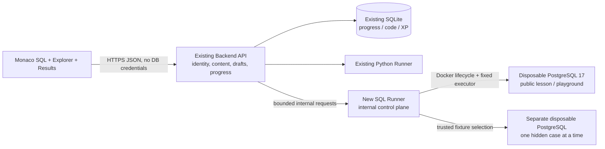
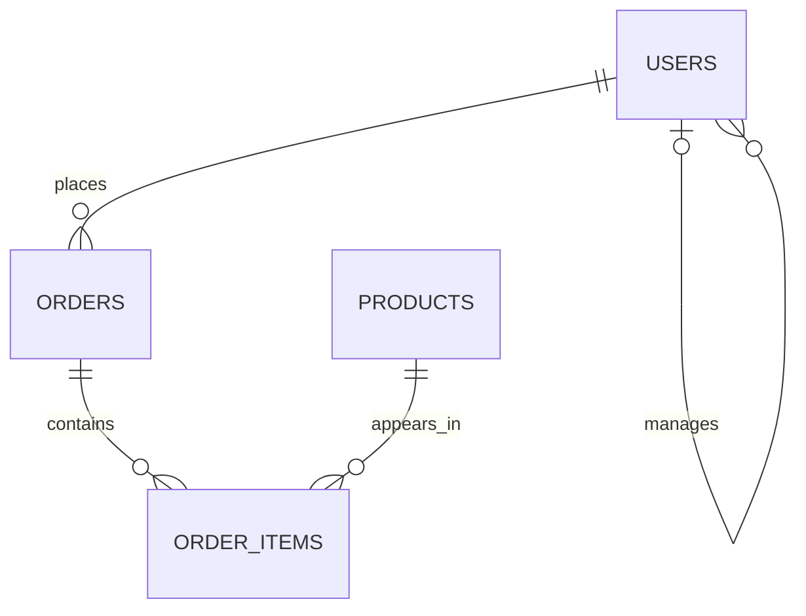

# Pythoria SQL Lab — архитектура и план реализации

Дата анализа: **2026-11-09**. Проверен `origin/main` **`fd963c7`**, включающий merge PR #2. Текущее рабочее дерево `9ef2f19` совпадает с ним по содержимому. Все пути ниже относятся к реальным файлам этого дерева; новые пути явно обозначены как предложения.

**Статус: только план.** Единственное изменение репозитория на этом этапе — этот документ. Приложение, задания, зависимости, Compose, progress и пользовательская БД не изменены; ветка реализации и PR не создавались.

## 1. Рекомендуемое решение и минимальный MVP

Рекомендую **один настоящий PostgreSQL 17 execution engine в отдельном SQL runner**, с отдельными одноразовыми PostgreSQL-контейнерами. Сначала локальный single-user сценарий, затем серверная проверка, затем DML и playground. PostgreSQL основного приложения не требуется: его SQLite с прогрессом остаётся на месте.

Причины выбора: Docker уже обязателен для штатного Python runner; серверная проверка скрытых наборов и последующие уроки о блокировках требуют доверенного исполнения и нескольких реальных соединений. PGlite — хороший самостоятельный браузерный playground, но не источник доверенного результата Check. Hybrid сейчас добавит два жизненных цикла, два набора ограничений и проверку совместимости без необходимости.

**Самый маленький полезный MVP — законченные PR 1 + PR 2 из раздела 15:**

1. Открывается опубликованный урок **10.2**, slug `s10-select-aliases-and-expressions`.
2. Автоматически создаётся ограниченная учебная сессия с `shop-v1`: `users`, `orders`, `products`, `order_items`.
3. Справа доступны список таблиц, колонки/типы, PK/FK и первые 50 строк выбранной таблицы.
4. Monaco открывает `query.sql` с опорным запросом `SELECT id, email FROM users;`. Студент меняет список колонок/алиасы, нажимает **Run** и получает настоящую таблицу PostgreSQL либо его ошибку.
5. Есть Refresh Explorer и Reset учебной сессии; SQL-текст сохраняется локально в браузере. Reset не стирает запрос.
6. Допустим один read-only statement; время, память и вывод ограничены. Доступа к основной БД нет.

**В MVP не входят:** Check/XP за SQL, hidden datasets, произвольные DDL/DML, долговечная БД playground, многооконные транзакции, визуальный ERD, SQL language server. Кнопка Check до появления реального grader не показывается. Это полезная среда исследования, а не имитация проверки.

Первое существующее задание `sql.basic.01`, хотя связано с 10.2, требует `WHERE active IS TRUE`, ещё не объяснённого в 10.2. Поэтому стартовый SELECT в MVP — guided activity без оценки. При добавлении Check простая задача выбора колонок дополняет существующий банк новым стабильным task ID; старый ID и его смысл не заменяются.

## 2. Что сейчас реализовано

| Реальный файл | Текущее поведение | Что переиспользовать / где граница |
| --- | --- | --- |
| `frontend/app/components/CourseApp.tsx` | Загружает lesson и Python files; всегда монтирует `CodeWorkspace`; при смене урока сохраняет files | Навигацию, тему, resize, toast, refresh прогресса. Выбор workspace и сохранение должны учитывать SQL отдельно |
| `frontend/app/components/CodeWorkspace.tsx` | Monaco, main.py, Run/Check, автосохранение через 800 мс, xterm, глобальные shortcuts | Внешний UX и настройки Monaco. Внутри жёстко заданы `.py`, Python commands, stdout и pytest; не превращать компонент в большой набор SQL-условий |
| `frontend/app/components/MarkdownLesson.tsx`, `lessonMarkdown.ts` | Learn/Review и закрытые ответы | Сохранить reader. SQL Lab — соседняя панель; переключение reader не должно сбрасывать SQL draft или БД |
| `frontend/app/api.ts`, `types.ts` | API Python files/run/check и stdout-ориентированный `ExecutionResult` | Добавить отдельные SQL методы/типы, не выдавать таблицу за stdout |
| `backend/app/main.py` | `/api/run` запускает существующий `.py`; `/api/check` берёт hidden pytest из lesson dir; terminal разрешает python/pytest/ls/pwd | Принцип: задания и tests выбирает сервер. Старые маршруты и payload остаются совместимыми |
| `backend/app/schemas.py` | `FilesPayload` не разрешает `.sql`; `RunPayload.entrypoint=main.py` | Не посылать SQL через этот payload и не добавлять SQL shell в terminal |
| `backend/app/content.py` | Читает metadata/Markdown/starter/solution/tests, interview sets; SQL bank не загружает | Добавить SQL repository/public projection, сохранив текущий lesson loader |
| `backend/app/runner_client.py` | HTTP к Python runner `/execute`, timeout 20 секунд | Аналогичный отдельный SQL client с собственными deadlines и typed errors |
| `runner/app/main.py` | Только `run/check/terminal`; allowlist команд python/pytest; Docker container на запуск | Опыт Docker lifecycle, cleanup, CPU/memory/output limits. Не смешивать SQL с этим execution request |
| `runner/sandbox/Dockerfile` | Python 3.12 + pytest/FastAPI/Pydantic/SQLAlchemy/Alembic; PostgreSQL server и драйвер для SQL Lab не объявлены | Наличие SQLAlchemy для Python exercises не означает наличие SQL engine |
| `docker-compose.yml` | frontend, backend, Python runner, sandbox-image builder; SQLite volume `pythoria_data`; runner с Docker socket и host port 8001 | Добавить SQL service/image, не монтировать в sandbox `pythoria_data` и не менять Python sandbox |
| `backend/app/models.py`, `database.py` | SQLite; глобальный `UserState(id=1)`; `CodeFile` keyed by lesson_slug/path; `LessonProgress` keyed by lesson_slug | Сохранить старые таблицы и ключи. Авторизации/tenant isolation сейчас нет |
| `content/practice_banks.json` | 48 SQL записей, уже привязанных к lesson_number | Это исходный банк; нужна адаптация, а не вторая независимая система задач |
| `tools/add_practice_banks.py` | Исторический каталог и генератор SQL/сценариев; существующие bundles и bank защищены от перезаписи | Не запускать для внедрения SQL Lab и не считать Python-константы новым источником истины |
| `tools/validate_content.py` | Проверяет минимальное число SQL записей и распределение категорий | Не исполняет `solution_sql`, не проверяет hidden datasets, SQL types/ordering и AST policy |
| `docs/SQL_RUNNER_DESIGN.md` | Краткий безопасный extension plan, без реализации | Сохранить как историческое описание; уточнения и выбор находятся здесь |

В `main.py` функция `persist_files()` **удаляет сохранённые файлы, отсутствующие в пришедшем словаре**. Поэтому отправка одного `query.sql` в старый `/files` может повредить прежний workspace. SQL drafts должны иметь отдельное сохранение.

Все 23 опубликованных урока Stage 10 сейчас имеют `has_task=false`, `xp=5`. SQL exercises не подключены к Python Check. Старое `task_completed` нельзя автоматически считать прогрессом каждого SQL-задания: в одном уроке до четырёх записей банка.

У приложения нет настроенной системы миграций собственной БД: startup делает `Base.metadata.create_all()`. Alembic в учебном sandbox обслуживает Python-уроки, а не schema приложения. Новые таблицы возможны аддитивно; изменение существующих колонок потребует отдельного versioned migration plan.

## 3. Проверка существующих SQL-заданий

### 3.1. Фактический состав

| Категория | Записей | Исполняемый эталон |
| --- | ---: | ---: |
| basic | 8 | 8 |
| aggregation | 8 | 8 |
| join | 10 | 10 |
| subquery | 6 | 6 |
| window | 6 | 6 |
| postgresql_reasoning | 10 | 0 |
| **Всего** | **48** | **38** |

Из 38 запросов 25 помечены `ordered`, 13 — `unordered`. Остальные 10 имеют `comparison=reasoning_rubric`, `solution_sql=null`, `expected_columns=[]` и текст `expected_reasoning`.

Все 38 используют **одинаковые schema и seed** магазина. Все 10 reasoning-сценариев формально используют другую общую schema с `rooms/bookings`, даже когда вопрос относится к users, orders или accounts. Полный разбор всех 48 записей — в приложении A.

`hidden_dataset_note` у 38 запросов содержит только «Проверять additional rows, NULL, duplicates и ties». **Реальных hidden datasets, expected results для них и grader сейчас нет.**

### 3.2. Что проверено исполнением

В ходе архитектурного анализа все **38/38** существующих `solution_sql` выполнены на исходном shop seed в одноразовом **PostgreSQL 17.11 (Debian 17.11-1.pgdg13+2)** из уже имеющегося локального образа `postgres:17`. Во всех 38 случаях названия и порядок выходных колонок совпали с `expected_columns`.

Проверочный контейнер имел `network=none`, без published ports и bind mounts, временный PGDATA в tmpfs, CPU/memory/PID limits; после проверки удалён. БД приложения и её volumes не использовались. Выполнялись только доверенные эталоны, не произвольный пользовательский SQL.

Это подтверждает совместимость **эталонов с текущим публичным seed**, но не правильность будущего grader, работу hidden tests, политику sandbox или педагогическую достаточность задач. Только для `sql.join.23` результат сейчас пустой; для FULL JOIN `sql.join.26` получено 6 строк, но это ещё не проверка обеих unmatched-сторон.

### 3.3. Исправления до включения Check

1. **Порядок результата.** Для 15 запросов `ordered` строже публичной формулировки: `aggregation.11`, `.13`; `join.19`, `.20`, `.21`, `.24`, `.25`; `subquery.30`, `.31`; `window.33`–`.38`. Нужно либо явно требовать финальный ORDER BY в prompt, либо выбрать unordered. Порядок внутри `OVER` не означает порядок результирующих строк. Для одноcтрочных aggregates ordered безвреден, но не проверяет навык сортировки.
2. **Последний заказ.** `sql.subquery.31` возвращает все заказы с максимальным created_at. При ties ORDER BY user_id не задаёт порядок между ними. Зафиксировать «все заказы на последней дате» и unordered, либо требование одного заказа с tie-break по id и другой эталон. Не угадывать намерение студента.
3. **FULL JOIN.** `orders.user_id NOT NULL REFERENCES users(id)` исключает заказы без пользователя. Ни один допустимый hidden seed этой schema не отличит правильный FULL JOIN от LEFT JOIN по этому примеру. Нужен отдельный reconciliation fixture с двумя источниками без такой связи, открыто описанная task-specific schema/версия и обновлённый эталон. Не ломать FK только в скрытых данных.
4. **Пустой результат.** В `sql.join.23` все products уже встречаются в items. Добавить hidden product без продаж; поправить название «Категории без продаж» на соответствующее фактическому вопросу о товарах.
5. **Пустая страна.** В `sql.basic.05` «непустые country» неоднозначно: эталон исключает NULL, но оставляет `''`. Уточнить «не NULL» либо действительно исключать пустую строку.
6. **Предпосылки.** `sql.basic.01` требует WHERE/IS TRUE в уроке 10.2; recursive `sql.subquery.32` привязан к 10.17, хотя 10.18 planned; LAG/LEAD `.37/.38` стоят в 10.21, а 10.24 planned. Добавить объяснение до практики или не включать эти задачи в обязательный маршрут, пока соответствующий материал не опубликован. IDs/slug уроков не менять.
7. **Missing practice.** Для опубликованных 10.1, 10.20 и 10.25 записей SQL bank нет. Особенно важно: **ни одного INSERT/UPDATE/DELETE/RETURNING/upsert задания в 38 запросах нет**. Их потребуется добавить, не объявлять уже готовыми.
8. **Границы revenue.** Например, order 10 имеет total=100, а его текущие product prices × quantities дают 150. В items нет цены на момент покупки. Для v1 `orders.total` — самостоятельная записанная сумма, не выводимая из текущих цен каталога. Не задавать сверку этих сумм как инвариант. Полноценные задания о стоимости покупки требуют `unit_price` и согласованного versioned seed.
9. **Несоответствующие PG-сценарии.** `sql.postgresql.01/.06/.07` требуют shop/больших данных; `.05/.08` — accounts; `.02` ожидает `(hotel_id, starts_at)`, хотя эти поля находятся в разных таблицах текущего booking dataset. `.09/.10` требуют сценария клиента/пула, а не сравнения SELECT-результата. Все 10 пока остаются заданиями на рассуждение.

## 4. PostgreSQL Sandbox, PGlite и Hybrid

| Критерий | A. Отдельный PostgreSQL sandbox | B. PGlite в браузере | C. Hybrid |
| --- | --- | --- | --- |
| Сложность MVP | Средняя: lifecycle/лимиты; Docker уже есть | Ниже для Run/Explorer: npm + worker | Выше: две реализации и маршрутизация возможностей |
| SQL-совместимость | Выбранная настоящая версия PostgreSQL | PostgreSQL, собранный в WASM, не SQLite; проверять доступные расширения и конкретную сборку | Нужен parity corpus и согласование версий/locale/types |
| Скрытые проверки | Сервер выбирает fixtures и решает passed | Секретные fixtures и passed нельзя доверять клиенту | Серверный Check решает это, но backend всё равно нужен |
| Изоляция | Отдельный cluster/container на lease/grade case; пределы ОС | БД находится на устройстве студента; не затрагивает серверную БД, но может занять память/CPU вкладки | Обе модели риска и cleanup |
| Производительность | Сетевой round trip, cold start PG | Локальный Run после загрузки WASM; worker не должен блокировать UI | Быстрый локальный Run, сетевой Check |
| Ресурсы | Серверная RAM/CPU на активный sandbox | RAM/CPU/storage браузера; quotas/eviction | Потребляются и клиентские, и серверные ресурсы |
| Запуск локально | Дополнительный image/service в существующем Compose | Не нужен отдельный DB service | Оба пути конфигурации |
| Transactions/indexes | Полный выбранный сервер; несколько соединений | Есть SQL-транзакции и индексы; single-connection модель не моделирует обычную межсоединительную конкуренцию | Различающиеся сценарии необходимо явно разграничивать |
| Stage 11 locks/deadlocks | Реализуемы двумя управляемыми соединениями | Не выбирать для доказательства реального поведения нескольких PostgreSQL sessions | Stage 11 обязан перейти на сервер |
| Free playground persistence | Lease/container сначала; durable storage отдельно | IndexedDB возможно, но это не cross-device/server persistence | Два разных смысла Reset и сохранения |
| Multi-user | Server ownership + отдельные ресурсы + admission control; сейчас auth отсутствует | Local isolation по браузеру; синхронизация и аккаунт отдельно | Серверная часть всё равно требует ownership/auth |
| Explorer | `pg_catalog`/information_schema | Аналогичные catalog queries через API движка | Переиспользуем DTO/UI, adapters отдельно |

PGlite действительно является WASM-сборкой PostgreSQL и поддерживает memory/IndexedDB storage; для UI рекомендован worker. Документация прямо отмечает single-connection ограничение. Это не основание учить SQLite вместо PostgreSQL, но и не эквивалент полноценному серверному concurrency lab. [PGlite About](https://pglite.dev/docs/about), [Getting Started](https://pglite.dev/docs/), [Multi-tab Worker](https://pglite.dev/docs/multi-tab-worker).

**Выбор для этой архитектуры — A.** Целевая major-версия MVP: **PostgreSQL 17**, поскольку эталоны проверены на ней и ветка pglast 7.x соответствует её parser. В PR 1 следует закрепить проверенный security patch/image digest и точные версии psycopg 3/pglast 7.x; это не обещание оставаться на текущем локальном image tag. Для PostgreSQL 18 нужен осознанный одновременный переход parser на ветку 8.x и прогон corpus. [pglast version history](https://pglast.readthedocs.io/en/latest/changes.html).

PGlite оставляем альтернативой, если приоритет изменится на offline/browser-only исследование без доверенного Check. Hybrid имеет смысл обсуждать после измерений cold start и нагрузки, а не вводить заранее. Сам по себе PGlite на сервере тоже потребовал бы trusted grading boundary и не решает многосессионные уроки.

## 5. Компоненты и границы доверия



- Новый `sql-runner` — отдельный FastAPI service. Он отвечает за AST policy, Docker lifecycle, dataset loading, execution, comparison и cleanup. Browser не может обращаться к нему напрямую.
- Backend остаётся владельцем lesson/task binding, аутентификации в будущем и начисления XP. SQL runner возвращает результат серверу; клиентский `passed` никогда не принимается.
- В SQL sandbox нет app SQLite volume, Docker socket, source checkout, grading catalog, production credentials и исходящего network access. Один sandbox содержит данные только одной учебной сессии или одного hidden case.
- Для связи при `network=none` внутри sandbox нужен **фиксированный trusted executor** с psycopg, подключающийся к локальному PostgreSQL socket. SQL runner передаёт bounded JSON через фиксированный request file/stdin Docker exec, получает bounded JSON ответа. Пользователь не выбирает shell, command, image, path, DSN или UID. Точный transport spike — часть PR 1, не пускать в продакшен самодельный разбор табличного psql stdout.
- Bootstrap/admin и query executor разделены по DB roles и OS identity. Исполнение student SQL всегда идёт под непривилегированной ролью, не владельцем cluster. Даже SQLi в Explorer не должно превратиться в bootstrap connection.
- В Compose добавляются builder image и internal SQL runner; PostgreSQL создаётся runner динамически, без постоянно опубликованного порта 5432. Не требуется ни Redis queue, ни Kubernetes, ни общая production PostgreSQL.

Docker socket делает control plane привилегированным. Для локального solo MVP допустим текущий доверенный host; перед публичным многопользовательским запуском SQL/Python workers выносятся на отдельный worker host/более сильную sandbox boundary. Одних schema-per-user и `search_path` недостаточно для защиты от общего memory/CPU exhaustion и доступа к объектам cluster. [PostgreSQL schemas](https://www.postgresql.org/docs/17/ddl-schemas.html), [Docker resource constraints](https://docs.docker.com/engine/containers/resource_constraints/).

## 6. Общая учебная БД, версии и режимы

### 6.1. Shared model, а не shared mutable state

**Общим является определение dataset**, а не изменяемая БД всех студентов. Уроки используют одну знакомую логическую модель и версию seed. Физическое состояние у каждого lease отдельно.

Первый dataset `shop-v1` повторяет существующие четыре таблицы и текущий seed: 4 users, 5 orders, 3 products, 5 order_items. Связи:



Self-reference: users.manager_id → users.id. Composite PK: order_items(order_id, product_id). Это конкретные случаи, которые Explorer обязан корректно отображать.

Версия dataset фиксирует schema, seed, engine major, timezone UTC, DateStyle ISO, deterministic locale/collation, доступные extensions и checksum. Обновление seed — новая revision, а не скрытая замена под работающей сессией. Контракт сортировки текста задаётся явно; не сравнивать русский алфавит с Python sort, если SQL использует PostgreSQL collation.

Оставить магазин основой Stage 10. Для reconciliation, accounts и booking добавить **именованные расширения/отдельные versioned datasets**, когда это требуется смыслом урока. Одна схема на абсолютно все concurrency/index scenarios не нужна.

### 6.2. Lesson Mode

- Session создаётся для конкретных owner + lesson ID + task ID + dataset revision. В MVP SELECT-only baseline неизменяем и может переиспользоваться в рамках lease; каждый Run — новое соединение и read-only transaction.
- После каждого Run соединение закрывается, временное/session state не переносится. Следующий урок не наследует изменённую БД предыдущего.
- При добавлении DML **каждый новый Run начинается с baseline**. После успешного Run его post-state сохраняется как текущая snapshot generation для Explorer, пока не начат следующий Run/Reset. Это прямо подписано в интерфейсе: «Каждый запуск задания начинается с исходных данных».
- Поэтому `UPDATE ... RETURNING` показывает изменение в том же Run, а Rows Explorer читает post-state. Отдельный следующий student Run `SELECT` уже начинается с baseline; для последовательности действий используется разрешённый script profile либо Playground.
- Ошибка DML откатывает весь запущенный script. Cleanup не ограничивается ROLLBACK: sequences, DDL и session effects требуют полного восстановления/нового sandbox по profile.
- Check использует **отдельные** sandbox и datasets, никогда не текущую сессию Explorer. Hidden state не появляется в lesson/playground.
- Reset пересоздаёт только эту учебную БД, увеличивает generation, инвалидирует table handles/result cache. Draft и старые attempts сохраняются.

### 6.3. Free Playground

Реализовать после read-only Run и grader. Открывается явно, с отдельным draft namespace и lease; стартует с public shop baseline, не из hidden case.

Разрешённый профиль: SELECT + DML + ограниченные CREATE/ALTER/DROP TABLE/INDEX внутри `lab`. Роль владеет своими созданными таблицами, но не cluster/system schema. CREATE FUNCTION/DO/EXTENSION, внешние подключения и admin commands не являются «свободной практикой» этого MVP.

Изменения коммитятся между запросами и сохраняются в рамках lease, включая reload вкладки, пока lease существует. Первое решение — **без durable per-user PostgreSQL volumes**: idle TTL 30 минут, absolute TTL 2 часа, SQL drafts сохраняются независимо. В UI сообщается срок жизни БД; рестарт runner или Reset может убрать её данные. Browser нельзя обещать сохранность, которой нет.

Reset = удалить только свой sandbox и загрузить baseline; запрос не очищается. Общий Reset всех пользователей и `docker compose down -v` не используются. Долговечный playground с quotas/backups — отдельная последующая потребность.

## 7. Содержание и привязка к урокам

Нужен адаптер поверх **существующих stable task IDs** из `practice_banks.json`, а не переписывание всех 48 в новую систему.

Предлагаемые новые источники (пока не созданы):

```text
content/sql_lab/
  manifest.json                 # dataset revisions, capabilities, lesson-ID → task IDs
  datasets/shop-v1/schema.sql    # одна каноническая копия общей схемы
  datasets/shop-v1/public.sql    # public seed
  tasks/<task-id>.json           # только дополнительные policy/comparison/version fields
sql_runner/grading/
  cases/<task-id>/...            # server-only fixtures / expected snapshots / case recipes
```

- На первом шаге adapter читает старые `schema/seed/solution_sql`; проверяет checksum одинаковых shop definitions и использует одну canonical dataset definition. Старые поля временно остаются для совместимости. Последующее сокращение дублей — отдельно, с parity test.
- `manifest.json` привязывает по **lesson.id**, разрешает его через curriculum/implementation_slug, хранит упорядоченный список task IDs и default task. Не привязывать только к названию или физической папке.
- В public projection: task ID/revision, title, prompt, dataset ID/revision, expected_columns, comparison contract, public examples, allowed capabilities. Не возвращать `solution_sql`, `expected_reasoning`, hidden seeds/results или note с ответом.
- `reasoning_rubric` отображается как упражнение с закрытым разбором, без SQL Check. Индексы/транзакции не получают фиктивную проверку по совпадению слов.
- Поля расширения: `statement_policy`, `required_capabilities`, `result_policy`, `required_for_lesson`, `grader_revision`; для DML позднее `state_assertions`, `affected_tables`, `returning_contract`.
- Не запускать authoring generators поверх исправленных lesson.md. Сохранить защиту `tools/curated_content.py`, Learn/Review и скрытие ответов. Удалять старую надпись «SQL пока не подключён» только в реально включённых уроках.

В Stage 10 задачи распределены по **20 из 23 опубликованных уроков**. Точная карта с количеством задач находится в приложении B. Stage 10.18 и 10.24 остаются planned, пока материал отдельно не готов; SQL Lab не публикует их автоматически.

## 8. SQL Workspace и Database Explorer

### 8.1. Пользовательский поток

Урок открывается с reader слева и SQL workspace вместо Python workspace справа. Внутри workspace: редактор и компактный Explorer рядом, результат ниже. На узком экране Editor / Database / Results — вкладки, не три сжатые колонки.

SQL Monaco получает `language="sql"`; Run исполняет весь текст editor. Запуск выделения, полноценный SQL language server и произвольный terminal откладываются. В MVP достаточно syntax highlighting; schema-aware completion по загруженному catalog добавляется без DB credentials, с dispose провайдера при смене контекста.

Действия: Run, Refresh Database, Reset Database. Check появляется только у supported graded task. Под результатом — duration, SQLSTATE/позиция ошибки, command tag, bounded notices. Это не shell terminal: `psql`, `\!`, filesystem/network commands не принимаются. Старый xterm Python не меняется.

Reader Learn/Review и SQL Lesson/Playground — **разные переключатели**. Переключение Learn ↔ Review закрывает ответы, но не сбрасывает соседний SQL editor или dataset. Все решения/expected results остаются за явным раскрытием; public schema/data и условия задачи видимы.

### 8.2. Схема и relationships

Catalog запрашивается у session database, а не вручную копируется из DDL в frontend:

- schema/table handles, display names;
- columns в ordinal order: name, PostgreSQL type, nullable, default, identity/generated;
- PK с упорядоченным списком колонок;
- FK: constraint handle, пары local/referenced columns, referenced table, update/delete rules;
- unique/check constraints — после базового MVP;
- индексы и plan view — в Stage 11.

MVP relationships — ссылки «orders.user_id → users.id» и self-reference, без дорогого графического ERD. Composite FK нельзя сопоставлять по одному имени столбца: использовать pg_constraint.conkey/confkey и ordinal correspondence либо корректные information_schema joins. Тип получать через catalog (`format_type`), сохраняя numeric precision/length. [key_column_usage](https://www.postgresql.org/docs/17/infoschema-key-column-usage.html).

Для read-only query role нельзя полагаться только на `information_schema.referential_constraints`: это view может скрыть FK от пользователя, имеющего лишь SELECT. Для MVP выбрать `pg_catalog.pg_constraint` с проверкой доступности таблицы и фильтром lab, проверить self/composite FK отдельным integration test. [referential_constraints visibility](https://www.postgresql.org/docs/17/infoschema-referential-constraints.html), [pg_constraint](https://www.postgresql.org/docs/17/catalog-pg-constraint.html).

Показывать только разрешённую `lab` schema. Не выдавать таблицы других sessions, hidden fixtures, внутренние roles/credentials. В новых запросах catalog/table rows даже trusted SQL использует query role и те же budgets; bootstrap admin не читает созданные студентом объекты для отображения.

### 8.3. Просмотр данных

`Rows` — отдельный серверный запрос, по умолчанию 50 строк, максимум 100. Он не выполняет student SQL и не начинает новый Run. Таблица задаётся непрозрачным handle из catalog; сервер проверяет owner/session/generation и сам сопоставляет handle с identifier.

Имена schema/table/column нельзя передавать обычными value placeholders: использовать `psycopg.sql.Identifier` только после проверки catalog handle. Значения фильтров/курсоров передавать параметрами. Для shop pagination сортируется по PK, включая composite PK order_items. Для таблиц Playground без PK: bounded offset/снимок и явное отсутствие стабильной идентичности между изменениями, без притворного row identity по номеру строки.

После Run/Reset результат содержит generation; Explorer обновляет данные для этой generation. Старый ответ запроса из предыдущей generation или урока игнорируется. MVP без React Query может использовать AbortController + request token, существующий стиль CourseApp; новая тяжёлая state library не требуется.

### 8.4. Results и типы

Результат — `columns[]` плюс `rows[][]`, **не массив объектов по имени колонки**: SQL может вернуть два одинаковых alias, и ключи объекта потеряют данные.

Пример предлагаемого wire contract, не реализация API:

```json
{
  "request_id": "opaque-request-id",
  "generation": 3,
  "command": "SELECT",
  "columns": [
    {"name": "email", "pg_type": "text", "type_oid": 25},
    {"name": "order_id", "pg_type": "int8", "type_oid": 20}
  ],
  "rows": [["a@example.com", "10"], ["b@example.com", "12"]],
  "rows_returned": 2,
  "has_more": false,
  "truncated": false,
  "duration_ms": 7,
  "error": null
}
```

Int8 и numeric передаются строками с type metadata, без потери точности JavaScript Number. NULL — JSON null, не строка `"NULL"`; bool — boolean; date/timestamptz — документированный ISO формат, timestamptz нормализуется к UTC. Для unsupported types Run может вернуть bounded text с type name; Check должен либо иметь явный normalizer, либо отказать как unsupported type, не сравнивать случайный repr.

UI различает NULL, пустую строку, текст `"NULL"`, false и 0. Значения/ошибки отображаются как текст, не HTML. При 500 показанных строках и наличии следующих писать «Показано 500, есть ещё», а не выдумывать полное число строк. Полный COUNT не выполняется автоматически поверх произвольного запроса.

В MVP SELECT читать через server-side cursor/другой проверенный bounded protocol, закрывая его после лимита. Обычный psycopg cursor получает весь result set; `fetchmany(500)` после обычного execute сам по себе не ограничивает память драйвера. Лимиты вывода не заменяют CPU/time budget сортировки до первой строки. [Psycopg cursor types](https://www.psycopg.org/psycopg3/docs/advanced/cursors.html).

## 9. Run, Check и сравнение результатов

### 9.1. Run

1. Backend разрешает lesson/task/session по серверному owner и manifest. Клиент не задаёт schema/seed/image/DSN.
2. SQL runner проверяет размер текста, AST и capability profile; ограничивает admission concurrency.
3. Создаёт/берёт соответствующий sandbox; при необходимости восстанавливает baseline, открывает query connection.
4. Выставляет trusted GUCs, выполняет один statement в server-managed transaction; возвращает bounded typed result или PostgreSQL diagnostics.
5. Закрывает connection/cursor в finally. При timeout/cancel убирает query process/session, а при сомнении в чистоте — весь sandbox.
6. Возвращает generation и историю операции. В MVP история в UI; после добавления SqlAttempt — bounded server record.

Student SQL не дополняется текстовым `LIMIT` и не делится по `;`: это ломает комментарии, строки, CTE и семантику. Количество statements проверяет PostgreSQL parser. `SELECT ...; DROP ...` не становится «первым безопасным запросом».

### 9.2. Check на hidden datasets

В Check API приходит **SQL, task ID и request ID**, не `passed`, эталон, сравниваемые строки, лимиты или fixture от клиента.

Для каждой задачи:

- Один public case и минимум два осмысленных hidden cases, достаточных для её типичной ошибки. Наборы должны удовлетворять объявленной schema и условиям задачи.
- Ожидаемый результат получается от проверенного `solution_sql` на том же engine/dataset revision, а не от SQL-строки студента. Можно хранить server-only typed snapshots, пересчитываемые в CI при изменении fixture/эталона/image.
- Каждый hidden case имеет отдельный sandbox только с его данными. Эталон выполняется до student query либо на отдельной чистой копии; expected rows не создаются как доступная студенту таблица.
- Все связи с другими cases и Explorer отсутствуют. После case контейнер удаляется. На внутреннюю ошибку trusted fixture/эталона возвращается grading infrastructure error, а не «неверное решение».
- Для public case допустим небольшой rows diff. Для hidden case — passed/failed, категория проблемы, sanitised SQLSTATE без rows, expected SQL, values из DETAIL, seed и внутреннего exception traceback.
- Не передавать client логи контейнера целиком. Frontend не запускает скрытые checks и не сообщает серверу, что они прошли.

«Hidden» означает не отправленный в browser. Публичный GitHub repository не делает committed fixtures/solution_sql секретными от читателя исходников. Для учебного продукта это защита от случайной утечки и hardcoded решений на видимом seed, а не proctoring. Если понадобятся действительно секретные задания, fixture bundle хранится вне публичного репозитория и монтируется только grader.

### 9.3. Comparator

- Сравнивать ordered список колонок с expected_columns; одинаковые names/разная позиция — разные контракты. Для нового задания отдельно разрешить/запретить duplicate aliases.
- `ordered`: сравнение полных последовательностей строк. Такой режим допустим только при сформулированном конечном порядке и tie-breaker. Оконный ORDER BY не достаточен.
- `unordered`: сравнение **multiset/bag строк со счётчиками**, не set. Иначе потеряются дубликаты, и неверный DISTINCT пройдёт проверку. Нормализация/hashing выполняется типизированно на сервере.
- NULL равен NULL для сравнения двух результатов; это не реализация SQL `NULL = NULL`. NULL отличается от empty string и text `NULL`.
- Numeric/Decimal сравнивается без float; 100.0 и 100.00 эквивалентны в numeric family. Boolean нельзя считать integer 1/0. Integer/numeric compatibility задаётся task policy; для задач на cast/type применяется строгий тип.
- Timestamp vs timestamptz не смешиваются произвольно; timestamptz сравнивается как один UTC instant. Text сохраняет регистр/пробелы. Никаких неявных strip/lower, скрывающих ошибку SQL.
- Float tolerance только в явно объявленном float-контракте; не применять epsilon ко всем суммам/деньгам.
- Пустой результат всё равно имеет columns/types. Для Check сравнивать **полный bounded result**, а не первые 500 строк. Если cap превышен, это resource-limit/unsupported result, а не pass по совпавшему префиксу.
- Не требовать текстового совпадения SQL. JOIN/EXISTS и иные эквивалентные решения допустимы, кроме задач с явным учебным требованием использовать конкретную конструкцию; такую отдельную AST-проверку нужно объявлять в prompt.

Первые hidden patterns: NULL и `''`, дубликаты после JOIN, users без orders, product без items, несколько paid orders, отсутствие paid rows, равные timestamps/total, значения ровно на пороге, shuffled insert order. Для rank ties и empty aggregates проверить ожидаемые NULL/COUNT. Для recursive chain гарантировать acyclic input, пока обработка cycles не входит в условие.

### 9.4. DML и изменения БД — позднее

SELECT-comparator не проверяет INSERT/UPDATE/DELETE. Для DML нужны state assertions по затронутым таблицам, invariants/constraints, affected rows и при необходимости RETURNING. Эталон и student query изменяют разные чистые копии одной исходной базы.

Для небольшого shop dataset before/after можно сравнить по PK и показать ограниченный diff INSERT/UPDATE/DELETE. Без PK — две отдельные views, не выдуманный diff по row number. В первом DML PR достаточно RETURNING, affected row count и обновляемого Explorer; визуальный diff отдельным маленьким PR.

## 10. API, компоненты и сохранение

Все ниже — **предлагаемые новые contracts**, существующие Python endpoints остаются на месте.

| Этап | Endpoint | Назначение |
| --- | --- | --- |
| MVP | `GET /api/sql/lessons/{slug}` | Public dataset/task capability manifest для опубликованного урока; 404/unsupported не ломает обычный reader |
| MVP | `POST /api/sql/sessions` | Создать lease по lesson/task/mode; actual dataset определяется сервером |
| MVP | `GET /api/sql/sessions/{id}/catalog` | Таблицы, типы, PK/FK и generation |
| MVP | `GET /api/sql/sessions/{id}/tables/{table_handle}/rows` | Bounded browsing, limit/cursor/generation |
| MVP | `POST /api/sql/sessions/{id}/run` | `{sql, request_id, expected_generation}` → typed result/error |
| MVP | `POST /api/sql/sessions/{id}/reset` | Reset только своего dataset, request id и generation precondition |
| MVP | `DELETE /api/sql/sessions/{id}` | Idempotent close; TTL cleanup всё равно обязателен |
| Draft PR | `GET/PUT /api/sql/lessons/{slug}/tasks/{task_id}/draft` | SQL text + optimistic revision; отдельное хранение от Python files |
| Check PR | `POST /api/sql/lessons/{slug}/tasks/{task_id}/check` | Server grading и task progress; ownership и lesson/task mapping проверяет backend |
| Позже | `POST /api/sql/attempts/{id}/cancel` | Отмена только собственного running attempt; не принимает PID/container ID |

Session ID — opaque server handle, не credential/DSN и не permission сам по себе. Во всех операциях проверяются owner, mode, task binding, engine/dataset revision, lease expiry и generation. При stale generation — 409, при занятости — 409/423 с понятным retry status, при нехватке capacity — 429/503; dataset lifecycle нельзя выбирать произвольным URL parameter.

Public SQL errors: `sqlstate`, `message`, безопасные `detail/hint`, position, statement index. PostgreSQL position считать по символам; frontend корректно переводит его в Monaco line/column с учётом UTF-16. Не возвращать DB credentials или пути manager. [PostgreSQL error fields](https://www.postgresql.org/docs/17/protocol-error-fields.html).

### 10.1. Предлагаемые frontend-файлы

- `SqlWorkspace.tsx`: editor/task selection/Run/Check/reset orchestration.
- `DatabaseExplorer.tsx`: table list, columns/PK/FK и Rows view; first relationships как ссылки.
- `SqlResultsTable.tsx`: columns/rows/nulls/truncation, bounded rendering.
- `SqlDiagnostics.tsx`: PostgreSQL errors/notices/command tags; не shell terminal.
- `sqlApi.ts`, `sqlTypes.ts`: отдельные API/DTO вместо разрастания Python ExecutionResult.
- Изменение `CourseApp.tsx`: выбор Python/SQL workspace по public manifest, отдельный flushDraft при смене урока/задания. Не вызывать Python persist_files для SQL.
- Позднее небольшой общий `MonacoPane` для стилей/shortcut UX. На первом шаге не рефакторить весь CodeWorkspace, чтобы не расширять regression surface.

Только смонтированный workspace регистрирует Ctrl/Cmd+Enter и Save shortcuts; при смене типа прежние listeners освобождаются. Не держать скрытый Python CodeWorkspace одновременно с SQL editor.

На MVP SQL draft хранится в localStorage под `pythoria:sql:<lesson-id>:<task-id-or-guided>`; selected lesson mode не меняет ключ. При смене dataset revision текст не удаляется. Статус MVP честно показывает «Сохранено в этом браузере». Backend save появляется отдельным PR. Для нескольких задач урока — отдельный draft на stable task ID, а не один общий query.sql на все exercises.

### 10.2. Предлагаемые backend/runner-файлы

```text
backend/app/sql_content.py            # adapter + public projection + binding
backend/app/sql_routes.py             # public API, ownership, persist result
backend/app/sql_schemas.py            # bounded request/response DTOs
backend/app/sql_runner_client.py      # internal HTTP contract, separate deadlines
backend/app/models.py                # только новые SQL tables после MVP
sql_runner/app/main.py                # internal service API
sql_runner/app/lifecycle.py           # lease registry, Docker, cleanup, generation
sql_runner/app/policy.py              # recursive PostgreSQL AST capability validation
sql_runner/app/datasets.py            # trusted versioned schema/seed loading
sql_runner/app/grading.py             # case selection, comparator, sanitisation
sql_runner/sandbox/Dockerfile         # PostgreSQL 17 + fixed executor, no app data
sql_runner/sandbox/executor.py        # local psycopg execution, rows/types/budgets
sql_runner/tests/                     # Docker-backed security/semantics tests
```

SQL service зависимости — отдельно в `sql_runner/requirements.txt`. Корень `backend.app.main` включает router; Python `runner/app/main.py` и его payload не меняются. `docker-compose.yml` добавляет service/image/config, без нового доступа SQL sandbox к application volumes.

### 10.3. Модели и XP

**MVP:** новые persistent tables не нужны. Session registry живёт у SQL runner, restart reaps его собственные orphan containers; SQL drafts локальные. Основной SQLite не мигрирует.

После MVP — новые таблицы без замены старых:

| Новая модель | Ключ / смысл |
| --- | --- |
| `SqlDraft` | owner + stable lesson ID + task ID, query text, revision, updated_at |
| `SqlAttempt` | attempt/request ID, owner, lesson/task IDs, kind, engine/dataset/grader revisions, bounded diagnostics/case counts; без hidden rows в client projection |
| `SqlTaskProgress` | unique(owner, task ID), first_passed_at, last_passed_revision; не смешивать с Python task_completed |
| `SqlReward` | unique(owner, stable lesson ID, reward_kind), immutable awarded amount; только когда включается SQL XP |

Для первых Check PR можно сохранять passed без нового XP. В отдельном XP PR рекомендую **+20 один раз за завершение объявленного required SQL task set урока Stage 10**, не по +20 за каждый click/case. Старые +5 за theory остаются. Не начислять награду повторно при новой попытке или смене grader revision; completed уроки не сбрасывать при добавлении упражнений. Список обязательных tasks фиксируется versioned manifest и имеет политику grandfathering.

В Stage 10 новый SQL completion можно агрегировать в существующий lesson status; предварительно проверить отсутствие уже начисленной task reward. В Stage 16 SQL Lab — дополнительный viewer/exercise, **не** замена существующей Python/ORM практики: SQL Check не завершает её и не расходует её reward.

Сетевой вызов SQL runner не держит write transaction SQLite открытой. После trusted результата — короткая транзакция: idempotent attempt, task progress, unique reward ledger и atomic increment XP. Два одновременных Check не дают двойное начисление. Существующие Python правила не менять попутно без отдельного regression-tested refactoring.

Lesson/task IDs в этих таблицах — внешние контентные ключи, проверяемые repository/manifest; таблицы lessons в SQLite сейчас нет, поэтому нельзя добавить к ней фиктивный FOREIGN KEY.

Для новых таблиц можно сохранить текущий аддитивный create_all-подход с тестом upgrade старой БД; перед ALTER/tenant migration нужна отдельная versioned migration infrastructure. Никакого drop_all/reset пользовательской БД или переименования persistence keys.

## 11. Безопасность и budgets

### 11.1. Несколько независимых границ

1. **Ресурсная/физическая изоляция:** отдельный cluster/container на owner lease или grade case; без production data, host mounts, Docker socket и исходящей сети. Управляющий service доступен только backend.
2. **DB roles:** query role — NOSUPERUSER/NOCREATEDB/NOCREATEROLE/NOREPLICATION/NOBYPASSRLS, без членства в admin/file/network roles. В read-only profile только CONNECT/USAGE/SELECT нужных объектов; убрать default PUBLIC CREATE/TEMP права. Не выдавать возможность SET ROLE на bootstrap owner. [PostgreSQL GRANT](https://www.postgresql.org/docs/17/sql-grant.html).
3. **AST capabilities:** pglast/libpg_query, не sqlparse token splitting и не regex blacklist. Один statement; recursive walk CTE/subqueries. В MVP SELECT без SELECT INTO, row locks, writable CTE, произвольных function/schema calls. Для каждого нового узла capability — отдельный allow rule и отрицательные tests.
4. **DB/runtime limits:** read-only transaction и trusted timeout/resource settings, close connection, external watchdog/cancel, destroy sandbox if necessary. Read-only не означает «SQL безопасен»: вычисления, sleep, session changes и некоторые функции всё ещё требуют контроля.

Запрещённые в учебных profiles семейства: COPY TO/FROM files/PROGRAM, DO/procedures/functions/triggers, CREATE EXTENSION/foreign servers/dblink, ROLE/GRANT/admin commands, ALTER SYSTEM, backend termination, session SET/RESET, произвольные prepared transactions. Это примеры отказа, а не достаточный blacklist: разрешаются только reviewed AST nodes, built-in functions и lab objects. COPY действительно умеет обращаться к файлам/PROGRAM и не должен попадать в MVP. [COPY](https://www.postgresql.org/docs/17/sql-copy.html).

Для search_path использовать контролируемую `lab` и pg_catalog; в read-only lab не writable для student. В DDL playground trusted admin queries работают с полностью квалифицированными именами вне student search_path; student не создаёт функции/операторы для подмены trusted вызовов. Parser — синтаксический анализатор, не доказательство безопасности функции: DB privileges и container boundary остаются обязательными.

### 11.2. Capability profiles

| Profile | Разрешено | DB permissions / lifecycle |
| --- | --- | --- |
| `lesson_read` — MVP | Reviewed SELECT/expressions, позднее aggregates/joins/windows/CTE после AST tests | CONNECT, USAGE lab, SELECT public dataset; без TEMP/CREATE; fresh connection + read-only transaction |
| `lesson_write` — DML PR | SELECT/INSERT/UPDATE/DELETE и объявленный RETURNING; без произвольного DDL/TRUNCATE | Только необходимые права на целевые lab tables/sequences; seed до каждого Run, commit post-state для Explorer, полный reset перед следующим |
| `playground` — отдельный PR | DML и reviewed CREATE/ALTER/DROP TABLE/INDEX внутри lab | CREATE lab и владение собственными таблицами, без cluster admin/functions/extensions; requests с auto-commit, TTL |
| `guided_concurrency` — Stage 11 | Специально объявленные transaction/locking шаги на двух connections | Controlled sessions в одном отдельном cluster, собственные deadlines/barriers; не универсальный HTTP transaction tunnel |

Profile назначает manifest/control plane, не клиент. Широкое право CREATE в playground само по себе не ограничивает вид создаваемого объекта: AST policy должна запрещать functions, operators, triggers и другие неподдержанные объекты даже там, где DB role технически смогла бы их создать.

### 11.3. Начальные проектные лимиты

Это **настройки для первого benchmark**, не измеренные гарантии и не рекомендации производителя для production.

| Ограничение | Начальный предел |
| --- | --- |
| SQL text | 32 KiB UTF-8 |
| Statements | 1 в MVP; позже максимум 10 только в явном script profile |
| Run statement timeout | 2 s |
| Lock timeout | 500 ms |
| Idle in transaction | 2 s для обычного Run |
| Transaction timeout | 5 s для обычного Run на PG17 |
| External execution deadline | 5 s на query; provisioning отдельно до 20 s |
| API deadline | до 30 s на cold create; backend client не использует неизменённые Python 20 s вслепую |
| Run output | 500 rows + 1 look-ahead, 1 MiB total, отдельный bounded cell limit |
| Explorer | 50 rows default, 100 maximum; не возвращать всю таблицу |
| Check output | полный result до 10 000 rows / 2 MiB на case; превышение никогда не truncation-pass |
| Container | стартовый профиль 512 MiB RAM, 1 CPU, 128 PIDs, bounded tmpfs 256 MiB, read-only root кроме явных writable paths |
| PostgreSQL | max_connections 10, shared_buffers 32 MiB, work_mem 4 MiB, temp_file_limit 32 MiB как стартовый профиль |
| Concurrency | 1 active operation на lease; 1 активный query/grade operation на local MVP installation |
| Leases | не более 2 idle/active sandbox на local owner, из них один playground; при capacity отказывать/освобождать expired idle leases |
| TTL | Lesson idle 15 min; Playground idle 30 min, absolute 2 h |

Два зарезервированных sandbox при профиле 512 MiB — бюджет до 1 GiB только на SQL, плюс существующий stack. Замерить cold start, peak RSS и actual latency на целевой машине; не обещать стоимость/скорость заранее. Hidden cases исполняются последовательно, без размножения 10 containers на один Check.

Statement/lock/idle/transaction timeouts — разные механизмы; `transaction_timeout` есть в выбранном PG17. Нельзя надеяться только на GUC, изменяемый SQL-функцией: AST не разрешает set_config и аналогичные обходы, external watchdog независим от PostgreSQL настроек. Resource bounds нужны ещё и для сортировки/aggregate до отдачи первой строки. [Client defaults/timeouts](https://www.postgresql.org/docs/17/runtime-config-client.html), [Resource consumption](https://www.postgresql.org/docs/17/runtime-config-resource.html).

### 11.4. Cleanup, отказоустойчивость, пользователи

- Все создаваемые контейнеры имеют собственные labels/lease ID и deadline. Startup reaper и периодический reaper удаляют только **свои** expired SQL containers. Cleanup в finally плюс reaper, не только успешный HTTP response.
- Cancel/HTTP disconnect закрывает запрос по request ID; request cancellation Python coroutine не заменяет PostgreSQL cancel/kill. Manager crash не оставляет бесконечный cluster без TTL/reaper.
- Request ID и generation исключают повторную DML-запись при retry и отображение старого результата после Reset. Reset сериализован с Run и не удаляет активный чужой lease.
- **Сейчас приложение single-user, без authentication.** MVP рассчитан на доверенный локальный доступ; ownership на сервере — фиксированный local principal, не client-supplied user_id.
- Перед публичным multi-user запуском обязательны auth, серверный principal, owner-scoped SQL tables, quotas/rate limits и отдельная worker boundary. Opaque UUID без ownership check не является защитой. Не объявлять эту часть уже готовой из-за наличия UserState.
- `sql-runner` не публикует host port. Существующий Python runner с host port 8001 тоже не следует открывать в недоверенную сеть; менять его deployment в рамках SQL MVP без отдельного тестирования не требуется.

## 12. Curriculum progression

| Группа | Что включается | Что ещё нужно |
| --- | --- | --- |
| 10.1–10.2 | Table explorer, selecting columns, aliases/expressions | Guided SELECT без WHERE; новая простая graded task позже |
| 10.3–10.6 | Existing basic bank | Уточнить NULL/empty/case/time/order contracts, добавить hidden cases |
| 10.7–10.9 | Aggregation, GROUP BY, HAVING | Empty aggregates, duplicates, revenue boundaries, явный final ordering |
| 10.10–10.13 | JOIN exercises | Unmatched products/users; отдельная reconciliation schema для FULL; self FK/compound key в Explorer |
| 10.14–10.17 | Subquery/EXISTS/ordinary CTE | Выбор ties, NOT EXISTS cases; recursive task не обязательна до 10.18 |
| 10.19–10.23 | CASE, set operations, windows | Добавить set tasks; rank ties; оконный порядок отделить от порядка результата |
| 10.25 | INSERT/UPDATE/DELETE/RETURNING/upsert | Новый write profile, state assertions и новый task content — банк этого пока не содержит |
| Stage 11 | Indexes/EXPLAIN, constraints, transactions, locks | Большие deterministic datasets, controlled sessions, собственные assertable задания |
| Stage 16 | SQL, генерируемый ORM | Сначала безопасный view/compile SQL из Python exercises; параметры отдельно. Не подключать untrusted Python напрямую к lesson PostgreSQL |

Stage 11 не оценивается по точному runtime в миллисекундах и единственному виду EXPLAIN plan: маленькая таблица законно даёт Seq Scan. Для index-задачи проверять допустимые определения/семантику, а plan использовать как наблюдение на достаточно большом dataset с ANALYZE. EXPLAIN ANALYZE действительно исполняет запрос; для DML нужна отдельная write profile и чистая копия.

Transactions/deadlocks требуют **двух настоящих соединений в одном изолированном учебном cluster**, а не двух чужих пользователей в общей базе. Порядок шагов задаётся контроллером/barriers, а не надеждой на sleep и скорость машины. Такие уроки получают отдельный capability/budget profile; бесконечные ручные транзакции через HTTP в MVP не нужны.

Для Stage 16 не отправлять пользовательский Python в процесс backend и не открывать production DSN в Python sandbox. Сначала показывать compiled SQL и bound parameters; полноценная совместная Python+DB sandbox — отдельный проектируемый boundary, а не снятие network_disabled у существующего runner.

## 13. Риски и компромиссы

| Риск / компромисс | Решение и проверка |
| --- | --- |
| Cold start и RAM контейнеров | Lazy leases, маленький seed, reuse только immutable SELECT session, измерения в PR 1; warm pool только после данных |
| Docker на одном host — не абсолютная isolation | Local trusted MVP; отдельный worker host перед public untrusted use |
| Shared schema ошибочно понимается как общие записи | Общий dataset definition, отдельное состояние leases; tests двух sessions |
| Старый bank «специфицирован», но grader semantics не готовы | 38 эталонов проверены только на public seed; скрытые случаи/контракты и audit отдельно |
| Metadata has_task/xp относится к Python | Отдельные SQL capability/progress/reward fields и required task set |
| SQL draft заменит CodeFile | Отдельные endpoint/storage/flush handler; regression test исходного Python file dict |
| UI получит решение из общего JSON | Public DTO allowlist; test отсутствия solution_sql/hidden seeds/expected_reasoning в API и frontend assets |
| Read-only SELECT окажется ресурсоёмким или с side effects | AST + least privilege + bounded result + time/OS budget + external kill |
| Truncation даст ложный pass | Preview cap и grader cap различаются; grader никогда не сравнивает только prefix |
| Нестабильный ORDER BY и потеря duplicates | Bag comparator + явно объявленные order contracts + tie fixtures |
| Reset/два таба/сеть породят stale rows или double write | Generation, per-lease mutex, request id, optimistic draft revision |
| Upgrade engine/seed сломает старую сессию/код | Pinned revisions, corpus CI, old draft сохраняется; не переписывать ID ради версий |
| Free playground превратится в бессрочный hosting | Lease TTL и bounded local session; durable storage только отдельной функцией |
| Hybrid усложнит всё преждевременно | Один engine сначала; общие typed DTO позволяют добавить adapter позднее |

## 14. Как проверять реализацию

Тесты появляются вместе с будущими PR, не выдаются за уже реализованные проверки.

- **Regression:** текущие Python Run/Check/terminal/save, XP idempotency, interview IDs, Learn/Review; Stage 1–7, curated bundles и старые CodeFile сохраняются. Старые API payload не меняются.
- **Content validation:** уникальные SQL task IDs, разрешимый stable lesson mapping, dataset checksum, совпадение shared schema, nullable/type/comparison contracts, отсутствие hidden fields в public projection. Выполнение всех 38 эталонов на pinned engine в отдельном opt-in Docker CI job.
- **Comparator:** duplicate rows, NULL/empty string/text NULL, bool vs int, Decimal precision, bigint вне 2^53, UTC instants, zero rows/columns, duplicate aliases, ordered ties, output cap failures.
- **Negative security tests:** multi-statement, DML CTE под SELECT, SELECT INTO, pg_sleep/set_config, filesystem/network/admin functions, COPY PROGRAM, DO/CREATE FUNCTION/EXTENSION, quoted identifiers/comments/semicolon inside strings, recursive nontermination, huge result/huge single cell, lock and idle transaction timeout. Проверять не только отказ parser, но и независимость DB privileges/OS limits.
- **Ownership/lifecycle:** две leases не видят записи друг друга; forged session/table handle, stale generation, cancel, manager restart, TTL orphan cleanup, Reset during Run, duplicate request ID. Hidden grader не меняет Explorer.
- **UI:** открыть 10.2 → таблицы/колонки/PK/FK → Run SELECT → error с позиционным marker → Reset без потери SQL. Другой task/урок/Review не теряет draft и не раскрывает solution. Loading/busy/session-expired states.
- **Stage 11:** deterministic interleaving двух connections, отсутствие зависания при deadlock/rollback, планы сравниваются по учебной цели без хрупкого exact timing.

Обычные команды репозитория сохраняются: `python3 tools/validate_content.py`, `python3 -m pytest`, frontend `npm run test`, lint, typecheck, build. SQL Docker tests вынести отдельно, чтобы Python/unit suite не требовал случайно запущенной локальной БД.

## 15. Roadmap небольшими PR

Ни один PR из этого списка сейчас не создан. После выбора порядка следующий шаг — отдельно разрешённая реализация.

| PR | Содержание и реальные затрагиваемые места | Критерий готовности |
| --- | --- | --- |
| **1. SQL execution boundary** | Новый `sql_runner/`, sandbox image, psycopg/parser, shop-v1 loader, SELECT policy, bounded result, TTL/cleanup; Compose internal service | Один trusted/public SELECT возвращает typed rows; все negative security/cleanup tests; измерены cold start/RSS; Python runner untouched |
| **2. Маленький полезный MVP** | SQL router/client/content projection; SqlWorkspace/Explorer/Results; CourseApp workspace selection; только 10.2, browser draft | Открыть 10.2 без ручной настройки → увидеть четыре таблицы/PK/FK/rows → Run SELECT → PostgreSQL result/error → Reset, сохранив запрос. Без Check/XP/DB migration |
| **3. Сохранение SQL** | Новая SqlDraft, отдельные routes, optimistic revision, workspace flush; additive upgrade test | Reload/task switch сохраняют SQL; старый словарь Python files побайтово тот же; конфликт двух табов не затирается молча |
| **4. Первый настоящий Check** | Grader + typed bag/ordered comparator, SqlAttempt/SqlTaskProgress; простая SELECT задача и небольшая basic-группа с hidden cases | Hardcode публичных строк не проходит hidden cases; expected fields не уходят в API; passed решает сервер; XP пока не меняется |
| **5a. Aggregation/JOIN** | Подключение соответствующих existing IDs; уточнения порядка/NULL; unsold/unmatched fixtures; отдельный FULL reconciliation | Эквивалентные запросы принимаются, duplicates не теряются, некорректные LEFT/FULL и COUNT(country) отклоняются |
| **5b. Subqueries/windows** | Контракты ties/window ordering, CTE, hidden cases; advanced planned topics не включаются автоматически | Все enabled references и намеренно неверные решения проходят/падают предсказуемо; recursive/LAG/LEAD имеют предварительное объяснение |
| **6. SQL progress / reward** | Required task sets, SqlReward, короткие atomic SQLite transactions, course display; Stage 10 only | +20 максимум один раз за required set; +5 theory и Python rewards сохранены; новые задачи не сбрасывают старый completion |
| **7. Lesson DML 10.25** | Write profile, новые INSERT/UPDATE/DELETE/RETURNING tasks, per-Run reset, state assertions | Последующий Run стартует с baseline; Explorer показывает post-state; Check проверяет изменения и не мутирует lesson session |
| **8. Free Playground** | Отдельный lease/draft/mode, scoped DDL, auto-commit script limits, Reset и TTL | Создать таблицу/записи, выполнить следующий запрос, reload, Reset; нет утечек в другие leases/основную БД; нет бессрочного обещания persistence |
| **9a. Database changes UI** | Bounded before/after/PK diff для маленьких DML datasets | Изменённые/добавленные/удалённые строки показаны без неверной идентификации таблиц без PK |
| **9b. Stage 11 lab** | Реальные index/EXPLAIN fixtures, typed plan viewer; затем отдельный PR controlled dual-session transactions/locks | Планы объясняют эффект на подходящем размере данных; concurrency воспроизводима без timing lottery |
| **10. Stage 16 bridge** | Read-only показ compiled SQL и bind parameters из ORM exercises | SQL виден для обучения без выдачи backend DSN и без ослабления Python sandbox |

PR 1 и 2 — рекомендуемый первый заказ реализации. PR 3 не блокирует первый локальный опыт, но нужен до обещания серверного сохранения. PR 6 не блокирует качественный grader. Playground, public multi-user hosting, PGlite и ORM bridge не должны задерживать работающий SELECT + Explorer MVP.

## 16. Что нужно выбрать перед реализацией

Предлагаемые defaults для согласования порядка, не блокирующие текущий документ:

1. **Начать с PostgreSQL sandbox и 10.2**, объединённого результата PR 1–2. Альтернатива — PGlite-only, если важнее отсутствие Docker и offline, но тогда без trusted Check и без Stage 11 concurrency.
2. **Сначала Run + Explorer**, затем saved drafts и graded basic tasks. Не включать фиктивный Check ко всем 48 записям.
3. **SQL XP только отдельным шагом** после решения required task sets, без изменения уже начисленного прогресса.
4. **Playground сначала session-scoped**, без cross-device долговечности. Если обязательна постоянная БД между днями/устройствами, это меняет объём storage/auth/backup работ и должно быть отдельным решением.

## Приложение A. Все существующие 48 записей

В колонке «строк» — фактическое число строк эталона на существующем public shop seed, не ожидаемое число для hidden datasets. `—` означает reasoning, а не неудачный запуск. Общие требования ко всем исполняемым записям: typed comparator, public contract review, server-only hidden cases и pinned engine/dataset.

| Stable task ID | Урок | Режим сейчас | Строк | Готовность и требуемая доработка |
| --- | --- | --- | ---: | --- |
| `sql.basic.01` | 10.2 | unordered | 3 | SELECT исполняется; WHERE/IS TRUE раньше предпосылок 10.2. Перенести обязательность к объяснённому фильтру, ID сохранить. |
| `sql.basic.02` | 10.3 | unordered | 4 | Кандидат basic Check; зафиксировать чувствительность LIKE к регистру и проверить другой/почти похожий domain. |
| `sql.basic.03` | 10.4 | unordered | 1 | Кандидат Check после NULL; hidden NULL, empty string и text values должны различаться. |
| `sql.basic.04` | 10.5 | ordered | 2 | Порядок сформулирован; hidden одинаковые created_at проверяют id DESC, не полагаться на insert order. |
| `sql.basic.05` | 10.6 | ordered | 2 | Уточнить NULL против empty string; hidden несколько одинаковых стран и пустое значение. |
| `sql.basic.06` | 10.19 | unordered | 5 | Кандидат CASE; hidden другие statuses и nullable status не вводить, пока schema NOT NULL. |
| `sql.basic.07` | 10.3 | unordered | 2 | Кандидат фильтра; UTC и включённая граница даты, hidden события до/на/после полуночи. |
| `sql.basic.08` | 10.5 | ordered | 2 | Порядок сформулирован; проверить неплотные id и разный размер dataset, не вычислять page по id ranges. |
| `sql.aggregation.09` | 10.7 | ordered | 1 | Одна строка; проверить пустую orders и дополнительные строки. |
| `sql.aggregation.10` | 10.8 | ordered | 3 | Финальный order задан; hidden новые statuses и разные group sizes. |
| `sql.aggregation.11` | 10.8 | ordered | 2 | Уточнить final ordering; hidden paid/cancelled у одного user, Decimal и users без paid. |
| `sql.aggregation.12` | 10.8 | ordered | 1 | Одна строка; hidden отсутствие paid даёт NULL, numeric без float rounding. |
| `sql.aggregation.13` | 10.9 | ordered | 2 | Уточнить final ordering; hidden ровно 1/2/3 заказа, включая не-paid. |
| `sql.aggregation.14` | 10.7 | ordered | 1 | Одна строка; hidden NULL country отличает COUNT(*) от COUNT(country). |
| `sql.aggregation.15` | 10.7 | ordered | 1 | Одна строка; hidden empty products → NULL aggregates, zero/decimal prices. |
| `sql.aggregation.16` | 10.7 | ordered | 1 | Одна строка; FILTER должен быть объяснён, hidden нулевые counts. |
| `sql.join.17` | 10.10 | unordered | 5 | Кандидат JOIN Check; hidden несколько orders у user, users без orders, реальные duplicates проекции. |
| `sql.join.18` | 10.11 | unordered | 1 | Кандидат anti-join; hidden users с нулём/одним/несколькими orders. |
| `sql.join.19` | 10.10 | ordered | 2 | Уточнить final ordering; fixed order 10 — часть публичного условия; hidden другой состав именно этого заказа. |
| `sql.join.20` | 10.13 | ordered | 4 | Уточнить final ordering; hidden отсутствующий manager через NULL, не нарушать FK. |
| `sql.join.21` | 10.11 | ordered | 5 | Уточнить final ordering; скрытый user только с unpaid отличает ON от WHERE. |
| `sql.join.22` | 10.10 | unordered | 4 | Кандидат многотабличного JOIN; hidden unpaid и несколько items, сохранять cardinality. |
| `sql.join.23` | 10.11 | unordered | 0 | Переименовать title: речь о products, не категориях. На public seed 0 строк; hidden unsold product обязателен. |
| `sql.join.24` | 10.10 | ordered | 4 | Уточнить final ordering; hidden quantity > 1 отличает SUM(quantity) от COUNT(items). |
| `sql.join.25` | 10.12 | ordered | 5 | Уточнить final ordering; hidden product без items, тогда order_id=NULL. |
| `sql.join.26` | 10.12 | unordered | 6 | Запрос валиден, но FK/NOT NULL запрещают unmatched orders. До полноценного Check нужна reconciliation schema/контракт. |
| `sql.subquery.27` | 10.14 | unordered | 2 | Кандидат subquery; hidden значения ниже/на/выше AVG, duplicates и empty orders. |
| `sql.subquery.28` | 10.16 | unordered | 2 | Кандидат EXISTS; hidden несколько paid у одного user не должны размножить users. |
| `sql.subquery.29` | 10.16 | unordered | 1 | Кандидат NOT EXISTS; hidden users без orders и без paid — разные случаи. |
| `sql.subquery.30` | 10.17 | ordered | 1 | Уточнить final ordering; hidden revenue ровно 150, ниже и выше границы. |
| `sql.subquery.31` | 10.15 | ordered | 3 | Зафиксировать все ties либо один последний заказ с id tie-breaker; текущий ORDER BY user_id недостаточен для ordered. |
| `sql.subquery.32` | 10.17 | ordered | 3 | Recursive материал 10.18 planned. Не включать в обязательный CTE 10.17 без объяснения; гарантировать acyclic managers. |
| `sql.window.33` | 10.22 | ordered | 5 | Уточнить final ordering отдельно от OVER; hidden timestamp ties должны решаться id DESC. |
| `sql.window.34` | 10.22 | ordered | 5 | Уточнить final ordering; hidden равные total отличают RANK от ROW_NUMBER/DENSE_RANK. |
| `sql.window.35` | 10.22 | ordered | 5 | Уточнить final ordering; hidden ties проверяют отсутствие gaps у DENSE_RANK. |
| `sql.window.36` | 10.23 | ordered | 5 | Уточнить final ordering и running-window contract; hidden несколько users, одинаковые даты и разные id. |
| `sql.window.37` | 10.21 | ordered | 5 | LAG относится к planned 10.24; объяснить раньше; явно задать created_at/id внутри окна и final ordering policy. |
| `sql.window.38` | 10.21 | ordered | 5 | LEAD относится к planned 10.24; объяснить раньше; hidden конец partition → NULL и явный порядок событий. |
| `sql.postgresql.01` | 11.4 | reasoning_rubric | — | Reasoning. Нужны users/email, expression index и подходящий размер данных; booking seed не соответствует. |
| `sql.postgresql.02` | 11.6 | reasoning_rubric | — | Reasoning. hotel_id и starts_at сейчас в разных таблицах; определить реальный query/schema, не обещать индекс на несуществующем сочетании. |
| `sql.postgresql.03` | 11.8 | reasoning_rubric | — | Reasoning. Нет конкретного query/selectivity/большого dataset; Seq Scan сам по себе не ошибка. |
| `sql.postgresql.04` | 11.9 | reasoning_rubric | — | Reasoning. Нужны точный booking invariant и две controlled sessions; существующий CHECK периода не запрещает пересечение бронирований. |
| `sql.postgresql.05` | 11.13 | reasoning_rubric | — | Reasoning. Нужен accounts dataset и controlled deadlock schedule; accounts отсутствует в schema. |
| `sql.postgresql.06` | 11.5 | reasoning_rubric | — | Reasoning. Нужен orders dataset с большой долей archived/new; текущий booking seed не подходит. |
| `sql.postgresql.07` | 11.7 | reasoning_rubric | — | Reasoning. Нужен orders(user_id,created_at,total) и visibility/statistics scenario; дополнительно проверить соответствие теме Selectivity 11.7. |
| `sql.postgresql.08` | 11.10 | reasoning_rubric | — | Reasoning. Нужен accounts/balance dataset и заданный concurrent schedule; booking seed недостаточен. |
| `sql.postgresql.09` | 11.11 | reasoning_rubric | — | Reasoning. SAVEPOINT/batch требует сценария transaction/client. Текущая привязка к MVCC 11.11 требует review. |
| `sql.postgresql.10` | 11.12 | reasoning_rubric | — | Reasoning. Нужны client pool и session lifecycle, а не один SQL result. Привязка к Locks 11.12 неточна; pooling находится в 11.14. |

## Приложение B. Точная привязка Stage 10

Связи ниже прочитаны из существующего банка; это не новый предлагаемый порядок и не разрешение на публикацию advanced тем. Все lesson IDs/slug сохраняются.

| Урок | Статус | Существующие task IDs |
| --- | --- | --- |
| 10.1 — Relational model and tables | complete | — |
| 10.2 — SELECT, aliases and expressions | complete | `sql.basic.01` |
| 10.3 — WHERE and boolean logic | complete | `sql.basic.02`, `sql.basic.07` |
| 10.4 — NULL and three-valued logic | complete | `sql.basic.03` |
| 10.5 — ORDER BY, LIMIT and OFFSET | complete | `sql.basic.04`, `sql.basic.08` |
| 10.6 — DISTINCT | complete | `sql.basic.05` |
| 10.7 — Aggregates | complete | `sql.aggregation.09`, `sql.aggregation.14`, `sql.aggregation.15`, `sql.aggregation.16` |
| 10.8 — GROUP BY | complete | `sql.aggregation.10`, `sql.aggregation.11`, `sql.aggregation.12` |
| 10.9 — HAVING | complete | `sql.aggregation.13` |
| 10.10 — INNER JOIN | complete | `sql.join.17`, `sql.join.19`, `sql.join.22`, `sql.join.24` |
| 10.11 — LEFT JOIN | complete | `sql.join.18`, `sql.join.21`, `sql.join.23` |
| 10.12 — RIGHT and FULL OUTER JOIN | complete | `sql.join.25`, `sql.join.26` |
| 10.13 — Self join | complete | `sql.join.20` |
| 10.14 — Subqueries | complete | `sql.subquery.27` |
| 10.15 — Correlated subquery | complete | `sql.subquery.31` |
| 10.16 — EXISTS vs IN | complete | `sql.subquery.28`, `sql.subquery.29` |
| 10.17 — CTE | complete | `sql.subquery.30`, `sql.subquery.32` |
| 10.18 — Recursive CTE | planned | — |
| 10.19 — CASE | complete | `sql.basic.06` |
| 10.20 — Set operations | complete | — |
| 10.21 — Window functions | complete | `sql.window.37`, `sql.window.38` |
| 10.22 — `ROW_NUMBER`, `RANK`, `DENSE_RANK` | complete | `sql.window.33`, `sql.window.34`, `sql.window.35` |
| 10.23 — `PARTITION BY` and window ordering | complete | `sql.window.36` |
| 10.24 — `LAG` and `LEAD` | planned | — |
| 10.25 — Data modification | complete | — |

## Приложение C. Источники и пределы анализа

Репозиторий изучен по перечисленным реальным файлам; server-side проверки эталонов описаны в 3.2. Никакой SQL Lab функциональности этот документ не добавляет. Не выполнялись генераторы контента, миграции, application smoke test с записью пользовательского прогресса, изменение Compose или GitHub PR/merge. Повторный frontend/backend build для изменения одного Markdown-файла не нужен.

Первичные внешние источники проверены 2026-11-09:

- [PGlite — устройство и WASM](https://pglite.dev/docs/about), [persistence](https://pglite.dev/docs/), [API](https://pglite.dev/docs/api), [worker/single connection](https://pglite.dev/docs/multi-tab-worker).
- [PostgreSQL 17 — schemas/search_path](https://www.postgresql.org/docs/17/ddl-schemas.html), [GRANT](https://www.postgresql.org/docs/17/sql-grant.html), [COPY](https://www.postgresql.org/docs/17/sql-copy.html).
- [PostgreSQL 17 — timeouts](https://www.postgresql.org/docs/17/runtime-config-client.html), [resource settings](https://www.postgresql.org/docs/17/runtime-config-resource.html), [error fields](https://www.postgresql.org/docs/17/protocol-error-fields.html), [key column metadata](https://www.postgresql.org/docs/17/infoschema-key-column-usage.html).
- [pglast API и parser](https://pglast.readthedocs.io/en/latest/introduction.html), [соответствие веток PostgreSQL](https://pglast.readthedocs.io/en/latest/changes.html).
- [Psycopg — размещение результатов и server cursors](https://www.psycopg.org/psycopg3/docs/advanced/cursors.html), [Docker resource constraints](https://docs.docker.com/engine/containers/resource_constraints/).

Значения budgets, порядок PR, выбор lease model и API — проектные рекомендации по результатам анализа, а не свойства, уже реализованные в Pythoria. Полная производительность, поддержка конкретного parser/image combination и пригодность sandbox к публичному untrusted hosting требуют проверок будущего PR 1.
