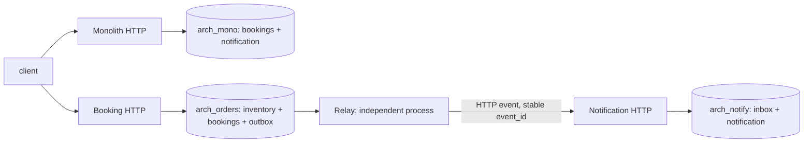

# Booking architecture lab

Один booking workflow в двух архитектурах: modular monolith и два bounded
services. Сравниваются реальные transaction boundaries, а не количество папок
или Docker-контейнеров. FastAPI/SQLAlchemy/PostgreSQL, независимые роли БД,
structured JSON logs, correlation ID и реальные HTTP/failure tests.

## Запуск и контракт

Из этой директории:

```sh
docker compose up -d --build --wait
curl -i -X POST http://127.0.0.1:18100/bookings -H 'Content-Type: application/json' \
  -H 'Idempotency-Key: mono-first' -H 'X-Correlation-ID: training-one' -d '{"room_id":1}'
curl -i -X POST http://127.0.0.1:18101/bookings -H 'Content-Type: application/json' \
  -H 'Idempotency-Key: distributed-first' -H 'X-Correlation-ID: training-two' -d '{"room_id":1}'
docker compose logs --tail=30 orders notifications relay
```

18100 — monolith, 18101 — booking service, 18102 — notification service. Порты
только loopback. `GET /bookings/<UUID>` читает booking, а
`GET http://127.0.0.1:18102/notifications/<UUID>` — отдельно доставленный effect.
Повтор POST с тем же key/body даёт 200 и тот же UUID; другой room с тем же key —
409. Для последней единицы room 1 два разных ключа дают ровно один 201 и один 409.
room 2 начинается с двух единиц. Нет реального email/payment, только durable
notification ledger. Passwords синтетические; authentication здесь не реализуется.

Dev volume `architecture_data` создан только этим проектом. Он не связан с
`pythoria_data`; `docker compose down` оставляет учебное состояние. Инициализация
schema выполняется при создании пустой базы, это не production migration.

## Границы модулей и данных



`orders.py` содержит application service и конкретный PostgreSQL repository.
API layer валидирует HTTP, переводит Conflict в 409 и передаёт correlation ID.
BookingService управляет `engine.begin()`, repository инкапсулирует SQL. Нельзя
делать COMMIT внутри каждого repository method: резерв и создание intent должны
оставаться одной transaction boundary.

`BookingEvents` — узкий Protocol. Composition root в api.py передаёт
LocalNotificationAdapter для monolith либо OutboxAdapter для service. Это обычная
constructor injection, без DI container. В примере service/repository ещё знают
SQLAlchemy connection: это практическая layered structure, не заявление о полном
независимом domain model или чистой hexagonal architecture.

Notification module владеет `receive_on` и inbox/notifications. В monolith adapter
вызывает его с **тем же connection/transaction**. В distributed варианте relay
использует HTTP, notification service открывает **свою transaction**. Orders role
не имеет CONNECT к arch_notify, notify role — к arch_orders; нет cross-DB join/FK.
Три учебные БД находятся в одном PostgreSQL cluster для экономии ресурсов. Это
раздельное владение данными, но общий failure domain сервера; не демонстрация
трёх независимо отказоустойчивых database servers.

## Механизм бронирования

1. Unique request_key атомарно закрепляет логический POST. Hash room_id проверяет,
   что повтор key не выдаёт результат другого payload.
2. Conditional UPDATE inventory SET available=available-1 WHERE available>0
   сериализуется по row lock. Если строка не возвращена — SoldOut и ROLLBACK.
3. В той же транзакции сохраняется notification intent: непосредственно inbox/
   notification в monolith либо outbox в distributed варианте.
4. Ответ 201 означает booking COMMIT. В distributed варианте notification в этот
   момент может ещё отсутствовать. GET 404 «not delivered yet» ожидаем до relay.

CHECK available>=0 — дополнительный invariant, а не замена conditional UPDATE.
Нет process-local mutex или shared in-memory availability. Два API instances
используют одинаковый DB contract; добавление replicas не требует sticky sessions.
DB pool и downstream concurrency всё равно должны укладываться в общий бюджет.

## Сбои и согласованность

| Событие | Monolith | Distributed |
| --- | --- | --- |
| Ошибка до COMMIT | Booking и notification откатываются вместе | Booking и outbox откатываются вместе |
| Notification service недоступен | Внешнего HTTP hop нет | Booking уже принят; intent остаётся для retry |
| Producer умер после COMMIT | Сохранены обе локальные строки | Relay позже найдёт durable outbox |
| Timeout после receiver COMMIT | Нет этой HTTP boundary | Повтор event_id находит inbox, эффект один |
| Consumer restart | Модуль рестартует с приложением | Другой процесс читает прежний durable inbox |
| Чтение сразу после booking | Локальная notification уже в transaction | Notification read может отставать |

Relay claim использует SKIP LOCKED, lease и generation. Crash до ack допускает
повтор того же event_id, старый owner не может ack-нуть новый generation. HTTP идёт
вне DB transaction. Retry ограничен пятью deliveries, после чего outbox сохраняется
как failed для диагностики. Нет production operator retry UI или DLQ broker.

Обычный COMMIT в service A не делает service B атомарным. Failed notification не
должна тайно откатывать уже проданное место: нужен явный business workflow. Для
платежа возможна saga с отдельными reserve/pay/confirm и compensation. Compensation
— новая идемпотентная business operation, а не возврат времени или SQL ROLLBACK в
чужой БД. Реальный payment gateway и saga orchestrator в этом примере отсутствуют.

## Проверки

Из корня Pythoria:

```sh
scripts/test_architecture_lab.sh
scripts/test_architecture_lab.sh -k timeout
python3 projects/architecture_lab/check_deployment.py
```

Test Compose не публикует ports и хранит PostgreSQL в tmpfs. Он не использует dev
volume или SQLite Pythoria. Test-only admin connection управляет fixture и fault
injection; оба API имеют только свою application role. Код не получает Docker
socket. Trap удаляет только `pythoria-architecture-test`.

Проверки включают concurrent booking, replay/conflicting payload, local rollback,
unavailable service, реальный HTTP timeout после receiver COMMIT, duplicate message,
реальный producer process exit после COMMIT, consumer process stop/restart, stale
read before delivery, bounded retry и запрет CONNECT к чужой БД. Несколько независимых
API processes проверяют отсутствие process-local состояния. Порядок гонок задаётся
barriers/events; победитель не фиксируется как часть контракта.

## Сравнение решений

| Критерий | Modular monolith | Два bounded services |
| --- | --- | --- |
| Latency path | Локальные вызовы и одна transaction | Отдельная асинхронная доставка, HTTP и очередь |
| Deployment | Один deployable и общий release | Отдельные executable entrypoints и releases при совместимом API |
| Data consistency | Возможна одна локальная transaction | Eventual notification, inbox/outbox и retries |
| Reliability | Меньше сетевых границ; общий process failure | Частичный отказ и независимый restart, больше failure paths |
| Cost/overhead | Проще запуск, тесты и диагностика | Больше процессов, health checks, contracts и operational work |
| Testing | In-process модули + настоящая DB | HTTP, несколько DB roles, restart/timeout/duplicate tests |

Это качественное сравнение конкретных границ; benchmark latency, стоимость в деньгах
или production capacity не измерялись. Service независим по коду/API и данным, а не
потому, что его container запускается отдельно. `docker compose up -d --no-deps
notifications` меняет notification deployable без рестарта booking при совместимом
контракте; организация реальных releases/rollback остаётся задачей deployment pipeline.

## Observability и ограничения

HTTP logs содержат service, path, status, duration_ms и correlation_id. Relay
переносит correlation_id исходного события и пишет event_id/attempt при ошибке.
Это позволяет связать операции, но не является полноценным distributed trace:
trace/span hierarchy, sampling, propagation и collector нужно подключать отдельно.
Сравните понятия trace ID, span ID и business idempotency key — они не взаимозаменяемы.

Наблюдайте backlog size/oldest age, failed count, delivery latency, retry rate,
DB pool saturation и ошибки по service/route. Не используйте event UUID как
high-cardinality metric label и не логируйте credentials/payload. Здесь JSON logs
работают, но нет готового Prometheus/Grafana/OTel deployment или alert pipeline.

Нет service mesh, Kubernetes, real email, payment gateway, API authentication,
schema migrations между версиями и production secrets. Для small-team workflow
модульный монолит обычно дешевле развивать; выделение service стоит оправдать
конкретной независимой нагрузкой, владением команды или release boundary.

## Самостоятельные задания

1. Добавьте новый notification adapter, сохранив Protocol и local rollback tests.
2. Сделайте два API process и отправьте одинаковый key одновременно. Должен остаться
   один booking и единичный запас; объясните, почему in-memory lock не помог бы.
3. Замедлите receiver после его COMMIT. Повтор должен использовать прежний event_id;
   покажите durable inbox и один notification.
4. Спроектируйте безопасный payment event: unique provider_event_id + hash, local
   payment state + outbox в одной transaction. Добавьте actual DB duplicate test,
   не списывая реальные деньги. Объясните границу компенсации booking.
5. По logs найдите intent, который стал failed после пяти deliveries; сформулируйте
   операторский retry contract, сохранив event_id. Не удаляйте inbox для «повтора».

## Источники

- Lewis/Fowler, [Microservices (2014): independent deployment and data management](https://martinfowler.com/articles/microservices.html).
- Fowler, [Monolith First (2015)](https://martinfowler.com/bliki/MonolithFirst.html),
  [Repository](https://martinfowler.com/eaaCatalog/repository.html),
  [Dependency Injection (2004)](https://martinfowler.com/articles/injection.html).
- Cockburn, [Ports and Adapters, original 2005 article](https://alistair.cockburn.us/hexagonal-architecture).
- [PostgreSQL 17 locking](https://www.postgresql.org/docs/17/explicit-locking.html),
  [SQLAlchemy 2.0 transactions](https://docs.sqlalchemy.org/en/20/core/connections.html).
- [Docker Compose networking / service discovery](https://docs.docker.com/compose/how-tos/networking/).
- [OpenTelemetry trace concepts](https://opentelemetry.io/docs/concepts/signals/traces/),
  [Saga pattern](https://learn.microsoft.com/en-us/azure/architecture/patterns/saga).

Проверка секций: 2026-11-16. Runtime dependencies закреплены в requirements.txt,
PostgreSQL 17.11 и Python base image — digest в Compose/Dockerfile. Версия страницы
latest не выдаётся за установленную версию runtime.

Проверка dev deployment создаёт собственные сети/volume и свободные loopback-порты, пересоздаёт notification container отдельно от booking, затем весь project, проверяет replay и удаляет только свои ресурсы. Опубликованные API подключены к edge-сети; БД и relay остаются во внутренней lab-сети.
