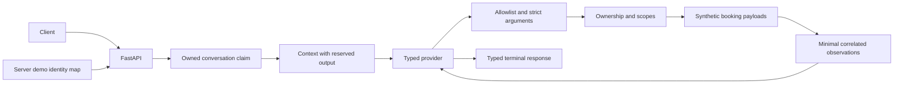
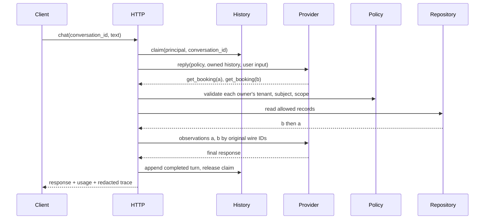

# P3 · Controlled Booking Assistant

Учебный FastAPI-сервис с управляемым доступом к вымышленным бронированиям. Модель предлагает вызовы. Приложение проверяет аргументы, права и бюджет до чтения. Два read-only инструмента вызывают внедрённый репозиторий. `propose_cancel` возвращает серверное предложение со статусом `pending` и не меняет запись.

## Запуск

Из каталога `projects/booking_assistant` с Python 3.12:

```sh
python3.12 -m venv .venv
source .venv/bin/activate
python -m pip install --require-hashes -r requirements.txt
python -m uvicorn main:app --host 127.0.0.1 --port 8765
```

Во втором терминале из того же каталога запустите `.venv/bin/python smoke_http.py`. Он создаёт диалог, читает бронь, проверяет отказ другому tenant, создаёт предложение и повторяет чтение. Для ручного запроса передайте `X-Demo-Actor: north-alice` в `POST /assistant/conversations`, затем отправьте полученный `conversation_id` и строку `text` в `POST /assistant/chat`. Учебные команды: `список`, `бронь 42`, `предложи отмену 42`. Выбор простых команд делает локальное воспроизведение предсказуемым. Список учебных actors находится в `main.py`.

## Поток данных





При проверке прав инструменты чтения обращаются к отдельному индексу. В ответе чтения остаются ID и статус брони. Предложение содержит серверный ID, владельца, действие и точные проверенные аргументы. При продолжении провайдер получает предложение без данных владельца. Trace хранит серверные алиасы вместо исходных wire ID. Prompt, аргументы и содержимое записи в trace не попадают. [Пример trace](data/redacted-trace.json), [решение по архитектуре](ADR.md).

## Коды завершения

| HTTP | Причина | Поведение |
| --- | --- | --- |
| 200 | `completed` | Текст и безопасные результаты. История пополняется целым завершённым turn. |
| 200 | `refusal`, `incomplete` | Явное состояние, без неподтверждённого текста и записи в историю. |
| 401 | `authentication_required` | Заголовок отсутствует или отсутствует учебный actor. |
| 404 | `conversation_unavailable` | Единый ответ для чужого и неизвестного диалога. |
| 409 | `conversation_busy` | Первый запрос сохраняет claim. Второй может повторить запрос после его завершения. |
| 422 | `invalid_input`, `context_budget` | Вход вне схемы либо обязательные элементы вместе с резервом превышают лимит. |
| 429 | `step_budget`, `call_budget`, `output_budget` | Текущий turn остановлен лимитом приложения. |
| 502 | `invalid_provider` | Нарушение контракта, включая дубликат call ID или пустой финал. |
| 503 | `provider_unavailable` | Типизированная временная ошибка адаптера. |
| 504 | `deadline` | Общий deadline охватывает модель, tools и continuation. |

`unavailable` на этапе tool скрывает разницу между отсутствием брони и отсутствием прав; `invalid_arguments`, `unknown_tool`, `tool_timeout`, `tool_error` и `result_too_large` являются безопасными наблюдениями. При отмене coroutine claim освобождается и неполный turn не сохраняется. `usage.context_units` считается в условных единицах на базе UTF-8. `provider_tokens: null` означает, что scripted provider их не измеряет.

## Проверка

```sh
python -m pytest -o addopts='' -q tests
python evaluate.py --output /tmp/booking-assistant-evaluation.json
cmp data/evaluation.json /tmp/booking-assistant-evaluation.json
```

[Набор сценариев](data/workflows.jsonl) и [воспроизводимый отчёт](data/evaluation.json) проверяют контракт приложения с заранее заданными результатами провайдера. Счётчики фактических вызовов, чтений, записей, отказов и состояний проверяются отдельно. Результаты не оценивают качество реальной модели. Тесты блокируют сетевые соединения. HTTP smoke дополнительно запускается через локальный Uvicorn.

## Ограничения

Заголовок выбирает учебного пользователя. Приложение рассчитано на loopback, один worker и один event loop. При перезапуске история исчезает. Хранилище держит до 12 завершённых turn на диалог, без TTL или учёта диалогов на пользователя. Условная единица контекста не равна токену конкретной модели. Тесты инъекций проверяют границу действий приложения для замороженных входов. Ответ модели остаётся недоверенным текстом, а предложения не имеют механизма исполнения. [Источники и версии](SOURCES.md), [опциональный SDK пример](LIVE_PROVIDER.md).

## Задание для защиты

Добавьте `get_booking_status` как новый read-only tool. Согласуйте точные аргументы и минимальную проекцию. Покажите, где применяются tenant, владелец и scope. Добавьте негативный сценарий для пользователя другого tenant, который использует существующий booking ID. Тест должен подтвердить, что полезная нагрузка не читалась. Объясните, какой assertion сработает после отключения проверки владельца. Покажите трассу оставшегося разрешённого чтения.
