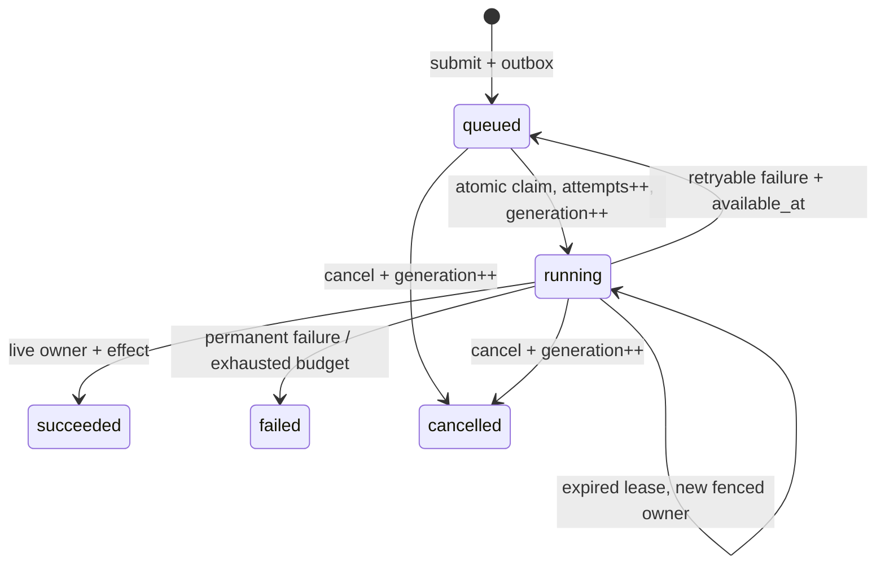

# Durable Training Job Queue

Небольшая очередь на PostgreSQL, которую можно прочитать целиком и сломать
управляемым способом. FastAPI принимает задания, два процесса worker независимо
claim-ят строки, heartbeat продлевает lease, generation защищает от старого worker.
SQLAlchemy 2 используется для границ транзакций и bind parameters. Это локальный
учебный проект, отдельный от SQLite Pythoria и её student runners.

## Быстрый запуск

Из этой директории:

```sh
docker compose up -d --build --wait --scale worker=2
curl -i -X POST http://127.0.0.1:18090/jobs \
  -H 'Content-Type: application/json' -H 'Idempotency-Key: first-training' \
  -d '{"payload":{"n":10},"max_attempts":3}'
docker compose logs --tail=30 worker relay
```

POST вернёт `201` и UUID. `GET /jobs/<UUID>` покажет queued/running/succeeded.
Результат для n=10 — сумма квадратов 1..10, то есть 385. Повтор того же POST
с тем же ключом и payload даёт `200`, тот же UUID, одну job и один business effect.
Изменённый payload с тем же ключом даёт `409`. API сохраняет внутренний ключ с префиксом `api:`, scheduler — `periodic:`: их пространства не пересекаются даже при одинаковой клиентской строке. Не используйте реальные credentials
и данные: пароль намеренно виден, authentication отсутствует, порт только loopback.

`POST /jobs/<UUID>/cancel` конкурирует с finish под row lock. Если отмена победила,
generation увеличивается и старый worker теряет право finish. Если finish уже
зафиксирован, отмена не переписывает succeeded. HTTP `202/201` означает приём,
а не успешное завершение работы.

`worker` не имеет HTTP-порта и Docker socket. DB не публикует TCP на host.
API подключён к отдельной edge-сети для loopback-порта; БД, workers и relay используют внутреннюю lab-сеть. `queue_data` — новый volume этого проекта; он не связан с `pythoria_data`.
`docker compose down` останавливает проект и оставляет учебные jobs. Для полностью
чистого теста используйте test script ниже: он вообще не монтирует этот volume.
Schema выполняется при первом создании учебной базы; это не production migration.

## Границы транзакций

| Операция | Одна PostgreSQL-транзакция | Работа снаружи |
| --- | --- | --- |
| Submit | jobs + outbox; unique idempotency key + payload hash | HTTP response может потеряться |
| Claim | SELECT FOR UPDATE SKIP LOCKED + UPDATE generation/attempts/lease | Вычисление после COMMIT |
| Heartbeat | UPDATE по id, worker, generation, running, live lease | Thread может задержаться |
| Finish | Та же ownership-проверка + effect в одной транзакции | Внешний HTTP не становится атомарным |
| Outbox | Lease события / отдельный ack после отправки | HTTP receiver и retry |

Время lease сравнивает сама БД через `clock_timestamp()`. Время процесса worker
не определяет право завершить задание. Claim увеличивает generation при каждом
новом владельце. Heartbeat, finish и fail требуют точного generation, worker и
ещё живого lease; старый владелец не сможет «оживить» истёкший lease.

При потерянной связи результат COMMIT может быть неизвестен вызывающей стороне.
Нужно перечитать состояние/повторить с тем же ключом, а не создавать новый ключ.
`effects.job_id` уникален, и этот effect записывается вместе с succeeded. Это
одна локальная DB boundary. Мы не обещаем exactly-once произвольного email/payment.

## Состояния и восстановление



Один worker выполняет одно задание, поэтому `--scale worker=2` даёт два отдельных
процесса и максимум две одновременно вычисляемые работы. Соединение не удерживается
на время вычисления. Polling имеет короткую паузу, пустая очередь не busy-loop.
Lease по умолчанию 5 s, heartbeat примерно раз в треть lease. При SIGTERM worker
перестаёт брать новую работу и заканчивает текущую. При SIGKILL её подберёт новый
worker после истечения lease. Протокол не требует вручную «снимать running».

`max_attempts` ограничен 1..8. Явная recoverable ошибка планирует capped exponential
backoff. Падение процесса оставляет running до lease expiration; это тоже расходует
попытку. Sweeper в claim переводит окончательно исчерпанную expired job в failed.
Автоматической «вечной повторной попытки» нет. Для исследования retry можно отправить
`{"payload":{"n":10,"fail_until":2},"max_attempts":3}`: две ошибки, затем success.

## Outbox и неопределённый внешний результат

`submit` добавляет `job.created` в outbox в той же транзакции. Relay claim-ит событие
с lease/generation, отправляет его вне транзакции, затем fenced ack отмечает delivery.
Если producer умер после COMMIT, строка outbox остаётся. Если relay умер после
успешного receiver, но до ack, событие придёт повторно с тем же event UUID.

Учебный `/demo-effects` хранит key + hash в отдельной транзакции, дедуплицирует
повторный запрос и конфликтует при повторном ключе с другим payload. Здесь receiver
находится в том же deployable и DB, но границы HTTP и двух транзакций реальны.
Это демонстрация идемпотентного receiver, а не двух bounded services; раздельное
владение БД разбирается в архитектурном проекте Phase 8D.

Внешний сервис без idempotency contract остаётся неопределённым после timeout.
Сам по себе outbox не удаляет дубль бизнес-эффекта у такого сервиса. Не держите
транзакцию открытой во время HTTP и не отмечайте delivered до фактической отправки.

## Повторяемая проверка

Из корня Pythoria:

```sh
scripts/test_durable_queue.sh
scripts/test_queue_brokers.sh
python3 projects/durable_queue/check_restart.py
```

Первый script поднимает отдельный Compose project: PostgreSQL tmpfs, реальный API,
pytest и отдельные процессы worker. Публичных портов и `queue_data` нет. Trap удаляет
только test project. В tests используются barriers/events, управляемое истечение
lease и проверки наблюдаемого условия с deadline; fixed sleeps не доказывают порядок.

| Проверка | Наблюдаемое доказательство |
| --- | --- |
| Два claim одновременно | Разные jobs либо один победитель на одной job |
| Падение после claim / во время работы | Реально завершённый OS process, reclaim с новой generation |
| Старый worker вернулся | Его finish отклонён; один effect нового владельца |
| Heartbeat задержался | Старый renewal false, новый owner true |
| Retry исчерпан | failed, attempts ограничены, новый claim отсутствует |
| Cancel против finish | Один terminal outcome, effect соответствует победителю |
| Duplicate API/message | Один UUID/effect, разные payload с тем же key конфликтуют |
| External timeout после commit | Receiver сохранил эффект, повтор того же key не дублирует |
| Потеря DB connection | Реальный pg_terminate_backend, незавершённая transaction откатилась |
| Producer crash после COMMIT | Outbox доступен другому relay, старый ack fenced |
| Два scheduler | Один UTC bucket даёт один durable key/job |

Тестовый ADMIN_DATABASE_URL доступен только trusted fault-injection process.
API/worker используют queueapp без superuser/DDL/TEMP. Student Python Runner не
получает эти DSN, зависимости, сеть или Docker privileges.

## Брокеры: отдельный небольшой эксперимент

Второй script запускает Redis, Celery worker, RabbitMQ и Kafka в другом internal
network без host ports и с disposable storage. Он выполняет реальные операции:

- Redis Lists: RPUSH/BLPOP, порядок двух элементов и пустая очередь. BLPOP удаляет
  элемент до business effect: потеря consumer после pop требует другого протокола.
- Celery 5.5.3 + Redis: задача идёт настоящему worker, результат 385 читается из
  отдельного result backend Redis DB1; broker DB0, учебная List DB2.
- RabbitMQ 4.1: publisher confirm, unacked delivery, разрыв consumer connection,
  redelivery, nack(requeue=False), dead-letter queue с x-death, финальный ack.
- Kafka 4.1.0: один topic/partition, два records, два независимых consumer group
  читают сохранённый log в том же partition order. Это не benchmark и не тест
  cross-partition ordering или exactly-once с внешней БД.

RabbitMQ DLX arguments здесь удобны для одноразового теста; в управляемом deployment
предпочтительны policies. Confirm producer и consumer ack отвечают на разные вопросы.
Redis persistence/replication, Rabbit cluster/quorum recovery, Kafka replicated cluster
и production observability этим single-node стендом не проверяются.

## Самостоятельная работа

1. Отключите generation predicate в копии Store.finish и запустите stale-worker test.
   Объясните, почему одного времени lease недостаточно при повторном владении.
2. Добавьте новый вид вычисления и сохраните atomic claim/finish. Напишите тест двух
   процессов и crash-before-complete; не удерживайте row lock во время работы.
3. Остановите relay, создайте job, запустите relay. Убедитесь, что outbox доставлен.
   Затем воспроизведите timeout-after-commit и объясните необходимость receiver key.
4. Добавьте метрику возраста самой старой ready job, count running/expired/failed и
   число stale-owner rejection. Не помещайте payload/пароли в структурированные logs.

Пять маленьких задач Stage 20 проверяются обычным Python Run/Check в приложении.
Они моделируют отдельные решения, но не заменяют реальные concurrency tests проекта.

## Проверенные источники

- PostgreSQL 17: [SELECT locking clause / SKIP LOCKED](https://www.postgresql.org/docs/17/sql-select.html#SQL-FOR-UPDATE-SHARE),
  [transaction isolation](https://www.postgresql.org/docs/17/transaction-iso.html).
- [SQLAlchemy 2.0 Core: working with connections and transactions](https://docs.sqlalchemy.org/en/20/core/connections.html).
- [FastAPI Background Tasks](https://fastapi.tiangolo.com/tutorial/background-tasks/).
- Celery 5.5.3: [tasks / acknowledgements and retries](https://docs.celeryq.dev/en/v5.5.3/userguide/tasks.html),
  [Redis transport / visibility timeout](https://docs.celeryq.dev/en/v5.5.3/getting-started/backends-and-brokers/redis.html).
- RabbitMQ 4.1: [confirms](https://www.rabbitmq.com/docs/4.1/confirms), [dead lettering](https://www.rabbitmq.com/docs/4.1/dlx).
- Kafka 4.1: [quickstart](https://kafka.apache.org/41/getting-started/quickstart/).

Секции сверены 2026-11-16. Точные Python dependencies — requirements.txt, фактические
broker images закреплены digest в compose.brokers.yml. Ограничения примера изложены
выше; наличие Docker-контейнера само по себе не доказывает durability после сбоя узла.

Redis server 7.4.12 и RabbitMQ 4.1.8 проверены в закреплённых images. KRaft settings сверены 2026-11-17 с [официальным Kafka 4.1.0 single-node example](https://github.com/apache/kafka/blob/4.1.0/docker/examples/docker-compose-files/single-node/plaintext/docker-compose.yml). Restart smoke создаёт собственные сети, свободный loopback-порт и новый именованный volume, пересоздаёт контейнеры и затем удаляет только эти ресурсы.
